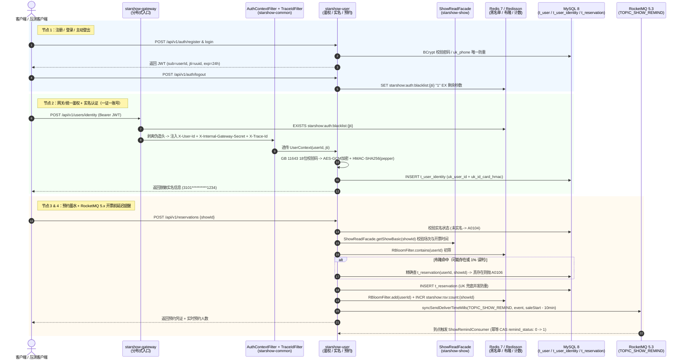
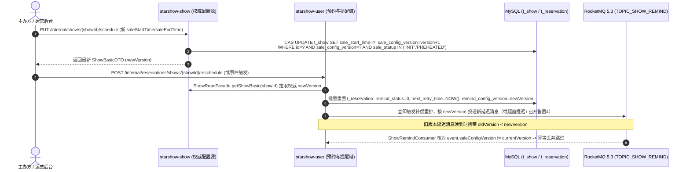

# 板块 01：链路一完整开发设计规格书（鉴权 · 实名防黄牛 · 预约蓄水 · 开票延迟提醒）

- **文档状态**：✅ Phase 1 已完成并通过终版复验（`ISSUE-001` ~ `ISSUE-010` 全部关闭）。见 [进度账本](../PROGRESS.md) 与 [终版复验回执](../issues/ISSUE-007-chain1-acceptance-evidence.md#2026-11-20-终版复验回执issue-008--issue-010-闭环)。
- **映射代码模块**：`starshow-common`（Web 底座）、`starshow-api`（跨模块契约）、`starshow-gateway`（网关鉴权）、`starshow-user`（链路一核心）、`starshow-show`（提供最简 `ShowReadFacade` 与 `/internal/shows/{showId}/basic`）
- **目标里程碑**：Phase 1（`v0.2.0-chain1`）

---

## 一、行业成熟方案调研与化用决策（绝不重复造轮子）

本链路涉及 5 个经典高并发/安全工程问题，全部直接化用业界成熟方案与现成组件：

| 技术痛点 | 行业成熟方案 / 组件 | 本项目化用策略 | 刻意规避的反模式 |
| --- | --- | --- | --- |
| **密码安全存储** | `BCrypt`（内置随机盐 + 自适应计算成本） | 仅引入轻量 `spring-security-crypto` 单 jar，直接复用 `BCryptPasswordEncoder`（cost=10） | 严禁手写 MD5/SHA-1；严禁为用 BCrypt 而拉入整套 Spring Security Web 过滤器链把 Gateway 与单进程调试搞复杂 |
| **JWT 主动踢人与防头伪造** | 网关收口鉴权 + JTI Redis 黑名单 + 清洗客户端 `X-User-Id` + 内部密钥头 `X-Internal-Gateway-Secret` | 复用 `jjwt 0.12.6` + Reactive/Redisson Redis 黑名单（TTL = Token 剩余有效期）；下游 `AuthContextFilter` 兼顾 **分布式（验网关密钥头）** 与 **单进程 `boot-all`（直连自动验 JWT + 查黑名单）** 双形态 | 严禁下游服务盲信客户端传来的 `X-User-Id`（防水平越权伪造）；严禁把黑名单设成永不过期撑爆 Redis |
| **一证一号防黄牛与防脱库** | GB 11643-1999 校验码 + `HMAC-SHA256(pepper)` 唯一索引 + `AES-256-GCM` 密文落库 | 直接复用 Phase 0 已验证的 `CryptoUtil`；并发抢绑直接走 `INSERT` + 捕获 `DuplicateKeyException` 区分冲突索引名 | 严禁裸 `SHA-256(idCard)`（低熵身份证几秒彩虹表撞破）；严禁“先 SELECT 再 INSERT”留 TOCTOU 并发绕过漏洞 |
| **海量粉丝预约去重蓄水** | Redisson 分布式 `RBloomFilter<Long>` + MySQL 唯一索引兜底 + Redis `INCR` 计数 | 复用 Redisson `RBloomFilter`（`tryInit(500_000L, 0.01)`）；**布隆防误杀策略**：布隆说不存在直接落库，布隆说可能存在必须回查 DB 确认才拦 `A0106` | 严禁把布隆过滤器 `contains()==true` 直接当成绝对存在（1% 误判率会误杀真实正常粉丝！） |
| **开票前精准延迟提醒** | Apache RocketMQ 5.x 原生时间轮任意时间延迟消息 | 直接复用 `rocketmq-spring-boot-starter 2.3.1` 内置 `rocketMQTemplate.syncSendDeliverTimeMills(topic, payload, deliverTimeMs)`（绝对时间戳）与 `syncSendDelayTimeMills`（测试短延迟） | 严禁沿用 RocketMQ 4.x 固定 18 级 `delayLevel`（无法精确对齐“开票前 10 分钟”）；严禁因 MQ 瞬时抖动回滚用户预约主流程 |

---

## 二、链路一端到端全景时序与节点拆解



整条链路拆解为 **5 个独立可测节点**：
- **节点 0**：全链路公共 Web 底座（`TraceIdFilter`、`UserContext`、`GlobalExceptionHandler`、`JwtTokenService`）
- **节点 1**：用户注册、登录与主动登出（BCrypt + JTI Redis 黑名单 + 网关/单进程双形态防伪造鉴权）
- **节点 2**：实名认证与一证一账号防黄牛（GB 11643 校验 + AES-GCM + HMAC-SHA256 + `UserFacade` 实现）
- **节点 3**：演出预约蓄水（实名前置校验 + `ShowReadFacade` 联动 + Redisson 布隆防重与防误杀 + Redis 实时热度计数）
- **节点 4**：RocketMQ 5.x 任意时间延迟开票提醒（绝对时间投递 + 发送降级补偿 + 消费端幂等状态更新）

---

## 三、各节点详细业务内容与技术实现

### 节点 0：公共 Web 底座与鉴权上下文（`starshow-common`）
- **包路径**：`com.starshow.common.web`、`com.starshow.common.auth`
- **组件清单**：
  1. `TraceIdFilter`（最高优先级 `Ordered.HIGHEST_PRECEDENCE`）：读取请求头 `X-Trace-Id`（无则生成 32 位 UUID）写入 `TraceIdContext`（MDC），回写响应头 `X-Trace-Id`，`finally` 中强制 `TraceIdContext.clear()`。
  2. `UserContext`（`ThreadLocal<LoginUser>`，含 `userId`、`jti`、`expireEpochSec`）+ `UserContext.requireUserId()`（未登录抛 `ErrorCode.UNAUTHORIZED`）。
  3. `GlobalExceptionHandler`（`@RestControllerAdvice`，仅在 Servlet Web 环境生效）：统一捕获 `BizException`、`MethodArgumentNotValidException`、`ConstraintViolationException`、`DuplicateKeyException` 与兜底 `Exception`，全部包装为 `Result.fail(...)` 且绝不把堆栈/敏感 SQL 泄露给客户端。
  4. `JwtTokenProvider`（放 `starshow-common` 供 `starshow-gateway` 与 `starshow-user` 复用，避免重复写 JWT 逻辑）：
     - 算法：`HS256`（密钥由 `STARSHOW_JWT_SECRET` 注入，校验长度 ≥ 32 字节）；
     - Claims：`sub = String.valueOf(userId)`、`jti = UUID`、`iat`、`exp`（默认 24 小时，可配置）；
     - 提供 `generateToken(long userId)` 与 `parseToken(String token) -> JwtPayload(userId, jti, expireEpochSec)`。

### 节点 1：注册、登录、登出与双形态防伪造鉴权（`starshow-user` + `starshow-gateway`）
- **业务规则**：
  - **注册** (`POST /api/v1/auth/register`)：校验 11 位合法手机号 + 密码长度（8~32 位）+ 昵称（可选，默认脱敏手机号）；`GeneSnowflakeIdGenerator.nextId()` 生成 `userId`；`BCryptPasswordEncoder.encode()` 哈希密码；插 `t_user`，捕获 `uk_phone` 冲突返回业务提示“该手机号已注册”（复用 `INVALID_PARAM` 或新增 `PHONE_ALREADY_EXISTS("A0107")`）。
  - **登录** (`POST /api/v1/auth/login`)：按手机号查 `t_user`，校验 `status == 1` 且 `passwordEncoder.matches(raw, hash)`；失败统一返回“手机号或密码错误”（防账号枚举）；成功签发 JWT 并返回 `{ userId, nickname, token, expireAt }`。
  - **主动登出** (`POST /api/v1/auth/logout`)：从当前 `UserContext` 取 `jti` 与 `expireEpochSec`，计算 `remainSec = expireEpochSec - nowSec`，若 `> 0` 则执行 `SET starshow:auth:blacklist:<jti> "1" EX <remainSec>`。
  - **双形态防头伪造拦截**：
    - `starshow-gateway`（`JwtAuthGlobalFilter`）：白名单路径（`/api/v1/auth/register`、`/api/v1/auth/login`、`/api/v1/shows/**`、`GET /api/v1/reservations/*/count`、健康检查与 Swagger）直接剥离伪造头后放行；其余路径必须验签 JWT + 查 Reactive Redis 黑名单，命中黑名单返回 HTTP 401 + `Result.fail(TOKEN_REVOKED)`；通过后剥离客户端原有 `X-User-Id` / `X-User-Jti` / `X-Internal-Gateway-Secret`，注入可信值并透传。
    - `starshow-common`（`AuthContextServletFilter`，运行在 `starshow-boot-all` 与各业务微服务内）：
      - 若请求携带 `X-Internal-Gateway-Secret` 且与服务端配置常量匹配（恒定时间比对 `MessageDigest.isEqual`）→ 信任 `X-User-Id` / `X-User-Jti` 写入 `UserContext`；
      - 否则若携带 `Authorization: Bearer <token>` → 本机直接调 `JwtTokenProvider.parseToken` + 查 Redis 黑名单（支持单进程 `boot-all:8090` 免网关直调）；
      - 未通过鉴权且接口标记 `@RequireLogin`（或位于受保护路径）→ 直接返回 401；公开接口允许匿名进入（`UserContext` 为空）。

### 节点 2：实名认证与一证一账号防黄牛（`starshow-user`）
- **业务规则** (`POST /api/v1/users/identity` & `GET /api/v1/users/identity`)：
  1. 校验真实姓名（2~32 位中英文）与 18 位中国大陆居民身份证号：
     - `IdCardValidator`（纯 Java 工具）：正则校验 + 出生日期合法性 + ISO 7064:1983.MOD 11-2 第 18 位校验码验证（测试与压测数据均使用符合校验码规则的虚拟测试号）。
  2. 调用 `CryptoUtil`：
     - `realNameCipher = encryptAesGcm(realName, aesKey)`
     - `idCardCipher = encryptAesGcm(idCard, aesKey)`
     - `idCardMasked = maskIdCard(idCard)`
     - `idCardHmac = hmacSha256Hex(idCard, idcardPepper)`
  3. 直接执行 `INSERT INTO t_user_identity(...)`：
     - 捕获 `DuplicateKeyException`：
       - 若查本用户 `user_id` 已有记录 → 幂等/明确返回已认证提示（或返回已有脱敏信息）；
       - 否则必然是触发了 `uk_id_card_hmac` → 抛出 `BizException(ErrorCode.IDENTITY_DUPLICATE)`（`A0105`），彻底防黄牛一证多号！
  4. **实现 `UserFacade`**：
     - `UserFacadeImpl implements UserFacade`（`@Service`）：`isRealNameVerified(long userId)` 查询 `t_user_identity` 是否存在记录（同时缓存一个轻量 Redis/本地正缓存 `starshow:user:verified:<userId>`，实名一旦完成不可逆，可直接缓存 1 小时极大加速链路三抢票前置校验！）。

### 节点 3：场次预约蓄水与布隆防重（`starshow-user`）
- **业务规则** (`POST /api/v1/reservations` & `GET /api/v1/reservations/{showId}/count`)：
  1. **实名校验**：调 `userFacade.isRealNameVerified(userId)`，未实名抛 `ErrorCode.IDENTITY_REQUIRED`（`A0104`）。
  2. **演出校验**：调 `showReadFacade.getShowBasic(showId)`：
     - 不存在抛 `SHOW_NOT_FOUND`（`A0201`）；
     - 若演出状态已为 `ENDED` 或已过 `saleEndTime`，禁止预约并抛 `SHOW_NOT_ON_SALE`（`A0202`）。
  3. **布隆初筛 + 防误杀二次确认**：
     - 获取 `RBloomFilter<Long> bloom = redissonClient.getBloomFilter(RedisKeys.reservationBloom(showId))`，首次懒初始化 `bloom.tryInit(500_000L, 0.01)` 并设置过期时间（演出结束 + 1 天）；
     - 若 `bloom.contains(userId)` 为 `true` → **必须回查 DB** `t_reservation(user_id, show_id)`；仅当 DB 确实存在时抛 `ErrorCode.RESERVATION_DUPLICATE`（`A0106`），彻底杜绝布隆 1% 误判误杀真实用户。
  4. **落库 + 蓄水计数**：
     - 用 `GeneSnowflakeIdGenerator.nextId()` 生成预约 ID，执行 `INSERT t_reservation(id, user_id, show_id, remind_status=0)`；并发重复提交触发 `uk_user_show` 捕获转为 `A0106`；
     - 落库成功后：`bloom.add(userId)` + `Long count = redissonClient.getAtomicLong(RedisKeys.reservationCount(showId)).incrementAndGet()`。
  5. **查询实时预约人数** (`GET /api/v1/reservations/{showId}/count`)：
     - 优先读 `starshow:rsv:count:<showId>`；若 Redis 缺失（如冷启动/重启），回源 `SELECT COUNT(*) FROM t_reservation WHERE show_id = ?` 并回填 Redis。

### 节点 4：RocketMQ 5.x 任意时间延迟开票提醒（`starshow-user`）
- **生产者逻辑**（紧接节点 3 落库成功后执行，**不包裹在 DB 事务内**，避免长事务与 MQ 抖动回滚预约）：
  - 计算目标提醒时间：`deliverTimeMs = saleStartTime - remindLeadSeconds * 1000`（生产默认 `remindLeadSeconds = 600` 即开票前 10 分钟；允许通过配置覆盖，集成测试可设短延迟如 3 秒，或若距开票不足 10 分钟但尚未开票则立即设 `now + 2000ms`）；
  - 若当前时间已超过 `saleStartTime`（演出已开票后用户仍点预约/关注），跳过发送延迟提醒，直接标记 `remind_status = 1`（或无需提醒）；
  - 构造 `ShowRemindEvent(reservationId, userId, showId, showTitle, saleStartTime)`，调用：
    ```java
    rocketMQTemplate.syncSendDeliverTimeMills(MqTopics.SHOW_REMIND, event, deliverTimeMs);
    ```
  - **发送失败降级**：捕获异常记录告警日志，将 `t_reservation.remind_status` 更新为 `2`（发送失败待补偿），**不向用户报错、不回滚预约成功状态**！
- **消费者逻辑**（`ShowRemindConsumer`）：
  - `@RocketMQMessageListener(topic = MqTopics.SHOW_REMIND, consumerGroup = MqTopics.CG_REMIND_NOTIFY)`；
  - 执行数据库级 CAS 幂等更新：`UPDATE t_reservation SET remind_status = 1 WHERE id = ? AND remind_status = 0`；
  - 仅当影响行数 `== 1` 时触发模拟站内信/通知日志输出（含 `traceId`、`userId`、`showId`），确保重复投递不发重复提醒。

---

## 四、精确契约与模块变更清单

### 1. Maven 依赖变更
- `starshow-common/pom.xml`：新增 `jjwt-api` / `jjwt-impl` / `jjwt-jackson`（可选或直接依赖供 gateway & user 复用）、`jakarta.servlet-api`（optional）。
- `starshow-user/pom.xml`：新增 `org.springframework.security:spring-security-crypto`（仅 BCrypt）与 `org.apache.rocketmq:rocketmq-spring-boot-starter`。
- `starshow-gateway/pom.xml`：引入 `jjwt`（通过 `starshow-common` 传递）用于网关验签。

### 2. 新增 `starshow-api` 契约
- 新增 `com.starshow.api.dto.ShowBasicDTO`（`showId`、`title`、`saleStartTime`、`saleEndTime`、`saleStatus`）
- 扩展 `com.starshow.api.facade.ShowReadFacade`：增加 `ShowBasicDTO getShowBasic(long showId);`
- 新增 `com.starshow.api.event.ShowRemindEvent`（`reservationId`、`userId`、`showId`、`showTitle`、`saleStartTime`）

### 3. 新增错误码（同步补入 `ErrorCode.java`）
- `PHONE_ALREADY_EXISTS("A0107", "该手机号已注册")`
- `LOGIN_FAILED("A0108", "手机号或密码错误")`
- `ID_CARD_INVALID("A0109", "身份证号格式或校验码不合法")`
- `IDENTITY_ALREADY_VERIFIED("A0110", "当前账号已完成实名认证，请勿重复提交")`

### 4. 配置项变更（同步补入 `.env.example` 与 `application.yml`）
- `STARSHOW_INTERNAL_GATEWAY_SECRET`（网关与业务服务间防伪造头内部密钥，必须由环境变量注入，零默认回退）
- `REDIS_DATABASE`（默认 `0`；隔离验收与集成测试可绑定 `1..15`）
- `starshow.security.jwt-expire-seconds`（默认 `86400`）
- `starshow.security.blacklist-timeout-ms`（默认 `500`）
- `starshow.reservation.count-cache-ttl-seconds`（默认 `30`，预约计数缓存有界回源收敛窗口，自增不续期 TTL）
- `starshow.reservation.count-rebuild-lock-lease-seconds`（默认 `10`，重建锁租约秒数；搭配 Fencing Token 防租约失效后旧快照覆盖）
- `starshow.reservation.remind-lead-seconds`（默认 `600`，集成测试可覆盖）
- `starshow.reservation.remind-max-delay-seconds`（默认 `259200`，与 `docker/rocketmq/broker.conf` 的 `timerMaxDelaySec` 对齐；超 72h 保留 `remind_status = 0` 并推进 `next_retry_time` 至入窗时刻）
- `starshow.reservation.remind-retry-backoff-seconds`（默认 `30`，提醒投递失败或元数据查询异常时的最小重试退避秒数）
- `starshow.reservation.remind-recovery-batch-size`（默认 `100`，单批游标拉取条数）
- `starshow.reservation.remind-recovery-max-batches-per-run`（默认 `20`，单轮补偿最多连续推进的积压批次数）
- `starshow.reservation.test-override-delay-ms`（默认 `0` 关闭；集成测试可设 `5000` 实测 5 秒延迟消费）
- `starshow.reservation.mq-enabled`（默认 `true`，纯单测环境可关）

### 5. 实装关键加固点（对齐 `ISSUE-001` ~ `ISSUE-010`）
- **H-1 WebFlux/Servlet 隔离 + ISSUE-006 原包依赖完备**：`StarShowServletWebAutoConfiguration` 加 `@ConditionalOnWebApplication(SERVLET)`，并将 `ConstraintViolationException` 拆至 `@ConditionalOnClass` 条件的 `ValidationExceptionHandler`，同时在 `starshow-show` 补全 `spring-boot-starter-validation`，确保 `starshow-show-exec.jar` 独立冷启动零报错且 `starshow-gateway` 零 Servlet 污染。
- **ISSUE-002 密钥强校验与零默认回退**：移除 `StarShowSecurityProperties`、全部 `application*.yml` 与 `docker/docker-compose.yml` 中的公开默认密钥/密码；4 个入口按组件声明校验规则（JWT `>=32B`、AES-256 恰 `32B`、Pepper/内部共享密钥 `>=16B`，禁止公开占位值），缺失或非法直接拒绝启动且报错仅含配置项名称。
- **H-2 登出 TTL 透传**：网关除透传 `X-User-Id`、`X-User-Jti`、`X-Internal-Gateway-Secret` 外，同步透传 `X-User-Token-Exp` 供下游精准计算黑名单剩余 TTL；`TraceIdGlobalFilter` 使用 `beforeCommit` 覆写确保客户端收到单值 `X-Trace-Id`。
- **H-3/H-4 聚合态与独立启动兼容**：`@MapperScan` 放在独立配置类 `UserPersistenceConfig` / `ShowPersistenceConfig`；`StarShowUserApplication` / `StarShowShowApplication` 独立启动时自动追加 `user`/`show` profile 加载 `application-user.yml`/`application-show.yml`，不污染 `starshow-boot-all` 主 `application.yml`。
- **ISSUE-005 分布式 OpenFeign 双形态**：`monolith` 仅注入本地 `ShowReadFacadeImpl`（零 HTTP 自调用）；`distributed` 通过 `@Profile("distributed")` 激活 `ShowServiceFeignClient`（OpenFeign，自动透传 `X-Internal-Gateway-Secret` 与 `X-Trace-Id`，显式配置连接/读取超时）调用 `starshow-show` 的 `/internal/shows/{showId}/basic`。
- **ISSUE-003 & ISSUE-008 预约计数一致性、有界收敛与 Fencing Token 防旧覆盖**：
  - `ReservationCountStore` 使用单 Key Hash `starshow:rsv:count:<showId>` `{epoch, count}`，写 DB 前捕获代际并在写后执行 Lua 原子自增（`CAS_INCR_SCRIPT` 刻意**不续期 TTL**）。
  - **对外一致性口径与有界恢复时限**：正常写路径实时更新计数；若发生进程在 DB 提交后、Redis 更新前硬中断或跨实例切换流量，计数最迟在 `starshow.reservation.count-cache-ttl-seconds`（默认 **30 秒**）过期后由下次读/写自动回源 MySQL `COUNT(*)` 收敛，且预约主流程成功状态始终与 Redis 暂时不可用解耦。
  - **Fencing Token 阻断陈旧快照**：持锁重建前通过 `FENCE_SCRIPT` 将 `epoch` 原子置为 `REBUILDING:<token>`，回源 DB 后通过 `FENCED_COMMIT_SNAPSHOT_SCRIPT` 校验当前 `epoch == "REBUILDING:<token>"` 方可发布新代际并设置 TTL；即使重建者 A 超过锁租约（默认 10s）后恢复执行，其旧快照也会被原子拒绝，绝不覆盖后续重建者 B 的较新结果。
- **ISSUE-004 & ISSUE-009 延迟提醒单向 CAS、按可处理时间调度与防饥饿积压治理**：
  - `t_reservation.remind_status` 明确 4 态（`0` 待投递/超 72h 待入窗、`3` Broker 已确认排期、`2` 发送失败/超时待重试、`1` 终态已送达/无需提醒）；全部写操作均走 SQL 级单向 CAS（`0/2 -> 3`、`0/2 -> 2`、`0/2/3 -> 1`），绝不将终态 `1` 回退为 `2`。
  - **索引与选取顺序**：`t_reservation` 新增 `next_retry_time DATETIME NOT NULL DEFAULT CURRENT_TIMESTAMP` 与联合索引 `KEY idx_remind_retry (remind_status, next_retry_time, id)`；补偿查询仅拉取 `deleted = 0 AND remind_status IN (0, 2) AND next_retry_time <= NOW() AND id > #{afterId} ORDER BY id ASC LIMIT #{limit}`。
  - **超窗让出与积压处理**：超 72h 预约写入或扫描时即通过 `casDeferNextRetryTime` 将 `next_retry_time` 推进至入窗时刻（`targetDeliverTime - maxDelaySeconds`），发送失败或场次元数据查询异常时按 `remind-retry-backoff-seconds`（默认 30s）退避；`ShowRemindRecoveryScheduler` 每轮按 `afterId` 游标连续推进最多 `remind-recovery-max-batches-per-run`（默认 20）批 × `100` 条（单轮上限 2,000 条）消化积压，同轮按 `showId` 缓存元数据并对单场次异常做独立隔离，彻底消除超窗记录饥饿阻塞到期提醒的问题。
- **ISSUE-010 E2E 脚本严格测试数据隔离**：`scripts/verify-chain1-e2e.ps1` 在任何写入前 Fail-Fast 校验隔离条件（拒绝 `TestDatabase=starshow`、拒绝复用已有库、拒绝 `TestRedisDb=0` 且要求目标 Redis 测试库 `DBSIZE == 0`），自动创建本轮专属库并统一绑定所有被测服务与夹具，`finally` 按进程树终止所有子进程并仅清理本轮创建的隔离库与隔离 Redis DB，绝不触碰默认库与 Redis DB 0。

### 6. 双形态冷启动命令（可复制执行）

所有安全凭据与中间件密码须由环境变量提供独立高熵值（切勿直接拷贝 `.env.example` 占位串）：

```powershell
# 1. 启动 Core 中间件栈（如宿主机 3306/8080/8081 被占用可通过环境变量覆盖）
$env:MYSQL_PORT='13306'; $env:MYSQL_PASSWORD='<local-mysql-pass>'; $env:REDIS_PASSWORD='<local-redis-pass>'
$env:RMQ_PROXY_PORT_8080='18080'; $env:RMQ_PROXY_PORT_8081='18081'
docker compose -f docker/docker-compose.yml up -d

# 2. 注入独立运行期安全密钥（JWT>=32B, AES-256==32B, Pepper/Internal>=16B）
$env:STARSHOW_JWT_SECRET='<random-32b-plus-jwt-secret>'
$env:STARSHOW_AES_KEY='<random-exact-32b-aes256-key>'
$env:STARSHOW_IDCARD_PEPPER='<random-idcard-pepper>'
$env:STARSHOW_INTERNAL_GATEWAY_SECRET='<random-internal-gateway-secret>'

# 3A. 单进程聚合形态（boot-all:8090 + gateway:8000）
java -jar starshow-boot-all/target/starshow-boot-all-0.1.0-SNAPSHOT.jar
$env:USER_SERVICE_URI='http://127.0.0.1:8090'; $env:SHOW_SERVICE_URI='http://127.0.0.1:8090'
java -jar starshow-gateway/target/starshow-gateway-0.1.0-SNAPSHOT.jar

# 3B. 分布式独立微服务形态（show:8002 + user:8001[OpenFeign] + gateway:8000）
java -jar starshow-show/target/starshow-show-0.1.0-SNAPSHOT-exec.jar --spring.profiles.active=distributed
$env:SHOW_SERVICE_URI='http://127.0.0.1:8002'
java -jar starshow-user/target/starshow-user-0.1.0-SNAPSHOT-exec.jar --spring.profiles.active=distributed
$env:USER_SERVICE_URI='http://127.0.0.1:8001'; $env:SHOW_SERVICE_URI='http://127.0.0.1:8002'
java -jar starshow-gateway/target/starshow-gateway-0.1.0-SNAPSHOT.jar

# 4. 一键可复跑隔离数据双形态 E2E 验收脚本（自动创建/销毁隔离库与 Redis DB 15，绝不触碰默认库）
powershell -ExecutionPolicy Bypass -File scripts/verify-chain1-e2e.ps1 -Mode monolith -VerifyMissingSecrets -VerifyCrashRecovery -TestRedisDb 15
powershell -ExecutionPolicy Bypass -File scripts/verify-chain1-e2e.ps1 -Mode distributed -VerifyCrashRecovery -TestRedisDb 15
```

---

## 五、异常边界、并发竞态与降级策略

| 异常 / 竞态场景 | 触发原因 | 系统处理策略 |
| --- | --- | --- |
| **同一手机号并发注册** | 极短时间内双请求穿透检查 | DB `uk_phone` 拦截，捕获 `DuplicateKeyException` 转 `A0107` |
| **不同账号并发绑同一身份证（黄牛脚本）** | 并发抢绑绕过前置 SELECT | 跳过前置 SELECT 直接 `INSERT`，DB `uk_id_card_hmac` 物理拦截转 `A0105` |
| **布隆过滤器 1% 误判** | Hash 碰撞导致新用户命中 `bloom.contains()==true` | 强制回查 DB `t_reservation`，未查到则正常放行落库，0 误杀 |
| **同一用户并发重复预约** | 连点或脚本并发请求 | DB `uk_user_show` 物理拦截，转 `A0106`，不重复 `INCR` 计数、不重复发 MQ |
| **RocketMQ Broker 抖动导致提醒发送失败** | 网络超时/Broker 不可用 | 捕获异常，预约记录保留，`remind_status` 置 `2`（待定时补发），不影响核心预约成功 |
| **Redis 黑名单查询超时（网关可用性权衡）** | Redis 瞬时抖动 | 鉴权黑名单查询设短超时（500ms）；高安全模式默认 Fail-Closed（返回 `B9999`），并记录告警日志 |
| **已过开票时间用户点击预约** | 距开票已不足 10 分钟或已开票 | 不足 10 分钟但未开票 → 立即 2 秒后触发提醒；已过 `saleStartTime` → 允许关注记录但不投递延迟提醒；已 `ENDED` → 拒返 `A0202` |
| **客户端伪造 `X-User-Id` 请求头** | 攻击者尝试水平越权 | 网关强制 strip 客户端原头；下游必须校验 `X-Internal-Gateway-Secret`（恒定时间比对），不匹配直接忽略伪造头并要求验 JWT |

---

## 六、跨板块影响矩阵（全局协同必看）

| 受影响板块 / 模块 | 影响类型 | 具体影响说明与兼容方案 |
| --- | --- | --- |
| **`starshow-common`** | **底座增强** | 新增 `TraceIdFilter`、`UserContext`、`AuthContextServletFilter`、`GlobalExceptionHandler`、`JwtTokenProvider`、`IdCardValidator`，成为后续链路二/三/四的统一 Web 基础设施，零重复建设 |
| **`starshow-api`** | **契约微扩** | `ShowReadFacade` 新增 `getShowBasic(long showId)`；新增 `ShowBasicDTO`、`ShowRemindEvent` |
| **`starshow-show`（链路二）** | **上游轻耦合 + 数据反哺** | ① Phase 1 需在 `starshow-show` 提供最简 `ShowReadFacadeImpl`（直查 `t_show`）；Phase 2 升级为 L1+L2 缓存后，链路一无需改一行代码。<br/>② 链路一产出的 `starshow:rsv:count:<showId>` 直接为链路二开票前容量评估与热点场次识别提供实时数据 |
| **`starshow-order`（链路三）** | **前置风控依赖** | 链路三抢票前调用 `UserFacade.isRealNameVerified(userId)`，直接受益于本板块提供的 Redis 正缓存加速，不增加抢票链路 DB 压力 |
| **`starshow-gateway`** | **安全边界收口** | 落地 `JwtAuthGlobalFilter` + 白名单路由，与 `starshow-boot-all` 单进程模式共用同一套 `JwtTokenProvider` 与黑名单 Key，行为 100% 一致 |
| **Phase 5（压测 Token 池）** | **直接复用能力** | 本板块注册/实名/登录逻辑可直接被 Phase 5 脚本批量调用，快速生成 5,000+ 已实名独立压测用户的真实 JWT Token 池 |
| **Phase 6（演示台）** | **直接支撑页面①** | 直接支撑“演出大厅 & 实名预约蓄水页”的注册登录、一键实名、实时预约人数滚动展示 |

---

## 七、Prove-It 实证验收清单（动工前锁定口径）

Phase 1 完工交付前，**必须逐条实跑通过**以下用例并出具《实证验收回执》：

### L1 单元测试与不变量证明（`mvn -B clean test` 全绿）
1. `IdCardValidatorTest`：合法 18 位身份证（含末位 `X`）通过；非法长度、非法日期（如 2 月 30 日）、错误校验码全部拒绝。
2. `JwtTokenProviderTest`：签发后解析 `userId`/`jti`/`exp` 准确；过期 Token 抛过期异常；篡改 Payload/签名验签失败。
3. `AuthHeaderSpoofingTest`：模拟客户端伪造 `X-User-Id: 999` 但无合法 `X-Internal-Gateway-Secret` 与 JWT → 必须拒绝（401），证明零水平越权。
4. `UserIdentityServiceTest`：同一身份证号绑定第 2 个账号触发 `uk_id_card_hmac` → 精准返回 `A0105`；密文可被 `AES-GCM` 解密还原，数据库不存明文。
5. `ReservationServiceTest`：
   - 未实名用户预约 → 返回 `A0104`；
   - **布隆误判防误杀用例**：Mock 布隆返回 `true` 但 DB 查询无记录 → 必须正常放行落库成功（证明 0 误杀）；
   - 真实重复预约 → 返回 `A0106`；
   - MQ 发送抛异常 → 预约依然返回成功且 `remind_status` 记为 `2`（证明降级有效）。

### 真实中间件联调与运行态证明（Docker Core 栈）
6. **实跑 Core 栈**：`docker compose -f docker/docker-compose.yml up -d` 启动 MySQL 8 + Redis 7 + RocketMQ 5.3 + Nacos，验证 `01_schema.sql` 的 18 张物理表和 `02_seed.sql` 的三个演示场次初始化成功。
7. **双形态隔离 E2E**：通过 [scripts/verify-chain1-e2e.ps1](../../scripts/verify-chain1-e2e.ps1) 在自动创建的专属隔离 MySQL 库与隔离 Redis DB（默认 `15`，Fail-Fast 拒绝 `starshow` 与 DB `0`）上连续跑通单进程与分布式双形态（[ISSUE-010](../issues/ISSUE-010-chain1-e2e-test-data-isolation.md) 已闭环）：
   - 校验 4 个原始发行包在缺失密钥环境变量时全部拒绝启动（`ISSUE-002`）；
   - 注册 → 登录拿 JWT → 实名认证（返回脱敏身份证，DB 存密文+HMAC）→ 换第 2 个号用同一身份证实名返回 `A0105`；
   - 在干净测试数据中预约未开票场次 `showId=10003` → 查询 `/api/v1/reservations/10003/count` 返回 `1` → 再次预约返回 `A0106`；
   - 使用短延迟（5 秒）安排开票提醒，先查 MySQL 确认预约后状态为 `3`（Broker 已确认受理排期，绝非已开票直写 `1`），约 5~6 秒后观察 `ShowRemindConsumer` 日志并确认 MySQL 状态收敛为 `1`；
   - 调 `/api/v1/auth/logout` 登出 → 用旧 JWT 再次请求网关与下游直连 `/api/v1/users/identity` 均返回 `401` + `A0102`；
   - 开启 `-VerifyCrashRecovery` 实证两进程下 DB 提交后强杀写入者、切流有界 TTL 收敛与重启重试返回 `A0106`（`ISSUE-008`）；开启 `-SimulateMidwayFailure` 与哨兵数据实证非零退出及隔离资源自动回收、默认库零损伤（`ISSUE-010`）。
8. **真实中间件并发、故障与积压集成测试（`Chain1LiveMiddlewareVerificationTest`）**：直连真实 Docker MySQL 8 + Redis 7 + RocketMQ 5.3 实证 4 项剧本全绿：`ISSUE-003` 并发计数一致性、`ISSUE-004` 三组延迟提醒恢复、`ISSUE-008` Fencing Token 防旧覆盖与有界 TTL 收敛、`ISSUE-009` 超 1 批超窗记录 + 故障场次元数据隔离下跨场次到期提醒正常送达。
9. **脱敏与防弱化审计**：扫描变更并检查 Phase 0 既有测试，更新进度账本、接口契约和全部 Issue 状态。

---

## 八、链路一深度优化方案（Phase 1.1：用户状态可查 · 提醒落账 · 改期联动 · 计数回源保护）

> 本章节承接 [四条票务链路优化评审](../reviews/chain-optimization-review.md) 中对链路一的 4 项优先优化建议，固化数据结构、接口契约、跨链路协同机制与实证验收标准，作为链路一 Phase 1.1 编码落地依据。

### 8.1 本人预约状态可查与下一步引导（解决请求超时 / 换设备无感知）

- **业务痛点**：此前仅提供 `POST /api/v1/reservations` 与公开人数查询，重复提交返回 `A0106`。用户遇到弱网请求超时或切换设备后，无法确认本人是否已成功登记预约、无法获知最新官方开售时间与购票入口状态。
- **技术方案**：
  1. 新增登录态查询接口 `GET /api/v1/reservations/{showId}/me` 与“我的预约列表” `GET /api/v1/reservations/me`（均走统一鉴权上下文 `UserContext.requireUserId()`）：
     - 单场次查询复用 `t_reservation` 的唯一索引 `uk_user_show(user_id, show_id)`；我的预约列表复用其最左前缀索引按 `user_id` 查询并按开售时间由近到远排序（已结束场次沉底）；
     - 同步通过 `ShowReadFacade.getShowBasic(showId)` 拉取权威场次配置，并通过带 1h Redis 正缓存的 `UserFacade.isRealNameVerified(userId)` 做实名前置检查；
  2. 响应 DTO `MyReservationVO` 明确输出预约事实、实名状态、官方时间与下一步引导：
     - `reserved`（boolean）、`realNameVerified`（boolean）、`reservationId`（String）、`showId`（String）、`showTitle`；
     - `saleStartTime`、`saleEndTime`、`serverTime`（校准前端倒计时）、`saleStatus`、`saleConfigVersion`；
     - `remindStatus`（Integer）与可读枚举 `remindStatusLabel`（`NOT_RESERVED` / `PENDING_SCHEDULE` / `SCHEDULED` / `FAILED_RETRYING` / `DELIVERED` / `SKIPPED_ALREADY_ON_SALE`）；
     - `entryOpen`（boolean：仅当 `saleStatus` 非 `ENDED` 且当前时间处于 `[saleStartTime, saleEndTime]` 区间内时为 `true`）；
     - `nextAction`：`VERIFY_IDENTITY`（未实名且场次未结束，把实名门槛前置到开票前） / `RESERVE`（已实名未预约） / `WAIT_FOR_SALE`（已预约等待开售） / `ENTER_SECKILL`（购票入口已开放） / `SALE_ENDED`（场次已结束）。
  3. **事实边界声明**：接口语义清晰区分「预约成功 = 需求已登记（MySQL 权威事实）」与「公开预约人数 = 关注热度参考（有界最终一致）」。

### 8.2 提醒语义精确区分与站内通知同事务落账

- **业务痛点**：此前 `remind_status = 1` 既代表“消费送达”又代表“预约时已开售/结束无需发送”，面向用户展示时语义混淆；且模拟日志通知在用户换设备后不可见。
- **技术方案**：
  1. **状态机细化为 5 态（单向 CAS 向后兼容）**：
     | `remind_status` | 枚举标签 | 精确业务含义 |
     | --- | --- | --- |
     | `0` | `PENDING_SCHEDULE` | 待投递 / 超 72h 时间轮窗口等待入窗 |
     | `3` | `SCHEDULED` | RocketMQ Broker 已确认受理排期 |
     | `2` | `FAILED_RETRYING` | 发送失败/超时，等待退避后补偿重投 |
     | `1` | `DELIVERED` | **真经 MQ 消费送达**，已写入站内通知 |
     | `4` | `SKIPPED_ALREADY_ON_SALE` | 预约或改期时已开售/已结束/场次失效，无需发提醒 |
  2. **站内通知持久化与同一本地事务幂等提交**：
     - 新增 `t_user_notification` 表，核心列：`id`、`user_id`、`show_id`、`reservation_id`、`sale_config_version`、`biz_key`（`rsv:<reservationId>:v<saleConfigVersion>`）、`title`、`content`、`action_url`（如 `/shows/<showId>`）、`read_flag`（`0` 未读 / `1` 已读）、`read_time`、`create_time`，建立唯一索引 `UNIQUE KEY uk_biz_key (biz_key)` 与查询索引 `KEY idx_user_create (user_id, create_time)`；
     - `ShowRemindConsumer` 在 `@Transactional(rollbackFor = Exception.class)` 同一本地事务中执行：① 数据库 CAS 将 `t_reservation.remind_status` 由 `0/2/3`（且 `remind_config_version == event.saleConfigVersion`）推进为 `1`；② 插入 `t_user_notification`（`uk_biz_key` 物理防重，重放消息只保留一条）；
     - 新增用户侧接口：`GET /api/v1/notifications/me`（查询本人站内提醒列表与购票入口）与 `POST /api/v1/notifications/{notificationId}/read`（标记已读并记录 `read_time`），便于分别统计「MQ 消费送达」「站内通知可见」「用户打开」三项独立指标。

### 8.3 主办方改期开票版本联动（链路一 ↔ 链路二统一 `sale_config_version`）



- **权限与改期边界**：
  - 仅授权内部管理端通过 `PUT /internal/shows/{showId}/schedule`（强制恒定时间校验 `X-Internal-Gateway-Secret`）修改开售时间；
  - 仅允许处于 `INIT` / `PREHEATED` 且当前未正式开售的场次改期（已开售 `ON_SALE` / 已结束 `ENDED` 直接拒绝）；若场次曾 `PREHEATED`，改期同时重置状态为 `INIT` 要求按新版本重新预热（与链路二版本预热闭环衔接）。
- **提前与推迟开售双规则**：
  - **数据模型**：`t_show` 新增 `sale_config_version INT NOT NULL DEFAULT 1`；`t_reservation` 新增 `remind_config_version INT NOT NULL DEFAULT 1`；`ShowBasicDTO`、`ShowRemindEvent` 全部携带 `saleConfigVersion`。
  - **改期即时变更通知（解决粉丝白等旧开售时间）**：改期触发 `POST /internal/reservations/shows/{showId}/reschedule` 时，除将有效预约重置至 `newVersion` 并重排延迟提醒外，同时以游标批次为该场次已预约用户幂等落盘 `notification_type = SCHEDULE_CHANGED` 站内通知（`biz_key = resched:<reservationId>:v<newVersion>`），让粉丝改期当下即获知新开售时间，重放不产生重复通知；开票前 10 分钟再按新版本投递 `REMIND_BEFORE_SALE` 临门提醒。
  - **提前开售**：改期后触发 `POST /internal/reservations/shows/{showId}/reschedule`（同属内部密钥鉴权，单进程/分布式均可调用），将有效预约的 `remind_config_version` 原子推进至 `newVersion`、状态重置为 `0`、`next_retry_time = NOW()` 并立刻触发重排：① 若距新开售时间已不足 `remindLeadSeconds`（10 分钟）且尚未开售 → 立即以 `now + 2s` 投递新版本提醒；② 若已提前到当前时刻之后即已开售 → CAS 标记为 `4 (SKIPPED)`，前端购票入口按最新 `saleStartTime` 立即开放。
  - **推迟开售**：同样推进至 `newVersion` 并重排：① 若新提醒时间超出 72h Broker 时间轮上限 → 自动推进 `next_retry_time` 至新入窗时刻；② 若在 72h 内 → 投递携带 `newVersion` 与新 `saleStartTime` 的新延迟消息。
  - **旧消息晚到防误报**：`ShowRemindConsumer` 消费 `ShowRemindEvent` 时，将 `event.saleConfigVersion` 同时与 `ShowReadFacade.getShowBasic(showId)` 及数据库 `t_reservation.remind_config_version` 核对；凡版本号落后（旧版本延迟消息晚到）一律直接跳过且不写站内通知，彻底避免用户收到旧开售时间提醒。

### 8.4 预约计数回源容量保护、错峰提醒与能力边界

1. **三类容量分层保护**：
   - **看人数（`ReservationCountStore`）**：
     - **同场次 SingleFlight 回源合并**：通过 `ConcurrentHashMap<Long, CompletableFuture<CountSnapshot>>` 合并同一 JVM 实例内对同一 `showId` 的并发回源重建请求，缓存过期瞬间千并发仅 1 次打入重建锁与 MySQL `COUNT(*)`；
     - **进程内带时间戳微快照 + 过旧降级**：保存最近一次有效快照 `(count, asOfEpochMs)`（热点微缓存默认 `count-local-snapshot-ttl-ms=1000ms`）；当 Redis/DB 双抖动时，若快照距今未超过 `count-max-stale-seconds`（默认 `120s`），返回 `{ count, asOfEpochMs, stale: true, countAvailable: true }`；超过陈旧上限返回 `{ count: null, asOfEpochMs, stale: true, countAvailable: false }` 提示前端暂隐人数，**绝不因人数展示失败导致客户端重试预约写入**；
     - **回源指标观测**：新增线程安全计数器（同步接入 Micrometer Counter `starshow_reservation_count_db_fallback_total`，带 `showId` / `reason` 标签），量化每轮压测中实际穿透到 MySQL `COUNT(*)` 的回源次数。
   - **做预约（`POST /api/v1/reservations`）**：仍以 MySQL `t_reservation` 为唯一权威写入事实，与计数展示和提醒投递完全解耦。
   - **开票前提醒分批送达**：新增配置 `starshow.reservation.remind-dispatch-jitter-seconds`（默认 `0` 精确对齐测试；压测与生产可配如 `60`），在 `[saleStart - lead - jitter, saleStart - lead]` 区间内按 `reservationId % jitter` 确定性错峰投递延迟提醒，平滑削减开票前 10 分钟瞬时详情访问洪峰，同时所有用户的购票入口仍严格在 `saleStartTime` 同一时刻开放。
2. **实名能力边界明示**：
   - `UserIdentityService` 解决的是项目内身份证格式校验（GB 11643）、`AES-256-GCM` 密文脱敏存储与 `HMAC-SHA256(pepper)` 唯一索引约束的一证一账号去重；
   - 链路三继续通过 `UserFacade.isRealNameVerified` 复用资格判断，流量削峰由网关限流负责、一单防重由订单库 `UK(user_id, show_id, active_flag)` 负责，三者职责正交、独立验证。

### 8.5 链路一优化专项 Prove-It 验收清单（Phase 1.1）

1. **本人预约查询（超时/换设备恢复）**：登录用户未预约查询返回 `reserved=false, nextAction=RESERVE`；预约后查询返回 `reserved=true, reservationId, saleStartTime, saleConfigVersion, remindStatus=3(SCHEDULED), nextAction=WAIT_FOR_SALE`；开售时刻后返回 `entryOpen=true, nextAction=ENTER_SECKILL`。
2. **提醒语义区分与站内通知同事务落账**：已开售场次预约标记为 `remind_status=4 (SKIPPED_ALREADY_ON_SALE)` 且不生成站内提醒；未开售场次经真实 RocketMQ 消费后 `remind_status=1 (DELIVERED)` 且同一事务落 1 条 `t_user_notification`；重复投递同一消息 `t_user_notification` 仍严格仅 1 条；调用 `GET /api/v1/notifications/me` 可查到提醒并可标记已读。
3. **主办方改期（提前 + 推迟）与旧消息丢弃**：
   - **推迟改期**：预约 v1 后主办方改期推迟至 v2，旧 v1 延迟消息到点被消费端按版本号拦截跳过（不写通知、不置终态 1），新 v2 延迟消息到点正常送达并写入带新 `saleStartTime` 的站内通知；
   - **提前改期**：预约远期超 72h 场次（v1 `PENDING`）后主办方提前至近窗口（v2），自动重排投递并送达 v2 通知；若提前至已开售则置 `4 (SKIPPED)` 且 `GET /me` 立即反映 `entryOpen=true`。
4. **计数回源单飞合并与故障微快照降级**：缓存过期瞬间并发 32 线程调用 `GET /count`，断言同实例仅触发 1 次 DB 回源（`dbFallbackCount == 1`）；模拟 Redis + DB 瞬时异常时返回带 `asOfEpochMs` 的 `stale=true` 快照，过旧时返回 `countAvailable=false` 不抛 500。
5. **双形态原包回归**：`monolith` 与 `distributed`（OpenFeign 透传 `saleConfigVersion`）双形态原包跑通全部既有 + 新增断言，且默认库哨兵 100% 完好。
