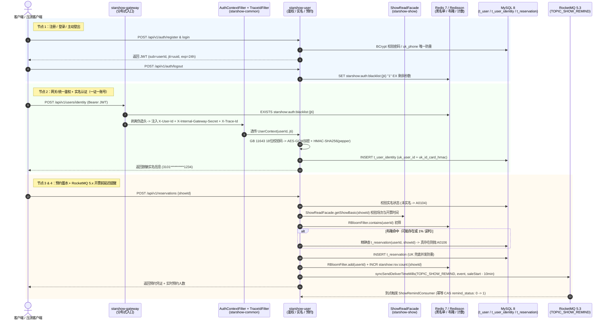

# 板块 01：链路一完整开发设计规格书（鉴权 · 实名防黄牛 · 预约蓄水 · 开票延迟提醒）

- **文档状态**：`Design-Review（待拍板，拍板后切分支 feat/chain1-user-reservation 动工）`
- **映射代码模块**：`starshow-common`（Web 底座）、`starshow-api`（跨模块契约）、`starshow-gateway`（网关鉴权）、`starshow-user`（链路一核心）、`starshow-show`（提供最简 `ShowReadFacade`）
- **目标里程碑**：Phase 1（`v0.2.0-chain1`）

---

## 一、行业成熟方案调研与化用决策（绝不重复造轮子）

本链路涉及 5 个经典高并发/安全工程问题，全部直接化用业界成熟方案与现成组件：

| 技术痛点 | 行业成熟方案 / 组件 | 本项目化用策略 | 刻意规避的反模式 |
| --- | --- | --- | --- |
| **密码安全存储** | `BCrypt`（内置随机盐 + 自适应计算成本） | 仅引入轻量 `spring-security-crypto` 单 jar，直接复用 `BCryptPasswordEncoder`（cost=10） | 严禁手写 MD5/SHA-1；严禁为用 BCrypt 而拉入整套 Spring Security Web 过滤器链把 Gateway 与单进程调试搞复杂 |
| **JWT 主动踢人与防头伪造** | 网关收口鉴权 + JTI Redis 黑名单 + 清洗客户端 `X-User-Id` + 内部密钥头 `X-Internal-Gateway-Secret` | 复用 `jjwt 0.12.6` + Reactive/Redisson Redis 黑名单（TTL = Token 剩余有效期）；下游 `AuthContextFilter` 兼顾 **分布式（验网关密钥头）** 与 **单进程 `boot-all`（直连自动验 JWT + 查黑名单）** 双形态 | 严禁下游服务盲信客户端传来的 `X-User-Id`（防水平越权伪造）；严禁把黑名单设成永不过期撑爆 Redis |
| **一证一号防黄牛与防脱库** | GB 11643-1999 校验码 + `HMAC-SHA256(pepper)` 唯一索引 + `AES-256-GCM` 密文落库 | 直接复用 Phase 0 已验证的 `CryptoUtil`；并发抢绑直接走 `INSERT` + 捕获 `DuplicateKeyException` 区分冲突索引名 | 严禁裸 `SHA-256(idCard)`（低熵身份证几秒彩虹表撞破）；严禁“先 SELECT 再 INSERT”留 TOCTOU 并发绕过漏洞 |
| **海量粉丝预约去重蓄水** | Redisson 分布式 `RBloomFilter<Long>` + MySQL 唯一索引兜底 + Redis `INCR` 计数 | 复用 Redisson `RBloomFilter`（`tryInit(500_000L, 0.01)`）；**布隆防误杀策略**：布隆说不存在直接落库，布隆说可能存在必须回查 DB 确认才拦 `A0106` | 严禁把布隆过滤器 `contains()==true` 直接当成绝对存在（1% 误判率会误杀真实正常粉丝！） |
| **开票前精准延迟提醒** | Apache RocketMQ 5.x 原生时间轮任意时间延迟消息 | 直接复用 `rocketmq-spring-boot-starter 2.3.1` 内置 `rocketMQTemplate.syncSendDeliverTimeMills(topic, payload, deliverTimeMs)`（绝对时间戳）与 `syncSendDelayTimeMills`（测试短延迟） | 严禁沿用 RocketMQ 4.x 固定 18 级 `delayLevel`（无法精确对齐“开票前 10 分钟”）；严禁因 MQ 瞬时抖动回滚用户预约主流程 |

---

## 二、链路一端到端全景时序与节点拆解



整条链路拆解为 **5 个独立可测节点**：
- **节点 0**：全链路公共 Web 底座（`TraceIdFilter`、`UserContext`、`GlobalExceptionHandler`、`JwtTokenService`）
- **节点 1**：用户注册、登录与主动登出（BCrypt + JTI Redis 黑名单 + 网关/单进程双形态防伪造鉴权）
- **节点 2**：实名认证与一证一账号防黄牛（GB 11643 校验 + AES-GCM + HMAC-SHA256 + `UserFacade` 实现）
- **节点 3**：演出预约蓄水（实名前置校验 + `ShowReadFacade` 联动 + Redisson 布隆防重与防误杀 + Redis 实时热度计数）
- **节点 4**：RocketMQ 5.x 任意时间延迟开票提醒（绝对时间投递 + 发送降级补偿 + 消费端幂等状态更新）

---

## 三、各节点详细业务内容与技术实现

### 节点 0：公共 Web 底座与鉴权上下文（`starshow-common`）
- **包路径**：`com.starshow.common.web`、`com.starshow.common.auth`
- **组件清单**：
  1. `TraceIdFilter`（最高优先级 `Ordered.HIGHEST_PRECEDENCE`）：读取请求头 `X-Trace-Id`（无则生成 32 位 UUID）写入 `TraceIdContext`（MDC），回写响应头 `X-Trace-Id`，`finally` 中强制 `TraceIdContext.clear()`。
  2. `UserContext`（`ThreadLocal<LoginUser>`，含 `userId`、`jti`、`expireEpochSec`）+ `UserContext.requireUserId()`（未登录抛 `ErrorCode.UNAUTHORIZED`）。
  3. `GlobalExceptionHandler`（`@RestControllerAdvice`，仅在 Servlet Web 环境生效）：统一捕获 `BizException`、`MethodArgumentNotValidException`、`ConstraintViolationException`、`DuplicateKeyException` 与兜底 `Exception`，全部包装为 `Result.fail(...)` 且绝不把堆栈/敏感 SQL 泄露给客户端。
  4. `JwtTokenProvider`（放 `starshow-common` 供 `starshow-gateway` 与 `starshow-user` 复用，避免重复写 JWT 逻辑）：
     - 算法：`HS256`（密钥由 `STARSHOW_JWT_SECRET` 注入，校验长度 ≥ 32 字节）；
     - Claims：`sub = String.valueOf(userId)`、`jti = UUID`、`iat`、`exp`（默认 24 小时，可配置）；
     - 提供 `generateToken(long userId)` 与 `parseToken(String token) -> JwtPayload(userId, jti, expireEpochSec)`。

### 节点 1：注册、登录、登出与双形态防伪造鉴权（`starshow-user` + `starshow-gateway`）
- **业务规则**：
  - **注册** (`POST /api/v1/auth/register`)：校验 11 位合法手机号 + 密码长度（8~32 位）+ 昵称（可选，默认脱敏手机号）；`GeneSnowflakeIdGenerator.nextId()` 生成 `userId`；`BCryptPasswordEncoder.encode()` 哈希密码；插 `t_user`，捕获 `uk_phone` 冲突返回业务提示“该手机号已注册”（复用 `INVALID_PARAM` 或新增 `PHONE_ALREADY_EXISTS("A0107")`）。
  - **登录** (`POST /api/v1/auth/login`)：按手机号查 `t_user`，校验 `status == 1` 且 `passwordEncoder.matches(raw, hash)`；失败统一返回“手机号或密码错误”（防账号枚举）；成功签发 JWT 并返回 `{ userId, nickname, token, expireAt }`。
  - **主动登出** (`POST /api/v1/auth/logout`)：从当前 `UserContext` 取 `jti` 与 `expireEpochSec`，计算 `remainSec = expireEpochSec - nowSec`，若 `> 0` 则执行 `SET starshow:auth:blacklist:<jti> "1" EX <remainSec>`。
  - **双形态防头伪造拦截**：
    - `starshow-gateway`（`JwtAuthGlobalFilter`）：白名单路径（`/api/v1/auth/register`、`/api/v1/auth/login`、`/api/v1/shows/**`、`GET /api/v1/reservations/*/count`、健康检查与 Swagger）直接剥离伪造头后放行；其余路径必须验签 JWT + 查 Reactive Redis 黑名单，命中黑名单返回 HTTP 401 + `Result.fail(TOKEN_REVOKED)`；通过后剥离客户端原有 `X-User-Id` / `X-User-Jti` / `X-Internal-Gateway-Secret`，注入可信值并透传。
    - `starshow-common`（`AuthContextServletFilter`，运行在 `starshow-boot-all` 与各业务微服务内）：
      - 若请求携带 `X-Internal-Gateway-Secret` 且与服务端配置常量匹配（恒定时间比对 `MessageDigest.isEqual`）→ 信任 `X-User-Id` / `X-User-Jti` 写入 `UserContext`；
      - 否则若携带 `Authorization: Bearer <token>` → 本机直接调 `JwtTokenProvider.parseToken` + 查 Redis 黑名单（支持单进程 `boot-all:8090` 免网关直调）；
      - 未通过鉴权且接口标记 `@RequireLogin`（或位于受保护路径）→ 直接返回 401；公开接口允许匿名进入（`UserContext` 为空）。

### 节点 2：实名认证与一证一账号防黄牛（`starshow-user`）
- **业务规则** (`POST /api/v1/users/identity` & `GET /api/v1/users/identity`)：
  1. 校验真实姓名（2~32 位中英文）与 18 位中国大陆居民身份证号：
     - `IdCardValidator`（纯 Java 工具）：正则校验 + 出生日期合法性 + ISO 7064:1983.MOD 11-2 第 18 位校验码验证（测试与压测数据均使用符合校验码规则的虚拟测试号）。
  2. 调用 `CryptoUtil`：
     - `realNameCipher = encryptAesGcm(realName, aesKey)`
     - `idCardCipher = encryptAesGcm(idCard, aesKey)`
     - `idCardMasked = maskIdCard(idCard)`
     - `idCardHmac = hmacSha256Hex(idCard, idcardPepper)`
  3. 直接执行 `INSERT INTO t_user_identity(...)`：
     - 捕获 `DuplicateKeyException`：
       - 若查本用户 `user_id` 已有记录 → 幂等/明确返回已认证提示（或返回已有脱敏信息）；
       - 否则必然是触发了 `uk_id_card_hmac` → 抛出 `BizException(ErrorCode.IDENTITY_DUPLICATE)`（`A0105`），彻底防黄牛一证多号！
  4. **实现 `UserFacade`**：
     - `UserFacadeImpl implements UserFacade`（`@Service`）：`isRealNameVerified(long userId)` 查询 `t_user_identity` 是否存在记录（同时缓存一个轻量 Redis/本地正缓存 `starshow:user:verified:<userId>`，实名一旦完成不可逆，可直接缓存 1 小时极大加速链路三抢票前置校验！）。

### 节点 3：场次预约蓄水与布隆防重（`starshow-user`）
- **业务规则** (`POST /api/v1/reservations` & `GET /api/v1/reservations/{showId}/count`)：
  1. **实名校验**：调 `userFacade.isRealNameVerified(userId)`，未实名抛 `ErrorCode.IDENTITY_REQUIRED`（`A0104`）。
  2. **演出校验**：调 `showReadFacade.getShowBasic(showId)`：
     - 不存在抛 `SHOW_NOT_FOUND`（`A0201`）；
     - 若演出状态已为 `ENDED` 或已过 `saleEndTime`，禁止预约并抛 `SHOW_NOT_ON_SALE`（`A0202`）。
  3. **布隆初筛 + 防误杀二次确认**：
     - 获取 `RBloomFilter<Long> bloom = redissonClient.getBloomFilter(RedisKeys.reservationBloom(showId))`，首次懒初始化 `bloom.tryInit(500_000L, 0.01)` 并设置过期时间（演出结束 + 1 天）；
     - 若 `bloom.contains(userId)` 为 `true` → **必须回查 DB** `t_reservation(user_id, show_id)`；仅当 DB 确实存在时抛 `ErrorCode.RESERVATION_DUPLICATE`（`A0106`），彻底杜绝布隆 1% 误判误杀真实用户。
  4. **落库 + 蓄水计数**：
     - 用 `GeneSnowflakeIdGenerator.nextId()` 生成预约 ID，执行 `INSERT t_reservation(id, user_id, show_id, remind_status=0)`；并发重复提交触发 `uk_user_show` 捕获转为 `A0106`；
     - 落库成功后：`bloom.add(userId)` + `Long count = redissonClient.getAtomicLong(RedisKeys.reservationCount(showId)).incrementAndGet()`。
  5. **查询实时预约人数** (`GET /api/v1/reservations/{showId}/count`)：
     - 优先读 `starshow:rsv:count:<showId>`；若 Redis 缺失（如冷启动/重启），回源 `SELECT COUNT(*) FROM t_reservation WHERE show_id = ?` 并回填 Redis。

### 节点 4：RocketMQ 5.x 任意时间延迟开票提醒（`starshow-user`）
- **生产者逻辑**（紧接节点 3 落库成功后执行，**不包裹在 DB 事务内**，避免长事务与 MQ 抖动回滚预约）：
  - 计算目标提醒时间：`deliverTimeMs = saleStartTime - remindLeadSeconds * 1000`（生产默认 `remindLeadSeconds = 600` 即开票前 10 分钟；允许通过配置覆盖，集成测试可设短延迟如 3 秒，或若距开票不足 10 分钟但尚未开票则立即设 `now + 2000ms`）；
  - 若当前时间已超过 `saleStartTime`（演出已开票后用户仍点预约/关注），跳过发送延迟提醒，直接标记 `remind_status = 1`（或无需提醒）；
  - 构造 `ShowRemindEvent(reservationId, userId, showId, showTitle, saleStartTime)`，调用：
    ```java
    rocketMQTemplate.syncSendDeliverTimeMills(MqTopics.SHOW_REMIND, event, deliverTimeMs);
    ```
  - **发送失败降级**：捕获异常记录告警日志，将 `t_reservation.remind_status` 更新为 `2`（发送失败待补偿），**不向用户报错、不回滚预约成功状态**！
- **消费者逻辑**（`ShowRemindConsumer`）：
  - `@RocketMQMessageListener(topic = MqTopics.SHOW_REMIND, consumerGroup = MqTopics.CG_REMIND_NOTIFY)`；
  - 执行数据库级 CAS 幂等更新：`UPDATE t_reservation SET remind_status = 1 WHERE id = ? AND remind_status = 0`；
  - 仅当影响行数 `== 1` 时触发模拟站内信/通知日志输出（含 `traceId`、`userId`、`showId`），确保重复投递不发重复提醒。

---

## 四、精确契约与模块变更清单

### 1. Maven 依赖变更
- `starshow-common/pom.xml`：新增 `jjwt-api` / `jjwt-impl` / `jjwt-jackson`（可选或直接依赖供 gateway & user 复用）、`jakarta.servlet-api`（optional）。
- `starshow-user/pom.xml`：新增 `org.springframework.security:spring-security-crypto`（仅 BCrypt）与 `org.apache.rocketmq:rocketmq-spring-boot-starter`。
- `starshow-gateway/pom.xml`：引入 `jjwt`（通过 `starshow-common` 传递）用于网关验签。

### 2. 新增 `starshow-api` 契约
- 新增 `com.starshow.api.dto.ShowBasicDTO`（`showId`、`title`、`saleStartTime`、`saleEndTime`、`saleStatus`）
- 扩展 `com.starshow.api.facade.ShowReadFacade`：增加 `ShowBasicDTO getShowBasic(long showId);`
- 新增 `com.starshow.api.event.ShowRemindEvent`（`reservationId`、`userId`、`showId`、`showTitle`、`saleStartTime`）

### 3. 新增错误码（同步补入 `ErrorCode.java`）
- `PHONE_ALREADY_EXISTS("A0107", "该手机号已注册")`
- `LOGIN_FAILED("A0108", "手机号或密码错误")`
- `ID_CARD_INVALID("A0109", "身份证号格式或校验码不合法")`
- `IDENTITY_ALREADY_VERIFIED("A0110", "当前账号已完成实名认证，请勿重复提交")`

### 4. 配置项变更（同步补入 `.env.example` 与 `application.yml`）
- `STARSHOW_INTERNAL_GATEWAY_SECRET`（网关与业务服务间防伪造头内部密钥，默认占位 `starshow-dev-internal-gateway-secret`）
- `starshow.security.jwt-expire-seconds`（默认 `86400`）
- `starshow.reservation.remind-lead-seconds`（默认 `600`，集成测试可覆盖）
- `starshow.reservation.mq-enabled`（默认 `true`，纯单测环境可关）

---

## 五、异常边界、并发竞态与降级策略

| 异常 / 竞态场景 | 触发原因 | 系统处理策略 |
| --- | --- | --- |
| **同一手机号并发注册** | 极短时间内双请求穿透检查 | DB `uk_phone` 拦截，捕获 `DuplicateKeyException` 转 `A0107` |
| **不同账号并发绑同一身份证（黄牛脚本）** | 并发抢绑绕过前置 SELECT | 跳过前置 SELECT 直接 `INSERT`，DB `uk_id_card_hmac` 物理拦截转 `A0105` |
| **布隆过滤器 1% 误判** | Hash 碰撞导致新用户命中 `bloom.contains()==true` | 强制回查 DB `t_reservation`，未查到则正常放行落库，0 误杀 |
| **同一用户并发重复预约** | 连点或脚本并发请求 | DB `uk_user_show` 物理拦截，转 `A0106`，不重复 `INCR` 计数、不重复发 MQ |
| **RocketMQ Broker 抖动导致提醒发送失败** | 网络超时/Broker 不可用 | 捕获异常，预约记录保留，`remind_status` 置 `2`（待定时补发），不影响核心预约成功 |
| **Redis 黑名单查询超时（网关可用性权衡）** | Redis 瞬时抖动 | 鉴权黑名单查询设短超时（500ms）；高安全模式默认 Fail-Closed（返回 `B9999`），并记录告警日志 |
| **已过开票时间用户点击预约** | 距开票已不足 10 分钟或已开票 | 不足 10 分钟但未开票 → 立即 2 秒后触发提醒；已过 `saleStartTime` → 允许关注记录但不投递延迟提醒；已 `ENDED` → 拒返 `A0202` |
| **客户端伪造 `X-User-Id` 请求头** | 攻击者尝试水平越权 | 网关强制 strip 客户端原头；下游必须校验 `X-Internal-Gateway-Secret`（恒定时间比对），不匹配直接忽略伪造头并要求验 JWT |

---

## 六、跨板块影响矩阵（全局协同必看）

| 受影响板块 / 模块 | 影响类型 | 具体影响说明与兼容方案 |
| --- | --- | --- |
| **`starshow-common`** | **底座增强** | 新增 `TraceIdFilter`、`UserContext`、`AuthContextServletFilter`、`GlobalExceptionHandler`、`JwtTokenProvider`、`IdCardValidator`，成为后续链路二/三/四的统一 Web 基础设施，零重复建设 |
| **`starshow-api`** | **契约微扩** | `ShowReadFacade` 新增 `getShowBasic(long showId)`；新增 `ShowBasicDTO`、`ShowRemindEvent` |
| **`starshow-show`（链路二）** | **上游轻耦合 + 数据反哺** | ① Phase 1 需在 `starshow-show` 提供最简 `ShowReadFacadeImpl`（直查 `t_show`）；Phase 2 升级为 L1+L2 缓存后，链路一无需改一行代码。<br/>② 链路一产出的 `starshow:rsv:count:<showId>` 直接为链路二开票前容量评估与热点场次识别提供实时数据 |
| **`starshow-order`（链路三）** | **前置风控依赖** | 链路三抢票前调用 `UserFacade.isRealNameVerified(userId)`，直接受益于本板块提供的 Redis 正缓存加速，不增加抢票链路 DB 压力 |
| **`starshow-gateway`** | **安全边界收口** | 落地 `JwtAuthGlobalFilter` + 白名单路由，与 `starshow-boot-all` 单进程模式共用同一套 `JwtTokenProvider` 与黑名单 Key，行为 100% 一致 |
| **Phase 5（压测 Token 池）** | **直接复用能力** | 本板块注册/实名/登录逻辑可直接被 Phase 5 脚本批量调用，快速生成 5,000+ 已实名独立压测用户的真实 JWT Token 池 |
| **Phase 6（演示台）** | **直接支撑页面①** | 直接支撑“演出大厅 & 实名预约蓄水页”的注册登录、一键实名、实时预约人数滚动展示 |

---

## 七、Prove-It 实证验收清单（动工前锁定口径）

Phase 1 完工交付前，**必须逐条实跑通过**以下用例并出具《实证验收回执》：

### L1 单元测试与不变量证明（`mvn -B clean test` 全绿）
1. `IdCardValidatorTest`：合法 18 位身份证（含末位 `X`）通过；非法长度、非法日期（如 2 月 30 日）、错误校验码全部拒绝。
2. `JwtTokenProviderTest`：签发后解析 `userId`/`jti`/`exp` 准确；过期 Token 抛过期异常；篡改 Payload/签名验签失败。
3. `AuthHeaderSpoofingTest`：模拟客户端伪造 `X-User-Id: 999` 但无合法 `X-Internal-Gateway-Secret` 与 JWT → 必须拒绝（401），证明零水平越权。
4. `UserIdentityServiceTest`：同一身份证号绑定第 2 个账号触发 `uk_id_card_hmac` → 精准返回 `A0105`；密文可被 `AES-GCM` 解密还原，数据库不存明文。
5. `ReservationServiceTest`：
   - 未实名用户预约 → 返回 `A0104`；
   - **布隆误判防误杀用例**：Mock 布隆返回 `true` 但 DB 查询无记录 → 必须正常放行落库成功（证明 0 误杀）；
   - 真实重复预约 → 返回 `A0106`；
   - MQ 发送抛异常 → 预约依然返回成功且 `remind_status` 记为 `2`（证明降级有效）。

### 真实中间件联调与运行态证明（需启动 Docker Desktop 拉起 Core 栈）
6. **实跑 Core 栈**：`docker compose -f docker/docker-compose.yml up -d` 启动 MySQL 8 + Redis 7 + RocketMQ 5.3 + Nacos，验证 `01_schema.sql` 14 张表与 `02_seed.sql` 演示场次自动初始化成功。
7. **端到端接口实跑（`starshow-boot-all` 8090 + `starshow-gateway` 8000）**：
   - 注册 → 登录拿 JWT → 实名认证（返回脱敏身份证，DB 存密文+HMAC）→ 换第 2 个号用同一身份证实名返回 `A0105`；
   - 预约 `showId=10001` 成功 → 查询 `/api/v1/reservations/10001/count` 返回 `1` → 再次预约返回 `A0106`；
   - 触发短延迟（如 5 秒）开票提醒消息 → 5 秒后观察 `ShowRemindConsumer` 日志命中且 DB `t_reservation.remind_status` 变为 `1`；
   - 调 `/api/v1/auth/logout` 登出 → 用旧 JWT 再次请求 `/api/v1/users/identity` 返回 `401` + `A0102`。
8. **脱敏与防弱化审计**：全仓敏感词扫描 0 命中；`git diff` 确认原有 Phase 0 测试 0 弱化；同步刷新 `docs/PROGRESS.md`。
