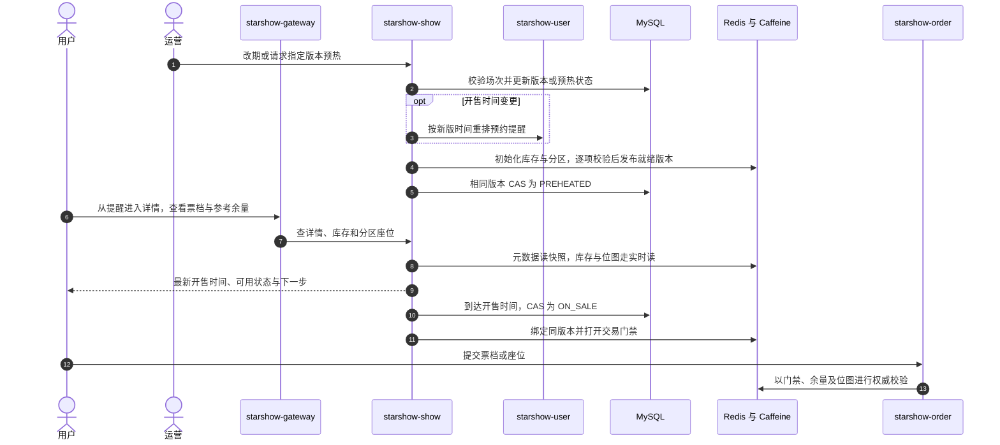

# 板块 02：链路二完整开发设计规格书（演出浏览 · 多级缓存 · 分区选座 · 开售预热）

- **文档状态**　设计评审稿。仓库已有演出、票档基础读接口和改期接口。公开浏览、版本化预热、库存读接口和座位图属于 Phase 2 待实现范围。
- **映射模块**　`starshow-show` 主责，联动 `starshow-user`、`starshow-api`、`starshow-common`、`starshow-gateway` 和 `starshow-order`。
- **目标里程碑**　Phase 2（`v0.3.0-chain2`）。

用户从预约提醒打开演出页时，应当看到最新开售时间、适用票档和下一步。浏览始终可用的目标是保护详情与座位图读取。交易正确性的目标是让过时页面、重复预热和缓存故障都无法改写已经开始售卖的库存。

## 一、成熟方案调研与项目选型

| 问题 | 选型与理由 |
| --- | --- |
| 开票前大量重复读详情 | Caffeine 按容量和写入后时长限制 L1，Redis 保存带逻辑过期时间的 L2 快照。过期时由一台实例重建，其他实例读取在允许陈旧时间内的旧值，避免同一场次同时查 MySQL。[Caffeine · Eviction](https://github.com/ben-manes/caffeine/wiki/Eviction) |
| 库存与席位写入频繁 | 用 Redis 数值 Key 维护票档余量，用 Bitmap 按分区保存占用。座位坐标、票价和开售时间来自 MySQL。库存与座位写入脚本绑定相同 `{showId}`，满足 Redis Cluster 多 Key 的同槽约束。[Redis Cluster 官方说明](https://redis.io/docs/latest/operate/oss_and_stack/management/scaling/) |
| 无效场次号和批量查询 | 合法场次布隆只过滤确定不存在的请求。布隆阳性仍查缓存或数据库。布隆未初始化或目录版本落后时，依靠空值缓存与限流保护 MySQL，新场次可见性优先。 |
| 改期、预热、开售错位 | 用现有 `sale_config_version` 关联同一版开售时间、提醒和预热。Redis 就绪标记控制库存写入，MySQL CAS 控制演出状态。两处更新间隔内，购票入口保持关闭。 |

## 二、端到端链路与节点拆解



| 节点 | 模块与职责 | 完成证据 |
| --- | --- | --- |
| 0　目录与详情 | `ShowQueryService` 按筛选查列表，并读取静态快照。 | 游标无重复，过期热点只回源一次。 |
| 1　库存与座位 | `ShowStockQueryService`、`SeatMapQueryService` 提供短时快照。 | 库存缺失与真实售罄分别显示，10×10 布局可选择。 |
| 2　改期和预热 | `ShowScheduleService`、`ShowPreheatService` 管理版本和初始化。 | 同版本重试收敛，旧任务写入被拒。 |
| 3　开售与停售 | `ShowSaleLifecycleService` 发布可交易门禁。 | 到点才开放，结束后即使有余量也停止受理。 |

## 三、各节点业务规则与实现

### 节点 0　列表、详情与元数据缓存

1. 列表 `GET /api/v1/shows` 支持 `city`、`limit`（默认 20，最多 50）和不透明 `cursor`。用 `show_time, id` 稳定排序，城市筛选按需加 `(city, deleted, show_time, id)` 索引。分页采用最后一项的排序键向后取，游标绑定筛选条件。列表只读演出摘要，票档、座位和实时库存由详情入口获取，避免逐条远程查询。
2. 详情组装 MySQL 中未删除的场次、票档、座位模式。Caffeine 以 `showId` 作 Key，初始配置 `maximumSize=5000`、`expireAfterWrite=60s`。Redis L2 对正值保存 `{saleConfigVersion, payload, refreshedAt, expireAt}`，采用逻辑过期。首版建议逻辑有效期 5 分钟加 0～300 秒抖动，超过 15 分钟不给旧的展示详情当现值。权威开售时间、价格校验和交易准入走当前版本，展示快照里的状态和价格不能直接用于下单。
3. L2 逻辑过期后，持场次锁的任务在有限队列异步读库，拿锁后再次查缓存。允许陈旧时其余请求立即返回快照；冷 miss 只允许合并等待有界时间，超时返回 `503/B9999`。Redis 不可用时，展示读可采用仍在上限内的进程内快照或受限回源，无快照且无预算时快速失败。缓存缺失且已确认 MySQL 无记录时写 30 秒空值。布隆可由有效场次目录按版本完整加载，目录未就绪时停用负判定。
4. 详情页的静态展示字段（标题、场馆、海报、简介）与动态交易字段严格分层：静态字段允许走 L1（60s）/ L2 逻辑过期自然收敛，不为纯文案改动额外叠加 `view_version`、专用 MQ Topic 与 Pub/Sub 失效链路；而**开售时间、配置版本和购票入口状态**统一锚定单一权威 `sale_config_version`，改期或预热时直接覆盖刷新 L2 并更新 `starshow:show:ready:{showId}`，不从陈旧详情复制。
5. Redis 就绪 Hash 健康时直接读取权威 `saleConfigVersion`、官方开售/停售时间戳与阶段，未初始化时走有界权威读。改期中或版本无法确认时保留页面内容，显示“开售时间确认中”并关闭交易入口，避免用户收到改期提醒后详情页仍显示旧倒计时。`ShowReadFacade.getShowBasic` 在 Phase 2 扩展返回权威 `entryState`，让链路一 `GET /api/v1/reservations/{showId}/me` 与本链路详情页展示完全一致的购票入口状态。

### 节点 1　实时余量与分区座位图

- 票档库存读 `starshow:stock:{showId}:<tierId>`。首版直接读 Redis，高频热点可配置 500ms～1s 的 Caffeine 快照。响应带 `asOf`、`stale` 和 `available`；库存不可读时 `available=null`，UI 显示“库存暂不可用，请稍后刷新”并暂缓提交。未开售页面展示官方时间与校准倒计时，库存值真实为零时才显示 `SOLD_OUT`（前端明确提示“当前暂无余票，如有未支付关单或退票将实时回流”，避免粉丝看到售罄立刻离开而错过 15 分钟后的回流票）。余量大于 0 但少于请求张数时提示余量不足，允许直接调低张数下单。
- 自主选座按场次和分区查询，布局返回 `rowNo`、`colNo`、`seatIndex`、`segmentId` 和可选标记。`segmentId` 表示同一排中未被走道隔开的连续段。只画 MySQL 布局中存在的座位，走道、空位、维修座不可选。分区 `seatIndex` 永久稳定，建议每区 1,000～2,000 位，按最大合法偏移预置字节长度。位图缺失或长度异常时返回不可用。Redis 位序按字节最高位到最低位解码，索引 0 对应首字节最高位。首版 `layoutVersion` 等于库存准备的 `saleConfigVersion`。改变布局也推进该版本，售卖期冻结布局。[Redis 位图读法](https://redis.io/docs/latest/commands/bitpos/)
- 前端切换分区只加载当前区域；保留用户已选且仍可选的座位。提交遇 `A0204` 时拉取冲突分区并高亮变化。布局版本变更时清除不能验证的选择并显示原因。自动配座场次以票档为入口，首版展示票档或区域，具体座位交付以链路四签出的票据为准。

### 节点 2　改期、首轮预热与故障恢复

1. 运营使用链路一已定义的改期接口 `PUT /internal/shows/{showId}/schedule` 提交新时间。数据库校验当前版本以及未开售条件。改期和开售共享同一场次操作锁，Redis 脚本只在版本等于预期且尚未进入开售窗口（`stage != 'OPEN'` 且 `nowMs < saleStartEpochMs`）时把旧配置置为 `BLOCKED`，再执行 DB CAS。CAS 未成功时重读权威状态，禁止旧任务关闭新版本。CAS 成功后立即刷新 L2 详情并发布新版本与时间，失败由 `t_show_task` 恢复。已开售场次拒绝改期重置库存。Phase 2 将 `PREHEATING` 纳入安全改期范围，并在改期事务中记提醒重排待办，调用链路一既有 `POST /internal/reservations/shows/{showId}/reschedule`（单进程本地调用，分布式走 OpenFeign）。[链路一规格](./01-user-reservation.md#83-主办方改期开票版本联动链路一--链路二统一-sale_config_version)
2. `POST /internal/shows/{showId}/preheat` 接收 `saleConfigVersion`。相同场次和版本只有一条预热任务，重复调用返回同一任务状态。数据库 CAS `INIT → PREHEATING` 后，Redis 就绪 Hash 写 `PREPARING`、配置版本和新执行编号（Fencing Token）。每段库存或 Bitmap 的写入 Lua 都同时校验 `stage=PREPARING`、版本和执行编号。任务失去锁租约后即使恢复执行，也无法通过新编号检查。
3. 初始化分批执行。清单由有效票档库存、各自所需座位分区和合法布局、场次详情及合法场次目录组成。自动配座无自主选座 Bitmap 时清单明确为空。手动选座初始库存等于本轮可售席位数量，位图按初始占用设置。预热阶段取当前数据库初始底账。所有条目回读与清单匹配后，Lua 将 Redis 状态从 `PREPARING` 置 `READY`（同时固化 `saleStartEpochMs`、`saleEndEpochMs`），数据库再 CAS `PREHEATING → PREHEATED`。切换前后同时校验配置版本；Redis 已 READY、数据库尚未更新时，恢复任务补 CAS。未到达 `saleStartEpochMs` 前绝不开放预扣。
4. 任务写到一半退出时，由 `t_show_task` 的租约、`next_retry_at` 和游标选出待恢复任务。新执行编号替换旧编号。READY 版本的重复请求直接查结果，已开售的版本禁止任何初始库存写入。Redis 在售库存或门禁遗失时，公开查询降级，停售受理并告警。恢复走确认为同一版本的库存、订单和回补凭证核对，DB 初始化数量不作为自动回填值。

### 节点 3　运营状态与毫秒级准点开售

- MySQL 保存 `INIT → PREHEATING → PREHEATED → ON_SALE → ENDED`。开售前合法改期以新配置版本回到 `INIT`。`SOLD_OUT` 可在兼容读路径识别为在售期缺货，前端显示由票档实际余量导出，回补完成后可再次显示可买。交易时段取左闭右开 `[saleStartTime, saleEndTime)`。
- **开票那一秒零延迟开放（绝不让用户干等定时任务）**：只要 `starshow:show:ready:{showId}` 处于 `stage IN ('READY', 'OPEN')`、版本号匹配且服务端当前绝对时间戳处于 `[saleStartEpochMs, saleEndEpochMs)` 区间内，详情入口与链路三预扣 Lua 立即在毫秒级准点开放交易，避免定时任务轮询间隔导致“20:00:00 倒计时归零却弹出尚未开票”的糟糕体验。
- 后台到时任务（或 RocketMQ 精确到点延迟消息）负责将 MySQL CAS 为 `ON_SALE` 并把 Redis `stage` 推进为 `OPEN`（用于管理态展示与硬锁死开售后禁止改期）；CAS 已成功但 Redis `stage` 未推进时，恢复任务只补状态，已预热库存原样保留。到 `saleEndTime` 时写路径立即按绝对时间戳停止受理，补偿仅允许完成已受理订单，绝不重新开放已停售场次。
- 管理写接口统一归口 `/internal/shows/**`（要求 `X-Internal-Gateway-Secret` 内部服务鉴权），`starshow-gateway` 默认零暴露公网写路由（Phase 6 演示台如需一键预热，走受控演练入口并校验独立演练开关与内部密钥）。运营能看到 `PREPARING / READY / FAILED`、失败项、配置版本与是否可重试；用户侧只展示开售时间、准备中、可购、余票不足、暂不可用或已停售。

## 四、精确契约、配置和模块变更

### 1. HTTP 与双形态内部契约

| 接口 | 关键请求与响应 | 访问控制 |
| --- | --- | --- |
| `GET /api/v1/shows` | `city, cursor, limit` → `items[], nextCursor`。列表项含 `showId, title, city, venue, showTime, saleStartTime, seatMode`。 | 公开 |
| `GET /api/v1/shows/{showId}` | `showId, saleConfigVersion, saleStartTime, saleEndTime, serverTime, entryState, tiers[], seatMode`。票档返回 `tierId, tierName, priceCent, zoneId`（含各档参考 `stockState`，避免用户点进详情才发现目标档位无票）。 | 公开 |
| `GET /api/v1/shows/{showId}/stock` | `showId, saleConfigVersion, asOf, stale, tiers[{tierId, available, stockState}]`。 | 公开 |
| `GET /api/v1/shows/{showId}/zones/{zoneId}/seats` | `showId, zoneId, tierId, layoutVersion, asOf, available, seats[{seatIndex,rowNo,colNo,segmentId,selectable}]`。位图不可读时不给出可选快照。 | 公开 |
| `POST /internal/shows/{showId}/preheat` | `{saleConfigVersion}` → `{showId, saleConfigVersion, taskStatus, failedStage, retryable}`。同请求兼作恢复状态查询。 | 内部密钥（公网零路由） |
| `GET /internal/shows/{showId}/tiers/{tierId}/snapshot` | 扩展 `TierSnapshotDTO` 返回版本、交易时段、票价、座位模式及 `maxTicketsPerOrder`。可选返回分区布局标识，精确校验仍用指定分区契约。 | 内部密钥 |

`entryState` 采用 `PREPARING / OPEN / SOLD_OUT / STOCK_UNAVAILABLE / ENDED`。`OPEN` 表示可以尝试买票，按所选票档和数量最终判断。场次在售时有一档可购即 OPEN。全部票档都有有效零余量才判 SOLD_OUT（提示可刷新等待未付回流票）。没有可购项且至少一档不可查时判 STOCK_UNAVAILABLE。`stockState` 复用这些枚举。库存聚合还有部分票档有效时，返回 200 并在缺失票档中标 `available=null,stockState=STOCK_UNAVAILABLE`。单区域位图缺失或库存整体不可用返回 `503/B0201`，可带 `retryAfterMs`。沿用 `A0201`（演出不存在）、`A0202`（不在售卖时段）、`A0203`（票档不存在）、`A0204`（座位冲突）、`A0301`（库存不足）。时间字段含时区偏移，服务端按绝对时间比较。兼容链路一 `LocalDateTime` 的内部字段时显式按 `Asia/Shanghai` 转换。

在售场次某一票档的参考快照示例。

```json
{
  "showId": "10002",
  "saleConfigVersion": 2,
  "asOf": "2026-11-20T20:00:00+08:00",
  "stale": false,
  "tiers": [
    {"tierId": "20003", "available": 0, "stockState": "SOLD_OUT"},
    {"tierId": "20004", "available": null, "stockState": "STOCK_UNAVAILABLE"}
  ]
}
```

### 2. 持久化、Redis 和消息

| 类型 | 契约 |
| --- | --- |
| MySQL 既有 | `t_show.sale_config_version`、`sale_status`、时间窗口；`t_ticket_tier` 价格为分；`t_seat.uk_show_zone_index` 确定分区位置。 |
| MySQL 拟扩展 | `t_seat.segment_id VARCHAR(24)` 保存座位连续段，初始化种子按真实走道标注。`t_show_task` 保存 `task_id BIGINT`、`show_id BIGINT`、`task_type`、`version`、`status`、`attempt`、`next_retry_at`、`lease_until`、`last_error_code`，唯一 `(show_id, task_type, version)`，调度索引 `(status,next_retry_at,task_id)`（最简状态表，复用公共任务恢复调度框架）。 |
| Redis 元数据 | 延续 `starshow:show:detail:<showId>`、`starshow:lock:show_rebuild:<showId>`。静态详情 L1 靠 60s TTL 自然收敛，改期/预热主动覆盖刷新 L2。展示目录布隆与预约布隆各由对应域管理。 |
| Redis 热数据 | `starshow:show:ready:{showId}` Hash 保存 `version, executionId, stage, saleStartEpochMs, saleEndEpochMs`。`starshow:seat:layout:{showId}:<zoneId>` 保存合法偏移和版本。库存和 Bitmap 继续使用既有 Key，售卖期常驻。 |
| 跨模块联动 | 改期触发提醒重排直接复用链路一 `POST /internal/reservations/shows/{showId}/reschedule`（单进程本地调用 / 分布式 OpenFeign）+ `t_show_task` 失败重试，不额外引入纯静态文案失效 Topic。 |

### 3. 应用装配

`ShowQueryController → ShowQueryService / ShowStockQueryService / SeatMapQueryService`。管理端通过 `InternalShowController`（`/internal/shows/**`）调用 `ShowScheduleService` 与 `ShowPreheatService`，生命周期由 `ShowSaleLifecycleService` 驱动。通过 `RedisKeys` 新增 Key 方法，OpenFeign 只在 `distributed` 激活，聚合态沿用本地 `ShowReadFacade`。Gateway 仅暴露公开 `GET /api/v1/shows/**`，`/internal/**` 在网关无任何路由，天然隔离公网。

配置项在实现时同步至 `application-show.yml`、聚合配置和 `.env.example`。下列数字是开发起点，按 Phase 2/5 证据调整。

| `starshow.show` 配置 | 初值与保护对象 |
| --- | --- |
| `detail-l1-ttl-seconds` / `detail-l1-max-size` | `60` / `5000`，限制单实例常驻元数据。 |
| `detail-l2-logical-ttl-seconds` / `detail-l2-jitter-seconds` / `detail-max-stale-seconds` | `300` / `300` / `900`，相同热场次读过期快照上限。 |
| `negative-cache-ttl-seconds` / `cold-read-timeout-ms` | `30` / `150`，限制无效 ID 和冷 miss 等待。 |
| `stock-local-ttl-ms` | `0` 默认直读，可配置 `500～1000`，只作用于浏览响应。 |
| `preheat-batch-size` / `task-recovery-batch-size` | `50` / `100`，约束单批工作量。 |

## 五、异常边界与面向用户的恢复

| 场景 | 系统动作 | 用户看到的结果 |
| --- | --- | --- |
| 通知里的时间已更新 | 详情读当前版本，旧提醒深链进入同一场次。 | 显示最新开售时间和倒计时。 |
| 已到开售时间但预热未完成 | 阻止交易，内部重试预热并告警。 | 开售准备中，可稍后刷新。 |
| 在售期库存或座位 Key 遗失 | 关闭交易受理，进入人工或核对恢复流程。 | 库存暂不可用，不显示售罄。 |
| 座位快照变化 | 订单链路返回冲突位置，重新读取局部区域。 | 保留其余选择，标出冲突席位。 |
| 票档库存有限、或回流 | 用当前读到的余量区分余量不足和售罄，售后释放后刷新。 | 选择较少张数，或更换有余量的票档。 |
| 详情缓存全层失败 | 合并、有界地查库，超过预算短失败。 | 原页面保留，显示可重试。 |

## 六、跨板块影响矩阵

| 模块或阶段 | 交接内容 | 责任 |
| --- | --- | --- |
| 链路一 `starshow-user` | `saleConfigVersion`、权威开售时间、改期重排。 | 预约计数用于估算热度。Phase 2 将 `entryOpen` 的最终判断接到本链路就绪与时段口径。 |
| 链路三 `starshow-order` | 票档快照、当前版本与门禁、合法座位、库存返回码。 | 受理时复核，V4 预扣在 Lua 内再次确认门禁。 |
| 链路四 `starshow-payment` / `starshow-order` | 回补后的 Redis 余量与位图由本链路展示。 | 状态和库存回补归订单/支付流程，本链路读取最后结果。 |
| `common / api / gateway / boot-all` | Key、错误码、DTO、路由、权限、双形态本地/Feign。 | 公共 DTO 保持 64 位数字串，避免网关把管理写路径暴露给公网。 |
| Phase 5 / Phase 6 | 预热耗时与失败场次、缓存命中、真实余量和座位图。 | 在同一时轴展示改期、提醒、开售、库存变化和误报计数。 |

## 七、Prove-It 设计验收与实施顺序

| 门禁 | 实跑用例与断言 |
| --- | --- |
| L1 单元 | 稳定游标、城市筛选、未知场次、逻辑过期和陈旧上限、价格分为 Long 串、位图 MSB 解码、稀疏偏移和走道、开售与停售边界。 |
| 真实 MySQL + Redis | 例如两实例 100 并发读取同一过期快照，MySQL 重建只一次。布隆已就绪且明确否定的批量不存在 ID 访问，详情 SQL 次数为 0。新增场次时不会被旧布隆永久挡住。 |
| 预热与改期 | 连跑同版预热、写到一半退出、新任务抢占旧执行编号、改期后旧任务复活、已开售收到旧任务。核对库存和位图逐项正确，旧任务造成的覆盖为 0。 |
| 真实 API | 隔离环境用 `10002` 检查 10×10 座位图。构造准备中、已开售后缺键、真实零余量、停售四态，验证状态和 HTTP/业务码。链路三完成后追加 50 并发抢同一连座只一单成功。 |
| 跨链路 | `10003` 构造改期提前和推迟各一次，核验通知、详情、准入版本一致。仅在新开售时刻且预热就绪时接受购票。分别在单进程和分布式原包实跑。 |
| 监控 | 记录 L1/L2 命中、详情回源次数、锁竞争、重建队列拒绝、预热耗时、库存缺键和提示售罄次数。压测回执记录硬件和请求分布。 |

开发顺序为公开读契约与快照 → 分区视图 → 版本化预热 → 开售门禁 → 改期、提醒和双形态联调。验收命令按 `mvn -B -pl starshow-show -am test` 和隔离 Docker MySQL/Redis/RocketMQ 实跑。此处列的是验收口径，待实现后填写实测数据。
