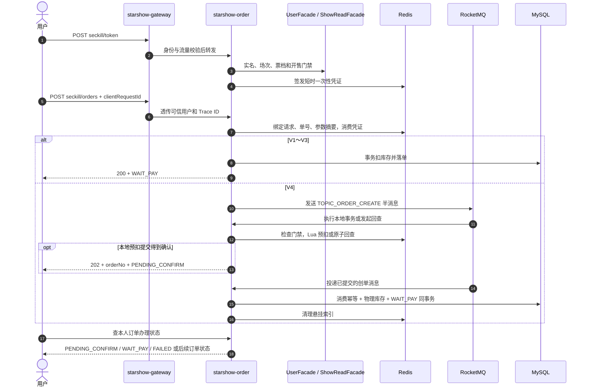

# 板块 03：链路三完整开发设计规格书（抢票准入 · V1～V4 演进 · 选座预扣 · 异步下单）

- **文档状态**　✅ Phase 3 已完成并全量实证验收（分支 `feat/chain3-order-seckill`）。已落地两段式短 Lua 绑定与门禁预扣/连座锁座、V1～V4 策略引擎、RocketMQ 5.x 事务消息防悬挂回查、基因分表三层幂等落单、超时关单任务投递、换设备找回、网关限流与双形态 OpenFeign。
- **映射模块**　`starshow-order` 主责，联动 `starshow-gateway`、`starshow-user`、`starshow-show`、`starshow-api` 和 `starshow-common`。
- **目标里程碑**　Phase 3（`v0.4.0-chain3`）。电子票、支付、退款与关单终态由 [链路四](./04-payment-reconcile.md) 实现。

用户提交抢票后，要能理解结果、找回第一次请求，并在订单确实可支付时进入支付页。系统按场次保证一个账号只有一个有效订单，按票档控制库存，按座位控制占用。在 V4 中，受理、预扣和落库是可分别验证的三步。

## 一、成熟方案调研与项目选型

| 决策 | 方案与使用边界 |
| --- | --- |
| 分阶段验证热点 | V1 用 MySQL 乐观锁。V2 加 Redisson 场次锁。V3 将锁缩至票档。V4 用 Redis Lua 原子预扣和 RocketMQ 事务消息。四个策略同仓运行，每场独立压测前固定版本。[InnoDB 锁](https://dev.mysql.com/doc/refman/8.0/en/innodb-locking.html) |
| 预扣与消息同步 | 先发半消息，再由本地事务执行 Lua。Redis 回查凭证决定提交或回滚。消费端以 MySQL 事务和唯一约束落单。RocketMQ 提供生产侧事务的最终一致，应用仍要处理消费重复与未知结果。[RocketMQ 事务消息](https://rocketmq.apache.org/docs/featureBehavior/04transactionmessage/) |
| 高峰选座 | Lua 先校验整组座位，再一次扣库存并占位。同场次脚本只涉及一个 Hash Tag。Lua 原子执行降低往返，运行时间仍随座位数增长，因此限制每单座位数量。[Redis Lua](https://redis.io/docs/latest/develop/interact/programmability/eval-intro/) |
| 由订单号直接定位 | 复用 `GeneSnowflakeIdGenerator` 和 MySQL 基因分表。下单结果以订单库为长期事实，在途状态由 Redis 记录，避免状态轮询广播查询。 |

## 二、端到端时序与节点拆解



| 节点 | 职责 | 主验收 |
| --- | --- | --- |
| 0　准入与限流 | 网关认证，订单服务确认资格和售卖窗口。 | 拒绝未实名、未开售、失效凭证，不触发库存写入。 |
| 1　请求绑定 | 同一请求只分配一个 `orderNo`，保留丢响应后的恢复路径。 | 相同请求重放结果一致，参数变化时明确拒绝。 |
| 2　策略执行 | V1～V3 同步落单，V4 事务消息原子预扣。 | 共享业务约束，四组结果可公平对照。 |
| 3　V4 消费与恢复 | 幂等落单，物理库兜底，清理预扣与异常。 | 受理、有效订单和库存最终一致。 |
| 4　结果查询 | 私有订单状态、购买历史和支付引导。 | 用户看得见进度，只有 `WAIT_PAY` 能付。 |

## 三、各节点业务规则与实现

### 节点 0　准入、凭证、价格与座位校验

- 可信 `userId` 只取认证上下文。`UserFacade.isRealNameVerified` 通过后校验售卖时段、场次门禁、票档及最新配置版本。链路一预约是需求信号，实名认证用于资格，预约人数和提醒状态不参与库存计算。Gateway 以用户与场次维度控制开票洪峰，登录态与共享的速率限制先于业务入队。
- `POST /api/v1/seckill/token` 生成不可预测的随机凭证，**绑定 `(userId, showId, saleConfigVersion)` 而非绑死单一 `tierId`**，默认有效期 60 秒。该凭证表示准入，锁座发生在后续下单；**业务体验优化**：当用户抢 680 元档遇售罄（`A0301`）或选座遇冲突（`A0204`）快速失败时，不浪费凭证或允许在有效期内直接切换其他票档/座位重试（仅当请求真正被受理进入下单链路时才消费 Token），省去用户二次申请凭证的 RTT 损耗。
- 服务端用当前票档单价乘 `qty`，检查整数范围。客户端带上所看到的 `expectedUnitPriceCent`；价格变化返回 `A0308` 和当前价格提示，待用户确认后提交。每场次一个有效订单。演示默认 `maxTicketsPerOrder=1`，两座连座验收场次明确配置为 2。
- 自动配座提交票档及数量。自主选座只能选同一票档、同一区域中真实存在、未禁售且互不重复的偏移。`qty=seatIndices.size`。连座按实际排号和相邻座位关系判断，走道分隔，偏移连续不替代连座校验。下单记录固定座位与布局版本，上游位置过期则刷新该区域后重选。

### 节点 1　防重、首次超时找回与换设备恢复

1. `clientRequestId` 使用客户端生成的 UUID，第一次点击时生成并与本次确认的参数一并保存。摘要纳入场次、票档、数量、座位集合、报价与配置版本。对同一 `userId+showId+clientRequestId`，摘要一致则找回原订单号。摘要不一致返回 `A0307`。鉴权和参数结构校验后先查本人原请求。已有订单的恢复不受新票价、当前售卖窗口和 Token 失效影响。只有首次请求需要继续校验实时准入。
2. **两段式短 Lua 拆分（V1～V4 通用 + 高可读）**：
   - 第一段 `seckill_req_bind.lua`（同 `{showId}` 槽，发 Half 消息前执行，**V1～V4 全部复用**）：原子校验 `seckillToken` 并将 `(userId, showId, clientRequestId)` 绑定至唯一胜出 `orderNo` 与参数摘要，同时写 `attempt` 在途记录；竞争失败的候选单号作废，所有重试使用胜出单号；若后续因业务拒绝（售罄/座位冲突）快速失败，清理未生效绑定并保留短时重试体验，不误扣用户重试机会。
   - 第二段 `seckill_deduct.lua` / `seckill_seat_deduct.lua`（仅 V4 本地事务执行）：保持 7～8 个 Key 简洁清晰，专职校验 `starshow:show:ready:{showId}` 门禁（`stage IN ('READY','OPEN')` 且处于 `[saleStartEpochMs, saleEndEpochMs)`）+ 墓碑 + `bought_owner` + 库存/Bitmap 原子预扣。
3. 同步策略 V1～V3 重放时查原分片订单，尚未落库且租约到期则按原号重新争取执行权。库存与订单在同一事务，主键和请求唯一索引保证旧执行与重试不能各自成功。V4 的尝试记录包含有限时长发送租约及待发送索引，后台按已知场次恢复，不全量扫描 Redis。发送确认未知时复用原单号，重发半消息和重复消费依赖它幂等。初次发送仍无结果时返回 HTTP `503/B0103` 并带已绑定的原单号与处理中状态。只有 V4 本地预扣提交得到确认时才返回 HTTP `202/00202`。
4. **从用户出发的跨设备恢复（精简零额外密钥）**：同设备遇 HTTP 超时、503 或 202 时，前端用同一 `clientRequestId` 或已拿到的 `orderNo` 轮询（初始 500ms，退避上限 3s，最多 30 次后转手动查询）。**若用户杀掉 App 或换手机登录（丢失本地单号与 `clientRequestId`）**，无需引入额外的 HMAC `X-Order-Receipt` 密钥体系，直接凭登录态调用 `GET /api/v1/orders/current?showId={showId}`：服务端依次查本人分片有效订单与 Redis `bought_owner:{showId}` 在途归属，立即告知用户“正在确认 / 待支付（带倒计时） / 尚未下单”，彻底消除弱网与换设备焦虑。

### 节点 2　V1～V4 业务一致，库存与锁差异可解释

| 策略与拟实现类 | 库存和事务边界 | 对比观察 |
| --- | --- | --- |
| V1 `DbOptimisticSeckillStrategy` | 在 MySQL 事务中按票档主键、`version` 和 `available_stock>=qty` 条件更新。自主选座的基线走同一事务的 MySQL 座位条件更新。占座、扣库存和订单提交任一失败则全部回滚。 | 观察版本冲突、数据库锁等待和连接池。 |
| V2 `ShowLockSeckillStrategy` | Redisson 场次锁覆盖同一 DB 事务，超时后返回 `B0102`。事务提交完成才释放锁。DB 条件和唯一索引继续保留。 | 对比同场不同票档被串行化的开销。 |
| V3 `TierLockSeckillStrategy` | 改用场次内票档锁。库存锁不覆盖跨票档重复购买，依靠 `uk_user_show_active` 兜底。 | 比较跨票档并发与单票档热点限制。 |
| V4 `LuaMqSeckillStrategy` | 售卖期 Redis 权威预扣，RocketMQ 异步创单，MySQL 复核物理库存。 | 分开报告 API 受理、DB 落单、最终订单和排空时间。 |

V1～V3 是隔离对照路径，每轮固定策略、初始数据与售卖场次。实际 V4 售卖运行期间不切换到 DB 扣减策略。V1～V3 的选座占用和售后释放按 DB 权威执行，V4 的实时余量或 Bitmap 不接收这些基线轮次的写入。

**V4 本地事务**

- 按 Half → Lua → Broker COMMIT/ROLLBACK 顺序。`seckill_deduct.lua` / `seckill_seat_deduct.lua` 校验运行门禁版本、`stage IN ('READY','OPEN')` 与毫秒级售卖窗口 `[saleStartEpochMs, saleEndEpochMs)`。校验合法座位集合、库存键存在、数量、重复购买、座位冲突及墓碑后再进行变更。缺失的位图不能当成全空。成功时原子更新库存与位图、`bought`、`bought_owner`、`deduct_log` 和 `deduct_pending`；重复执行相同订单号时若成功凭证与参数相同，只确认旧预扣。
- 新增 `seckill_tx_check.lua`，在一段原子操作内先检查 `deduct_log`，缺失时写 `SET rollback_done 1 NX EX 86400`。预扣先成功则回查 `COMMIT`。回查先写墓碑则迟到预扣返回 `-3`。Redis 连接超时或结果未知时返回客户端对应的事务未知枚举 `UNKNOW`，交由 Broker 回查。已确认预扣凭证不会改判成从未扣减。
- 保留 Lua 的现有编号。`1` 成功，`-1` 余量不足，`-2` 同场重复，`-3` 防悬挂，`-4` 座位冲突。拟增 `-5` 库存或必要位图缺失，`-6` 门禁关闭、窗口不符或配置版本变化。无效座位、分区或张数在应用层提前返回参数错误，Lua 仍做保护性校验。
- Redis Lua 的预扣和回补要在第一项写入前检查所有参与 Key 的类型、版本、初始化标记和参数范围。脚本运行中途报错时，已执行的写入可能保留。基础设施错误或执行结果未知时进入核对，不擅自返回业务失败。[Redis Lua 调用语义](https://redis.io/docs/latest/develop/programmability/lua-api/)
- `-5`、`-6` 的对外结果以权威售卖阶段分流。准备中或停售返回 `A0202`，已开售且门禁或热数据不可用返回 `B0201`，仅客户端配置或布局版本过时则返回拟增 `A0205`，提示刷新详情或所在分区。若已绑定请求，保留原请求的状态查询入口。

### 节点 3　消费落单、故障恢复与超时任务

1. `OrderCreateConsumer` 校验事件结构、用户基因位、数量价款及预扣凭证，按 `userId % 4` 路由。事务内写 `t_mq_consume_log`、`t_order_N`，条件扣减 `t_ticket_tier.available_stock`，并记 `CLOSE_CHECK` 后续任务。订单创建时间取该事务落库时刻，初始 `WAIT_PAY` 且 `expire_time=create_time+15m`。消息、订单和库存更新要么共同提交，要么共同回滚。
2. 以稳定 `msgKey=order-create:<orderNo>` 消费。存在对应已提交订单的重放直接返回，并补清悬挂索引。命中另一订单的用户场次唯一约束或物理库存拒绝时，不覆盖已有订单。先确认拒绝原因并留下可补偿的任务，再对已证实的 V4 预扣执行幂等释放，完成后写最终失败结果并清理挂账。暂时的 MySQL 失败让消费重试。
3. 每票档限制并发，先落地有界消费线程和积压阈值。评审微批方案时，验证一批订单和汇总库存仍能同事务提交，并支持将冲突订单拆开处理。记录最老积压年龄、行锁等待、受理和落库吞吐。达到容量上限时入口降载，已受理请求保有处理和查询能力。
4. 消费提交后清理 `deduct_pending`。调度器通过持久任务发送 `TOPIC_ORDER_TIMEOUT`，发送时间取订单的绝对截止时间。提交后、发消息前退出，可按 `next_retry_at` 找回任务。Phase 3 验证任务创建和幂等投递，Phase 4 消费后查支付状态再关单。
5. 悬挂巡检只枚举已知在售和待恢复的场次。每 5 分钟以 `ZRANGEBYSCORE starshow:deduct_pending:{showId}` 拉取超过 5 分钟的单。消费与确定终止的巡检事务都先按唯一键建立并锁定 `t_order_action` 的 `CREATE_DECISION` 行。消费只能在该行未拒绝时提交订单并写 `APPLIED`。巡检只在收到明确终止证据且该行未提交订单时写 `REJECTED` 和释放任务。迟到消费发现已拒绝直接结束，已存在订单只清索引。状态仍未知或证据缺失时保留待核对。单次查不到订单或仅超时均不足以触发回补。

### 节点 4　下单进度、列表与本人的下一步

| 办理状态 | 可依赖的依据 | 页面策略 |
| --- | --- | --- |
| `PENDING_CONFIRM` | 原请求已绑定、预扣或投递仍处理中。没有形成可以支付的 DB 订单。 | 显示正在确认。退出可再查，暂不提示重新购买。 |
| `WAIT_PAY` | 本人持久订单已存在。 | 显示价格和绝对截止时间，进入链路四支付。 |
| `FAILED` | 明确的终止、拒绝结果或已确认回补。仍持有未释放的预扣时继续为 `PENDING_CONFIRM`，`retryable=false`。 | 显示原因。库存不足可换票档，座位冲突刷新当前区。是否允许新请求由 `retryable` 明示。 |
| 已落单的后续状态 | `PAID / TICKETED / CLOSED / REFUNDING / REFUNDED`。 | 进入出票、关单或退款页，停止创单轮询。 |

查状态先按基因位路由本人订单。DB 暂无记录时，以请求时拿到的 `showId` 定位同槽在途记录，再核对 `userId`。换设备或忘记 `orderNo` 时，直接调用 `GET /api/v1/orders/current?showId={showId}` 按登录态查回本人当前场次在途或有效订单。只有明确终止证据才返回 `FAILED`。无法验证归属的未知订单与非本人请求统一返回 `A0304`。

## 四、精确契约、配置与模块变更

### 1. REST 接口与错误码

| 方法与路径 | 请求 / 响应 | 约束 |
| --- | --- | --- |
| `POST /api/v1/seckill/token` | `{showId,saleConfigVersion}` → `{seckillToken,expireAt,serverTime}`。 | 实名，短期有效，支持同场次切换票档。 |
| `POST /api/v1/seckill/orders` | `{showId,tierId,qty,zoneId?,seatIndices?,layoutVersion?,saleConfigVersion,expectedUnitPriceCent,seckillToken,clientRequestId}` → `{orderNo,showId,status,expireTime?,pollIntervalMs?}`。 | V1～V3 成功 `200/00000`，V4 已确认受理 `202/00202`。自主选座必传布局版本。 |
| `GET /api/v1/orders/{orderNo}/status` | DB 尚未落单时带 `showId`。响应 `{orderNo,showId,status,failCode?,retryable,pollIntervalMs?,expireTime?}`。 | 仅本人。 |
| `GET /api/v1/orders/current` | Query `showId` → 返回本人该场次当前在途或有效订单（无则返回 `hasOrder=false`），解决换设备/杀 App 找回。 | 仅本人。 |
| `GET /api/v1/orders/{orderNo}` | 订单与票档快照、数量、金额、状态、订单和支付时间（若发生关单后异常到账，同步带 `abnormalRefundNo` / `abnormalRefundStatus`）。 | 仅本人，只返回持久订单。 |
| `GET /api/v1/orders` | 按本人、状态与时间游标查订单，默认 20，最多 50。 | 只命中本人的一个订单分片。 |

既有业务码 `A0104` 实名资格、`A0202` 准入时段、`A0203` 票档不存在、`A0204` 座位冲突、`A0301` 库存不足、`A0302` 同场限购、`A0303` 凭证失效、`A0304` 订单不可见、`A0306` 迟到预扣拒绝。拟增 `A0307` 请求参数冲突、`A0308` 票档价格变化。`A0204` 的 `data` 带 `showId,zoneId,layoutVersion`，可附 `conflictSeatIndices`。未返回具体位置时，客户端刷新该区并比对当前选择。`B0101` 由网关 HTTP 429 返回，`B0102` 锁等待、`B0103` 投递未确认、`B0201` 在售库存暂不可用按接口总契约区分。所有 64 位 ID 和 Long 金额在 JSON 中统一序列化为字符串。

V4 已受理响应的 `data` 示例。实际支付时限等到持久订单进入 `WAIT_PAY` 再返回。

```json
{
  "orderNo": "123456789123456789",
  "showId": "10002",
  "status": "PENDING_CONFIRM",
  "pollIntervalMs": 500
}
```

### 2. MySQL、Redis 与 RocketMQ

| 类型 | 契约 |
| --- | --- |
| MySQL | 沿用 `t_order_0..3`、`t_ticket_tier`、`t_mq_consume_log`。订单分片拟增 `request_id CHAR(36)`、`request_fingerprint CHAR(64)` 与唯一 `(user_id,show_id,request_id)`，存储当前版本和策略以支持售后。`active_flag=1` 表示有效单，只有关闭或退款完成按状态机更新为 `order_no`。 |
| 后续任务 | 拟建 `t_order_action`（`action_id, order_no, user_id, show_id, action_type, status, next_retry_at, lease_until, attempt, last_error_code`）。唯一 `(order_no,action_type)`，调度索引 `(status,next_retry_at,action_id)`。当前与分片同库，后续分库时随 `user_id` 路由。Phase 4 复用。 |
| Redis 既有 | `starshow:token:{showId}:<userId>:<token>`、`stock`、`seat:bitmap`、`bought`、`deduct_log`、`deduct_pending`、`rollback_done`。凭证和墓碑保留 24h。 |
| Redis 拟增 | `starshow:seckill:req:{showId}:<userId>:<clientRequestId>`、`starshow:seckill:attempt:{showId}:<orderNo>`、`starshow:seckill:submit_pending:{showId}`（按下次处理时间的 ZSET）、`starshow:bought_owner:{showId}`（`userId → orderNo`）。与链路二门禁与布局 Key 同槽。 |
| `TOPIC_ORDER_CREATE` | 事务消息，`cg-order-create`，复用 `OrderCreateEvent`，补 `clientRequestId, requestFingerprint, saleConfigVersion, layoutVersion, strategy, traceId`。稳定业务键 `order-create:<orderNo>`，原有数量、价格和选座参数仍由服务端构造。 |
| `TOPIC_ORDER_TIMEOUT` | 延迟消息，`cg-order-timeout`，`orderNo,userId,showId,expireTime,traceId`。稳定键 `close-check:<orderNo>`，生产与重投沿用同一绝对截止。 |

基因号位宽保留 `1+41+6+12+4`，查单按 `(orderNo & 0x0F) % 4` 定位分表并校验归属。Maven 沿用项目的 Redis/Redisson、MyBatis-Plus、RocketMQ 5.x 和 OpenFeign。`starshow.seckill` 管理版本、凭证时长、每票档消费并发、请求与轮询窗口。单进程调用本地 `UserFacade / ShowReadFacade`，独立服务通过内部 OpenFeign，避免聚合态回环 HTTP。

| `starshow.seckill` 配置 | 初值与保护对象 |
| --- | --- |
| `strategy` | 默认 `V4`。当场售卖一旦开启即固定策略。 |
| `token-ttl-seconds` / `request-ttl-seconds` | `60` / `1800`。请求的留存时间不得短于已受理业务的恢复窗口，超期未知存证走持久巡检。 |
| `poll-initial-ms` / `poll-max-ms` / `poll-max-attempts` | `500` / `3000` / `30`。到上限改手动查，订单状态继续处理。 |
| `deduct-proof-ttl-seconds` / `pending-min-age-seconds` | `86400` / `300`，对应事务回查凭证与悬挂索引。 |
| `order-consumer-concurrency` / `per-tier-consumer-concurrency` | 起始 `4` / `1`。根据 DB 锁等待和最老积压年龄调整，保持同一组实验参数可追溯。 |

## 五、异常边界与体验策略

| 故障或竞态 | 处理 | 用户结果 |
| --- | --- | --- |
| 首次响应丢失 | 用同一请求 ID 查回原单，绝不二次预扣。 | 页面继续原办理进度。 |
| 凭证已用但存在原单 | 先查同请求绑定，真实原单仍可查询。 | 不要求重新进入抢票。 |
| 已开售的 Redis 键缺失 | 禁止预扣，报告 `B0201`。按链路二恢复。 | 库存暂不可用，并保留选择。 |
| 同一区域冲突 | 不扣库存、不锁部分座位。返回冲突偏移。 | 仅刷新受影响座位并重新选择。 |
| 用户跨票档并发 | 缓存防重，DB 唯一兜底，拒绝单的已扣库存可恢复。 | 最多一张有效订单，可从列表继续支付。 |
| Half 回查、消费乱序、主节点短停 | 保留单号，原子查凭证与墓碑。按 DB 明确结果重试或补偿。 | 处理中，确认终态后再提示下一步。 |
| 历史消息晚到且 Redis 凭证过期 | 检查订单与任务、消费记录。无法确认时将该单纳入待核对。 | 保持已确认状态与原凭证，避免重复占票。 |

## 六、跨板块影响矩阵

| 模块或阶段 | 交接内容 | 保持的业务边界 |
| --- | --- | --- |
| `starshow-user / gateway` | JWT、实名读接口、用户与场次限流。 | 网关不承担库存真相，预约不占库存。 |
| `starshow-show` | `saleConfigVersion`、票档价格、区域布局和 Redis 热门禁。 | 有效价和库存由下单复核，详情快照用于展示。 |
| `starshow-order` | 发证、策略、事务回查、Consumer、分片查询和订单动作。 | 状态可找回，物理库存和有效订单同库提交。 |
| `starshow-payment` | 订单已落库且 `WAIT_PAY`、金额与绝对截止时间、关单任务。 | 只有链路四决定支付、出票、退款和关单终态。 |
| `common / api / boot-all` | 标准返回、长整型序列化、Feign 契约、Key 和 MQ DTO。 | 本地 Bean 与远程实现共用数据语义。 |
| Phase 5 / 6 | 同用户池、同票池及用户页面状态。 | 同时对比受理与落库，演示一次请求超时找回和冲突后重选。 |

## 七、Prove-It 设计验收与实施顺序

| 门禁 | 实跑剧本与断言 |
| --- | --- |
| L1 | 参数去重与座位合法性、Hash Tag、同毫秒基因订单号、16 种基因/4 分片、金额精度、请求幂等、跨用户查询拒绝，以及窗口边界。 |
| L2 | 200 个独立实名用户抢 20 张。V1～V3 核对 DB 剩余和有效订单张数，V4 排空后加验 Redis 已扣张数及待处理 ZSET 为 0。全部超卖数和同场重复有效单数为 0。 |
| L2 选座 | 50 个用户抢同一双座组，只有一单占两座。同批传重复索引、穿过走道、错误票档或越界，库存余量与位图均无变化。 |
| L3 事务回查 | 丢 COMMIT 但已有 Redis 凭证后自动补单。回查先写墓碑时迟到 Lua 返回 `-3`。Redis 瞬断时回查保持未知。消费重复、事务后退出或 Broker 恢复均只落一单。 |
| L3 恢复 | V1～V4 在绑定后模拟进程中断或 HTTP 丢响应，同设备用 `clientRequestId` 找回同一单号，换设备用 `GET /api/v1/orders/current?showId=...` 查回在途或有效订单。创建订单后退出，补发唯一关单任务。巡检与延迟创单竞速，最终仅有合法落单或一次回补。 |
| 双形态 | 隔离 MySQL、Redis 与 RocketMQ 跑通开售→抢票→进度→`WAIT_PAY`。校验聚合模式使用本地实现，分布式确经 Feign 且 Trace ID 串联。 |

实施顺序为准入与分片契约 → V1/V2/V3 同步基线 → V4 槽内脚本和事务回查 → 消费、查单及补偿 → 双形态实跑。L1 使用 `mvn -B -pl starshow-order -am test`。L2/L3 与 [压测口径](../benchmarks/BENCHMARK_V1_TO_V4.md) 一起保留真实结果。

---

## 八、Phase 3 实证验收结果（2026-11-20）

- **L1 全量构建与常规单测**：`mvn -B clean package` 9/9 模块 `BUILD SUCCESS`，全部 88 项常规单测 0 失败、0 错误（含新增 `CryptoAndRedisKeysTest` 全量 `{showId}` Hash Tag 断言、`SeckillRateLimitGlobalFilterTest`、`OrderShardAndFingerprintTest`、`SeatSelectionValidatorTest` 走道/越界/重复/禁售校验、`SeckillOrderAndQueryUnitTest`）。
- **L2 真实 Docker 中间件 200 并发抢 20 张票（隔离 MySQL 8 + 隔离 Redis DB 14 + RocketMQ 5.3）**：
  - `V1`（DB 乐观锁）：`accepted=20, dbOrders=20, dbRemain=0, shortage=180, apiMs=619ms, e2eDrainMs=619ms`（未触碰 Redis 实时库存）
  - `V2`（Redisson 场次锁）：`accepted=20, dbOrders=20, dbRemain=0, shortage=180, apiMs=1565ms, e2eDrainMs=1565ms`（未触碰 Redis 实时库存）
  - `V3`（Redisson 票档锁）：`accepted=20, dbOrders=20, dbRemain=0, shortage=180, apiMs=1336ms, e2eDrainMs=1336ms`（未触碰 Redis 实时库存）
  - `V4`（Lua 原子预扣 + RocketMQ 事务消息）：`accepted=20, dbOrders=20, dbRemain=0, redisRemain=0, deduct_pending ZCARD=0, shortage=180, apiMs=212ms, e2eDrainMs=531ms`
  - 四策略均满足 `超卖数 == 0`、`同一(user_id, show_id)最大有效单 == 1`。
- **L2 自主选座 50 并发双座连座组（`HALL_A` 10×10 真实走道分布）**：
  - 重复索引 `[3,3]`、跨走道 `[2,3]`（`R1-L` 跨至 `R1-M`）、错误票档、越界偏移 `[105,106]` 全部拒绝且库存与位图 0 变化；
  - 50 并发抢 `[3,4]` 严格 1 单占 2 座、49 单返回 `A0204` 并附带 `conflictSeatIndices`，DB/Redis 剩余库存均为 `98`。
- **L3 魔鬼故障 5 大剧本实证（`Chain3LiveMiddlewareVerificationTest` 5/5 全绿）**：
  1. COMMIT 丢包（本地事务预扣后返回 `UNKNOWN`）→ RocketMQ 5.3 Broker 真实回查 `seckill_tx_check.lua` 发现 `deduct_log` 自动 `COMMIT` 补单为 `WAIT_PAY`；
  2. 回查先于延迟 Lua 到达 → 原子立碑 `rollback_done`，迟到 Lua 预扣返回 `-3`（`A0306`）零悬挂；
  3. `OrderCreateConsumer` 3 次重复投递 + `CLOSE_CHECK` 崩溃补发 → 仅落 1 单、扣 1 次物理库存、`CLOSE_CHECK` 幂等推进 `SENT`；
  4. 首请丢响应同 `clientRequestId` 重放找回原单号、篡改返 `A0307`、变价返 `A0308`、换设备 `GET /api/v1/orders/current` 找回、售罄保留 Token 直接切同场备用票档成功；
  5. 悬挂巡检 vs 延迟创单并发争夺 `CREATE_DECISION` 行锁（已根治独立短事务预创建 + 唯一索引等值 `FOR UPDATE` 消除 InnoDB Gap Lock 死锁）：无终止证据保单不盲退；10 轮并发竞速 + 巡检先胜出后迟到消费被拦截（`ALREADY_REJECTED`），资金与库存 100% 守恒。
- **双形态原始发行包隔离 E2E（`scripts/verify-chain3-e2e.ps1`）**：
  - `monolith`（`boot-all` + `gateway` + `starshow-order-exec.jar` 缺失密钥拒绝启动）与 `distributed`（`order-exec.jar` 零补丁 + `show-exec.jar` + `user-exec.jar` + `gateway`）均 100% 通过，验证网关限流 HTTP `429/B0101`、`TraceId` 全程串联、基因分片精准落表与默认 `starshow` 库 / Redis DB 0 哨兵 100% 完好。

## 九、Phase 4 接入复验（2026-11-21）

- 从 Phase 2 库依次执行 V3 和 V4 迁移并各执行两次，原有订单金额和终态保持正确。
- `seckill_rollback.lua` 先验证占用归属、库存和座位，再写独立回补凭证。巡检和客户端订单查询使用凭证确认结果，墓碑继续负责防悬挂。缺少明确释放证据时，未落单请求继续显示待确认。
- `scripts/verify-live-tests.ps1 -Chain Chain3` 实跑 5 项全通过。四策略各 200 人并发争抢 20 张，均形成 20 笔有效单，零超卖、零重复单。V4 该轮受理阶段 210 ms，排空 684 ms，Redis 和数据库实际库存均为 0。这一轮用于验证正确性，Phase 5 另做 5,000+ JWT 用户的容量测量。
