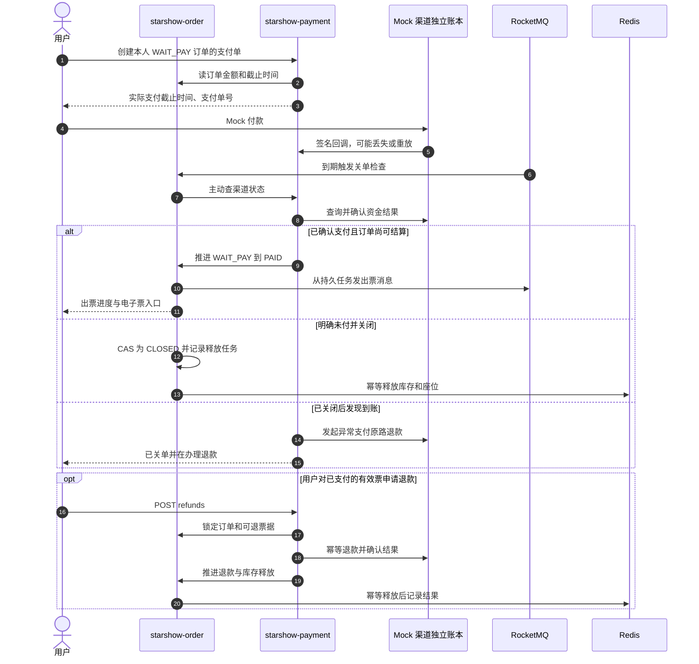

# 板块 04：链路四完整开发设计规格书（Mock 支付 · 超时关单 · 出票 · 退款 Saga · 四方对账）

- **文档状态**　实施规格。运行方式与实证范围见本文末尾。
- **映射模块**　`starshow-payment` 负责渠道与资金，`starshow-order` 负责订单、电子票及库存释放。`starshow-api` 定义跨模块接口。
- **目标里程碑**　Phase 4（`v0.5.0-chain4`）。

用户必须能从订单页确认还可支付多久、付款后是否出票、退款是否已经回到原渠道。订单终态、资金结果、票据状态和库存释放分别落账。它们允许短时间不同步，每一个都要能查看、重试或对账。

## 一、成熟方案调研与项目选型

| 问题 | 采用的方案 |
| --- | --- |
| 支付回调晚到、丢失或重复 | Mock 渠道账和本地支付单分开记账，校验签名、交易单号和订单金额。关单前主动查单，再用订单原状态 CAS 竞争结果。 |
| 延迟关单与任务遗漏 | 用同一 `expire_time` 计算 RocketMQ 绝对投递时间，同时保存同库任务，定时巡检补发。消息到达只表示应检查，消费者以订单截止和渠道结果为准。[RocketMQ 延迟消息](https://rocketmq.apache.org/docs/featureBehavior/02delaymessage/) |
| 出票和退款抢同一订单 | InnoDB 事务按订单、票据的固定顺序检查并更新。订单和票据按同一用户分片，共用原状态 CAS 与唯一键。[InnoDB 锁定读](https://dev.mysql.com/doc/refman/8.0/en/innodb-locking-reads.html) |
| 退款跨资金、票据、库存 | Saga 按步持久化，渠道退款带稳定流水键，库存回补继续用 Redis Lua。已完成的步骤可以重放确认，证据缺失的步骤停留待核对。 |
| 小概率异常要可追溯 | 5 分钟巡检处理未完成业务，T+1 四方对账定位资金、订单和票据差异。重复消费与乱序都以业务状态判断。[RocketMQ 消费重试](https://rocketmq.apache.org/docs/featureBehavior/10consumerretrypolicy/) |

## 二、端到端链路与节点拆解



| 节点 | 主责 | 输出 |
| --- | --- | --- |
| 0　建支付单和模拟扣款 | 支付 | 固定金额、渠道单号与可支付窗口。 |
| 1　支付入账与关单竞争 | 支付 + 订单 | 已支付、已关闭，或待确认与退款。 |
| 2　电子票签发和查询 | 订单 | 已支付后的出票进度和可展示票据。 |
| 3　正常退款与异常退款 | 支付 + 订单 | 资金、旧票和可售库存各有可追踪状态。 |
| 4　巡检与四方对账 | 支付主导，订单按职责修复 | 差异、处理模块、建议动作和处理凭证。 |

## 三、各节点详细业务规则与实现

### 节点 0　建支付单、时间与 Mock 渠道

1. `POST /api/v1/payments` 仅接收本人 `orderNo`。通过 `OrderPaymentFacade.getPayableOrder` 读取实际 `WAIT_PAY`、服务端订单金额和 `expire_time`。支付单按 DB 金额建。支付服务用 `t_payment_order.uk_order_no` 原子仲裁建单与关闭。建单命中已关闭行即拒绝，已有可支付行则复用原截止时间。无单时的关闭也会写入具有唯一订单号的 `CLOSED` 关闭标记，生成内部 `payNo`，该标记不当成用户可付款的支付单。Mock 扣款只允许已登记且未关闭的渠道记录。超时、关闭或退款中的订单返回可理解的下一步。
2. `orderExpireTime = WAIT_PAY 落库时间 + 15 分钟`。`paymentExpireTime = min(支付单创建时刻 + 14 分 30 秒, orderExpireTime - 30 秒)`。进入最后 30 秒后不得新建支付单。已有支付单的查询仍返回当前状态，支付按钮只在实际支付截止前可用。前端用 `serverTime` 校准倒计时，回到页面重新读取服务端时间。
3. Mock 渠道采用独立渠道账本，扣款或退款提交与本站回调处理处于独立事务。以 `payNo`、`refundNo` 作商户请求键，渠道生成独立交易号和确认时间。已支付的相同请求仅返回原结果。演示故障只在隔离环境或已启用演练配置时开放，正常流程的超时和签名校验不因演练入口放宽。
   - 渠道初始化和关单按同一 `payNo` 仲裁。未初始化时也允许先记录渠道账 `CLOSED`，延迟初始化不得覆盖已存在的关闭记录。真实扣款只允许 `INIT` 且尚未过期的渠道记录 CAS 为 `SUCCESS`。订单服务只在拿到渠道已关闭、未扣款的明确凭证后确认关单。
4. 回调以 Mock 配置签名密钥验证，采用 HMAC-SHA256 和恒定时间比较。使用 `X-Mock-Timestamp`（Unix 秒）和 `X-Mock-Signature`（小写十六进制）。签名输入依次为十进制时间戳 UTF-8 字节、单个 LF、原始 JSON 字节。首版允许 300 秒时钟偏差。延迟配送用当前发送时刻重签，支付发生时间仍取原渠道账。回调按渠道交易号和商户请求键去重，合法重复返回 `HTTP 200 / 00000`。验签、订单归属、金额或渠道对不上时，不推进资金和订单。
5. 演练模式沿用 `NONE`、`DUPLICATE_3X`、`DROP_CALLBACK`、`DELAY_20S`、`RACE_WITH_CLOSE`。重复、丢失与延迟只影响回调，渠道账保持原有事实。关单竞速在测试中设同步屏障，明确安排异常到账晚于关单 CAS，才能验证自动退款分支。

### 节点 1　到账、漏回调补单与超时关单

- `PaymentCallbackService` 将验签且匹配的渠道成功写入 `t_payment_order`，同事务记待同步订单动作。提交后调用 `OrderPaymentFacade.applyPaid`。聚合态本地调用，分布式使用内部 OpenFeign。订单只允许从 `WAIT_PAY` CAS 为 `PAID`，同事务写支付流水号、支付时间和出票待办。相同交易已结算时幂等返回，支付侧不重复入账。调用超时时重试同一业务键。
- `OrderTimeoutConsumer` 用持久 `expire_time` 判断是否实际到期。到期后使用短时的 Redisson 订单锁协调，主动查 Mock 渠道。支付服务查到已付时先补记本地入账及待办，再返回可核对支付结果。该调用不反向同步调用订单服务，关单消费者拿到结果后复用订单本地支付确认；支付侧待办补漏。渠道明确未付且已关闭支付能力，执行 `WAIT_PAY → CLOSED` CAS 并保存库存释放任务。查单超时或渠道状态未确定时继续保留订单，退避重试，告警后进入人工核对。Redis/锁故障时无法获得决策则重试，SQL CAS 仍为最终裁决。
- 已按 CAS 进入 `CLOSED` 的订单不得复活。发现迟到的真实到账时将支付单归类为 `ABNORMAL_PAID`，用该 `orderNo` 创建单一异常退款。这个退款只处理资金。关单产生的库存释放任务继续拥有释放责任。页面显示已关闭、原路退款处理中，退款确认后显示退款结果。
- 本人主动取消未支付单走同一确认路径。与自动关单的区别是无需等待 15 分钟，必须由渠道原子关闭尚未支付的付款能力。渠道已扣款时按支付结果处理，用户从订单页查看已付与退款规则。取消过程中先返回待确认，确证 `CLOSED` 后才给出取消成功。
- 一切状态改动在 SQL `WHERE order_no=? AND status=?` 中绑定期望原状态。主动关单和支付回调走同一套状态机。对同一订单的远程查单、签名验证和渠道退款在短本地事务之外完成。

### 节点 2　出票、查询与核销状态

- `TicketIssueConsumer` 处理 `TOPIC_TICKET_ISSUE`，以 `ticket-issue:<orderNo>` 幂等。在订单所属分片以固定顺序锁定订单和票据，校验仍为 `PAID`，按 `qty` 逐张签发，落 `t_ticket_N` 后 CAS `PAID → TICKETED`。订单更新、票据和消费去重在同库事务提交。消息重放时以 `(order_no, ticket_item_no)` 复核张数。
- 手动选座从订单中的固定位置生成展示；自动配座演示按该场次既定票档或区域生成票据，实际售卖编号座时在签发前消费合法的分配结果。出票服务不临时从在售库存选取新座位。已使用或退款锁定的电子票不再作为可用票展示。
- `GET /api/v1/tickets/order/{orderNo}` 仅允许本人。到账后未出票时返回 `ISSUING`、刷新建议，以及已锁定的票档/区域/座位预览信息（不含核销码，减少用户付款后等待出票的焦虑）；票据就绪后才返回签名核销码。签名密钥由环境注入，日志只输出票号与处理结果。验票或退款锁票均以持久票据状态做 CAS，票码签名只证明票面数据的真实性。

### 节点 3　退款 Saga、库存释放与三项结果

| Saga 步骤 | 正常退款 | 关单后迟到支付的异常退款 |
| --- | --- | --- |
| `INIT` | 校验本人、退款窗口、付款与可退资格，固定金额与业务键。演示默认开演前、票尚未核销可申请整单原路退款。重放返回原 `refundNo`。 | 校验 `CLOSED + ABNORMAL_PAID` 与渠道到账事实，自动建退款。 |
| `LOCK_TICKET` | 订单和票据在订单库事务中锁定。已核销票拒退。`PAID/TICKETED → REFUNDING`，已出票设为 `LOCKED`，未出票的订单进入 `REFUNDING` 后不再出票。 | 订单保持 `CLOSED`，验明没有新增有效票据后记录跳过。 |
| `REFUND_PAY` | 用 `refundNo` 向渠道退款。超时先按同键查结果，回放不重复打款。渠道成功后写 `pay_refund_status=SUCCESS` 与渠道退款号。 | 相同资金处理。 |
| `ROLLBACK_STOCK` | 订单模块确认渠道退款后，**在同一 MySQL 事务内将锁定票据置为 `REFUNDED`、将 `t_order.active_flag = order_no` 释放重抢资格、回补 DB 物理库存并提交释放任务（记录 `db_released_at`）**，随后再执行 Redis Lua 回补库存、座位并 `SREM bought`（确保用户收到退款成功当秒即可合法重抢，绝不撞 `uk_user_show_active`）。 | 库存由原关单动作处理，本 Saga 跳过库存回补。 |
| `DONE` | 资金已退、票据不可用且库存释放确认后，订单 CAS `REFUNDING → REFUNDED`。 | 资金确认退款后结束，订单仍为 `CLOSED`。 |

- 正常退款和异常退款分别使用 `NORMAL` / `ABNORMAL_PAID` 类型，`t_refund_order.uk_order_no` 在首版保证一个订单一个全额退款。锁票前拒退返回原因，原订单与原票保持可用条件。锁票后遇渠道明确拒绝或资金结果无法确认，进入人工核对，保留票据锁和退款步骤，不自动恢复可使用。页面明确区分退款处理中、已退回和需核对。已经退回资金但释放未决时，用户看到原路退款已确认，售卖侧另查释放进度。
- 申请预校验确证不可退时直接返回 `A0404`，不占退款单唯一键。已接受的申请保留同一 `refundNo`，短暂的资格查询或锁票失败重试原单。锁票阶段确证票已核销或退款条件永久不满足时，记录原申请的终止原因，资金环节不得启动。
- 库存释放归 `starshow-order`，使用 `t_order_action` 的 `RELEASE_STOCK` 持久业务键，同单只有一个释放动作。`CLOSED` 的订单更新和动作记录同事务提交。正常退款在满足票据不可用及资金确认后发布同类动作，动作用 `PENDING / RELEASED / MANUAL_CHECK` 记录。为有界恢复额外记录 `attempted_at`、数量、席位与策略快照，首次确认没有执行记录才能直接执行。
- 已落库订单释放时，先锁定同订单释放任务，在同一 MySQL 事务内确保 `active_flag = order_no` 已生效、按原订单数量回补 `t_ticket_tier.available_stock` 并记录 `db_released_at`。库存上限不超过初始化总量，事务重放看该字段不重复加。DB 提交后再执行 V4 的 Redis 库存/座位与 `bought` 回补，彻底杜绝“Redis 已放行原用户重抢、但 DB `active_flag` 仍为 1 导致落库撞唯一键”的顺序竞态。未落单拒绝的预扣没有发生 DB 扣减，只释放 Redis。V1～V3 的隔离演练按原 DB 路径释放库存和座位，写 `db_released_at` 后同事务完成所有释放。
- V4 释放用 `seckill_rollback.lua`。调用前以订单或预扣凭证核对 `showId, tierId, userId, qty, seatIndices`，只撤本订单持有的占用。Lua 按同槽 `bought_owner` 匹配归属，在写入前校验所有将读取或更新的 Key 类型、数量范围和合法索引，再更新余额、位图、已购状态和悬挂索引。增加只表示实际完成释放的 `stock_release_receipt`。`rollback_done` 继续承担防悬挂及幂等保护，存在墓碑本身不能证明曾经回补。
- Redis 回补结果明确成功后，MySQL 记 `RELEASED`。调用超时先查同订单释放凭证，确认已回补时只补写账本。超出凭证可靠期且缺少订单级证据时标 `MANUAL_CHECK`，不依据当前总余量或 `PENDING` 直接累加。人工修复通过同一动作入口和业务键完成。

### 节点 4　巡检与 T+1 四方对账

1. 每 5 分钟处理三类可定位任务。第一类从已知场次的 `deduct_pending` 用 `ZRANGEBYSCORE` 拉超过 5 分钟的在途预扣。第二类在各订单分片用 `idx_status_expire` 读取到期后仍待支付的记录，沿用主动查单关单。第三类按动作表 `next_retry_at` 游标处理未发送出票、释放、同步支付和退款步骤。每次有限批量，租约和原状态 CAS 防多实例冲突。
2. T+1 基于 `Asia/Shanghai` 账日和固定取数水位。按渠道到账、退款确认流水连到 `t_payment_order / t_refund_order`、`t_order_N`、`t_ticket_N`；存在本站订单无渠道回执时也要纳入。按订单号查分片，使用稳定游标可断点续跑。跨天到账和退款按结算日、原订单和业务键关联，水位后新事实交下一轮，避免把进行中的操作直接列为终态差异。
3. `t_reconciliation_diff` 按 `(bill_date,order_no,diff_type)` 去重，保存脱敏四方摘要、预期与实际金额、负责模块、建议动作、处理状态和审计轨迹。同日重复执行更新原记录。自动修复只在证据完整时提交已有业务动作，另留审计记录。金额差和释放归属无法确认时交人工核对。

| 差异类型 | 负责模块 | 复核与动作 |
| --- | --- | --- |
| `PAID_NO_TICKET` | `starshow-order` | 本地已付而票据不足，且订单允许出票时重放出票任务。 |
| `REFUNDED_STOCK_NOT_RELEASED` | `starshow-order` | 资金已退，核对票据状态与订单释放账，再完成或转人工。 |
| `DUPLICATE_STOCK_ROLLBACK` / `STOCK_DRIFT` | `starshow-order` | 冻结该单自动释放，核对归属和日志，按有权限的处理流程修复。 |
| `SHORT / LONG / AMOUNT_OR_FUND_MISMATCH` | `starshow-payment` | 核对到账和退款渠道流水、实际分值，查出明确结论后推进。 |
| `STATE_MISMATCH` | 对应状态主责方 | 记录不一致环节。异常到账按原状态机办理，已关闭订单保持终态。 |

## 四、HTTP、存储、消息和配置契约

### 1. REST 与跨模块接口

| 方法与路径 | 输入 / 输出要点 | 权限 |
| --- | --- | --- |
| `POST /api/v1/payments` | `{orderNo}` → `{payNo,orderNo,amountCent,paymentStatus,paymentExpireTime,orderExpireTime,serverTime}`。重复提单复用原支付单。 | 本人 |
| `GET /api/v1/payments/{payNo}` | `{payNo,orderNo,amountCent,paymentStatus,paymentExpireTime,orderExpireTime,serverTime,nextAction,abnormalRefundNo?,abnormalRefundStatus?}`。用于掉线或支付跳转后恢复，关单后异常到账时同页直接给出自动退款单号与进度。 | 本人 |
| `GET /api/v1/payments/order/{orderNo}` | 凭订单号找回上述支付视图。 | 本人 |
| `POST /api/v1/payments/mock/pay/{payNo}` | 可选 `fault`，返回模拟渠道受理状态。最终支付结果以后续查询为准。 | 本人 + 演练配置 |
| `POST /api/v1/payments/callback` | 签名头，`payNo,orderNo,channelTradeNo,amountCent,channelStatus,paidTime`。合法重放按成功应答。 | 签名 |
| `POST /api/v1/orders/{orderNo}/cancel` | `{orderNo,orderStatus,nextAction}`，仅在渠道确认为未付且已关闭时推进关单。 | 本人 |
| `GET /api/v1/tickets/order/{orderNo}` | `{orderNo,issueStatus,seatPreview?,tickets[]}`。未出票时不含可用核销码但可预览已锁定区/座信息。 | 本人 |
| `POST /api/v1/refunds` | `{orderNo,reason}` → `{refundNo,orderNo,amountCent,refundStatus}`。 | 本人 |
| `GET /api/v1/refunds/{refundNo}` | `{refundNo,orderNo,amountCent,refundStatus,payRefundStatus,updatedAt,nextAction}`。按本人订单保护。 | 本人 |
| `GET /api/v1/refunds/order/{orderNo}` | 凭订单号找回退款申请及资金状态。 | 本人 |
| `POST /internal/reconciliation/run` / `GET /internal/reconciliation/diffs` | 触发 `{mode,billDate?}`，返回运行标识。差异以 `billDate,status,cursor,limit` 分页查询。 | 内部密钥（公网零路由） |

沿用 `A0304`（订单不可见）、`A0305`（订单状态不允许）、`A0401`（支付单不存在）、`A0402`（验签失败）、`A0403`（金额不符）、`A0404`（不可退款）。拟增 `A0405`（支付窗口已关闭）、`A0406`（退款单不存在）、`C0401`（渠道暂无法确认，HTTP 503）。非本人支付或退款与不存在采用同一业务码。访客页面只接收支付和退款所需字段，运维补偿详情仅管理端可见。

| 返回信号 | 页面行为 |
| --- | --- |
| 支付 `INIT + PAY` | 当前还可支付，显示剩余时间并提交到同一支付单。 |
| 支付 `INIT + CHECK_PAYMENT` | 本次渠道结果待确认，复查原支付单。 |
| 支付 `SUCCESS + VIEW_ORDER` | 已付款，返回订单查看出票进度。 |
| 支付 `CLOSED + VIEW_ORDER` / `ABNORMAL_PAID + VIEW_REFUND` | 分别查看关闭原因或异常原路退款。 |
| 退款 `PROCESSING + CHECK_REFUND` / `SUCCESS + VIEW_ORDER` / `FAILED + CONTACT_SUPPORT` | 依次表示退款处理中、资金确定退回、终态失败需协助。另按 `payRefundStatus` 展示 `PENDING / SUCCESS / MANUAL_CHECK`，便于区分资金与其他售后步骤。 |

当 `refundStatus=PROCESSING` 但 `payRefundStatus=SUCCESS` 时，退款页显示原路退款已确认，订单和库存仍在收尾。`payRefundStatus=MANUAL_CHECK` 时显示退款结果待核对，引导用户查看原退款单或联系支持。

`OrderPaymentFacade` 提供读取可支付订单、确认到账、锁退款票据、提交退款结果。`PaymentReadFacade` 提供查渠道状态及到期关闭支付能力。跨模块调用单进程走本地 Bean，分布式走内部 OpenFeign，使用已有内部鉴权和 Trace ID。事务和 Mapper 各由所属模块管理。Gateway 仅给准确的 `POST /api/v1/payments/callback` 开签名入口，由支付服务负责验签，其余需登录或只允许内部访问。

付款返回后可查询同一支付单。处于确认中时继续查原单，服务端按渠道确认更新最终状态。

```json
{
  "payNo": "123456789123456790",
  "orderNo": "123456789123456789",
  "amountCent": "68000",
  "paymentStatus": "INIT",
  "nextAction": "CHECK_PAYMENT",
  "paymentExpireTime": "2026-11-20T20:14:30+08:00",
  "orderExpireTime": "2026-11-20T20:15:00+08:00",
  "serverTime": "2026-11-20T20:00:05+08:00"
}
```

### 2. MySQL 与 Redis

| 存储 | 计划契约 |
| --- | --- |
| `t_order_0..3` / `t_ticket_0..3` | 保持基因路由和状态 CAS。票据拟增 `ticket_item_no SMALLINT`，唯一 `(order_no,ticket_item_no)`。订单保留实际付款、关闭原因、截止时间和出票结果。 |
| `t_payment_order` | 沿用订单唯一及渠道流水唯一。拟增支付结果同步动作状态或以 `t_payment_action` 落持久待办。渠道结果与动作同库提交。 |
| `t_refund_order` | 拟增 `refund_type`、`pay_refund_status`、`channel_refund_no`、`next_retry_at` 与 `last_error_code`。资金确认后落独立退款结果，Saga 仍负责继续推进票据和库存。 |
| `t_mock_channel_txn` | 拟建独立模拟账本，记录 `kind, merchant_biz_no, channel_trade_no, amount_cent, state, confirmed_at`。唯一 `(kind,merchant_biz_no)` 与渠道流水索引。金额字段统一 BIGINT 分。 |
| `t_order_action / t_payment_action` | 稳定业务键、状态、尝试次数、调度时间、租约、结果。释放动作加 `db_released_at DATETIME NULL`。订单侧与订单分片同库提交，支付侧与支付或退款状态同库提交。 |
| `t_reconciliation_diff` | 增差异唯一键、`owner_module`、`suggested_action` 和处理凭证，保留审计记录。 |
| Redis | 保留 `starshow:lock:order:<orderNo>`、`deduct_pending`、`rollback_done`。增 `starshow:stock_release_receipt:{showId}:<orderNo>`，记录 `releaseId, qty, appliedAt`；和释放脚本其余 Key 同槽。可靠保存期需覆盖常规重试和巡检窗口。 |

### 3. RocketMQ、组件和配置

| Topic | 业务键与载荷 | 执行 |
| --- | --- | --- |
| `TOPIC_ORDER_TIMEOUT` | `close-check:<orderNo>`，`orderNo,userId,showId,expireTime,traceId`。 | 绝对时间延迟，收到后检查实际截止和资金。 |
| `TOPIC_TICKET_ISSUE` | `ticket-issue:<orderNo>`，`orderNo,userId,showId,orderVersion?,traceId`。 | 从订单事务持久待办补发，`cg-ticket-issue` 幂等签票。 |
| `TOPIC_REFUND_EVENT` | `refund:<refundNo>:<step>`，`refundNo,orderNo,userId,refundType,step,traceId`。 | 按 `orderNo` 路由顺序消费，仍按当前 Saga 状态决定推进。 |

拟实现 `PaymentController → PaymentApplicationService`、`PaymentCallbackService`、`MockPayChannelClient`、`RefundSagaService`、`ReconciliationService`。订单侧实现 `OrderTimeoutConsumer`、`TicketIssueConsumer`、`OrderStockReleaseService`。保留 Spring Boot、MyBatis-Plus、Redis/Redisson、RocketMQ 5.x、OpenFeign 和现有调度组件。支付保护窗默认 30 秒，关单 15 分钟。Mock 签名密钥与电子票签名密钥按环境分别注入，配置示例仅给占位。演练开关与缩短时钟配置仅用于隔离验证。

| 计划配置 | 初值与用途 |
| --- | --- |
| `starshow.payment.channel-expire-seconds` / `starshow.order.expire-seconds` / `starshow.payment.close-guard-seconds` | `870` / `900` / `30`，统一购买时间口径。 |
| `starshow.payment.signature-skew-seconds` | `300`，容许的签名请求时间偏差。 |
| `starshow.reconciliation.sweep-interval-seconds` / `starshow.reconciliation.sweep-batch-size` | `300` / `100`，按索引有界补偿。 |
| `starshow.payment.mock.fault-enabled` | 默认 `false`，只在隔离演练开启。 |
| `STARSHOW_MOCK_PAY_SIGN_SECRET` / `STARSHOW_TICKET_SIGN_SECRET` | 需独立注入，按用途校验，日志只标明配置项。 |

## 五、异常边界与用户体验

| 场景 | 系统怎样恢复 | 用户下一步 |
| --- | --- | --- |
| 前端晚创建支付单 | 服务端计算真实截止，最后 30 秒截止新建。 | 显示剩余时间或已过期。 |
| 回调丢失、支付页跳转失败 | 查询支付单并主动查渠道，确认后补单出票。 | 显示支付结果确认中，可回到订单页继续查。 |
| 支付回调重复或乱序 | 流水业务键去重，各状态用 CAS。 | 一笔有效支付和一组按张数签发的票。 |
| 已付款而出票排队 | 持久出票待办可补发。 | 显示已支付，出票中，保留电子票入口。 |
| 已关单订单晚到账 | 保持订单关闭，原路退款。 | 同页查看退款进度，不再次支付旧单。 |
| 已核销后申请退款 | 订单库和票据状态原子拒绝锁票。 | 显示明确的不可退原因。 |
| 渠道退款成功，库存释放未确认 | 保留资金成功，后续释放只凭订单级证据补偿。 | 可看到退款结果，运营另查库存回补。 |

## 六、跨板块影响矩阵

| 模块或阶段 | 需要对接 | 职责 |
| --- | --- | --- |
| 链路一 `starshow-user` | 同一登录态和本人订单权限。 | 支付与票据不携带实名原文。 |
| 链路二 `starshow-show` | 权威释放结果后刷新可售余量。 | 售卖时间与显示状态按场次管理，停售后不重新开放。 |
| 链路三 `starshow-order` | `WAIT_PAY` 订单、金额、截止、基因路由与持久任务。 | 决定订单和票据状态，负责库存动作归属。 |
| `starshow-payment / api / common` | Mock 账、支付与退款单、RPC DTO、消息业务键、签名与统一错误码。 | 金额和状态严格从权威存储读，模块通过接口协作。 |
| Phase 5 / 6 | 资金故障演练和购买体验。 | 展示可见的倒计时、出票、超时退款、余票释放与可复跑对账。 |

## 七、Prove-It 设计验收与实施顺序

| 门禁 | 实跑剧本与断言 |
| --- | --- |
| L1 | 支付两上限及边界时间、签名篡改、支付金额校验、订单与 Saga 合法状态、状态查询归属、票码校验、多张票唯一约束。 |
| L3 继承链路三 | 验证 Half 丢 COMMIT 回查自动补单，以及回查先落墓碑、迟到预扣返回 `-3`。 |
| L3 重复和掉回调 | 5 次渠道回调只保留一笔支付，票据数等于 `qty`。`DROP_CALLBACK` 后关单前主动查到已付，订单出票不误关。 |
| L3 关单竞速 | `RACE_WITH_CLOSE` 先确认 `CLOSED` 再送达真实成功。订单终态保持，只有一笔异常原路退款且无额外库存回补。另验取消与首次建支付单同时到达，关闭标记获胜后无可扣款单。锁失败或查单未知不会扩大可售库存。 |
| L3 退款 Saga | 在锁票、渠道已退款但响应丢失、回补后未记账处分别终止并重启。最终只有一次渠道退款和一次库存/座位释放；竞速核销成功的票不可被退款流程释放。 |
| L3 状态与消息 | 订单提交后禁发 MQ，巡检按待办补出票/释放。释放凭证人为超期后只在证据充分时推进，无证据的进入 `MANUAL_CHECK`。 |
| L3 对账 | 预置长款、短款、已付未出票、已退未释放。扫描命中预期类型与责任模块，同一账日复跑不新增重复差异，自动修复回执可查。 |
| 双形态 | 独立原包与聚合模式在隔离数据下完成付款→出票→退款，以及未付关闭→余票回流。构造先卖完、再释放一张、另一用户重新买到，核对 Redis 与 MySQL 库存均只回补一次。逐单对照资金、订单和票据，检查默认库哨兵安全。 |

实施顺序为渠道账与受理接口 → 回调/关单共用状态机 → 出票 → 退款 Saga 与释放凭证 → 双重对账和演练。L1 使用 `mvn -B -pl starshow-payment,starshow-order -am test`。L3 使用真实 MySQL、Redis 和 RocketMQ，Mock 渠道作为有独立账本的业务模拟组件，隔离测试工具只用于控制时序和注入故障。

## 八、运行与实施口径

1. 已有实例按当前数据库版本依次导入 `docker/mysql/migrations/V2__phase2_show_inventory.sql`、`V3__phase3_order_seckill.sql`、`V4__phase4_payment_fulfillment.sql`，每次显式指定目标 schema。新建库使用 `docker/mysql/init/01_schema.sql`。票据新增序号列允许存量记录为 NULL，新签票据使用从 1 开始的序号。若已有重复对账记录，升级前先人工确认归档，唯一索引会拒绝重复键。
2. 聚合态和独立订单服务通过 `STARSHOW_PAYMENT_ENABLED=true` 启用链路四。独立支付包以 `distributed` 启动，默认端口 8004。订单与支付实例使用相同 JVM 时区，按部署规范设置为 Asia/Shanghai。分别注入独立的 `STARSHOW_MOCK_PAY_SIGN_SECRET` 和 `STARSHOW_TICKET_SIGN_SECRET`，以及项目已有内部鉴权密钥。Mock 扣款与故障开关默认关闭，可分别在隔离演练环境开启。
3. MQ 初始化需有 `TOPIC_ORDER_TIMEOUT`（DELAY）、`TOPIC_TICKET_ISSUE`（NORMAL）、`TOPIC_REFUND_EVENT`（NORMAL）。出票待办以 `ticket-issue:<orderNo>` 唯一标识，Broker 不可用或延迟时由数据库待办继续推进。退款消息用于启动 Saga，后续步骤直接扫描退款表的 `status,next_retry_at` 索引，数据库 CAS 和渠道退款键裁决重放。
4. 关单和退款提交后通过同单 `RELEASE_STOCK` 动作推进。DB 物理库存依据 `db_released_at` 只回补一次，V4 同槽 Lua 在核验实际持有者、Key 类型及座位索引后释放热库存并写入 `orderNo:qty` 独立回执。只有墓碑、凭证超期或占有归属不明时，保留 `MANUAL_CHECK`。V1～V3 在 MySQL 释放物理库存及所选座位。
5. T+1 以上海账日的左闭右开区间发现候选订单，再读取四方当前可核对状态。管理端可从 `nextCursor` 重跑同账日，差异记录按账日、单号、类型去重。当前实现保留差异和自动补出票结果。金额或库存证据不足时留待人工核对；以历史时点重建完整流水快照属于后续加强。
6. 串行实跑使用 `scripts/verify-live-tests.ps1 -Chain Chain4`。脚本使用新 schema、空闲的非 0 Redis DB，限制测试 JVM 堆内存为 288 MiB，保留既有并发与断言。打包后可追加 `-FromPhase2Schema -Distributed`，验证存量库升级及订单、支付原始发行包的 Feign 联调，每个服务堆上限 192 MiB。

## 九、2026-11-21 实证结果

- L1 共 90 项常规测试通过，四条链路的真实中间件测试共 24 项通过。链路四的 7 项覆盖 5 次回调只有一张票、漏回调主动查单、已关闭订单迟到到账后单次退款、正常退款重放、核销后禁退、注入 1 分差异以及墓碑和错误持有人不得改库存。
- Phase 2 存量订单经过 V3 与 V4 迁移并重复执行后仍保留原金额和状态。分布式发行包联调实测付款 → 出票 → 原路退款，以及未支付取消 → 回补，Redis 和 MySQL 均从 0 恢复至 2。
- 这轮通过持久步骤重放覆盖了 Redis 已释放且数据库待补记的情形。进程强杀重启的每个退款断点、全量历史账本重建和 Phase 5 的容量测试仍需单独验证。
