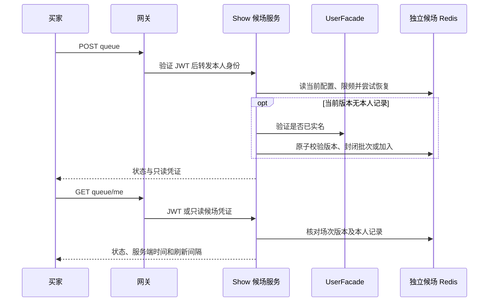

# 独立候场设计规格

**评审状态** 已确认（2026-11-22）

**适用任务** [ISSUE-015](../issues/ISSUE-015-waiting-room.md)

## 1. 方案与选型

复用开售前统一随机排序、开售后按到达顺序排队的做法。开售前每个账号只分配一次随机排序键。封闭预排批次时冻结批次人数，Redis 无须重新排列整个有序集合。正式开售后由服务端分配递增序号，新记录全部排在预排批次之后。[Cloudflare 候场事件](https://developers.cloudflare.com/api/resources/waiting_rooms/)

网关复用现有 JWT 鉴权，Show 服务承载候场接口和页面数据。候场使用独立 Redis 实例、连接池和超时配置，关闭淘汰并用 AOF 持久化。以同场次单槽 Lua 完成边界判定、唯一绑定、封闭与入队。预排的排序键和后排的序号分别存入两个有序集合，状态轮询只读小记录；内部验证可用 `ZRANK` 计算位置。[Redis Lua](https://redis.io/docs/latest/develop/programmability/eval-intro/) · [Redis 有序集合](https://redis.io/docs/latest/commands/zadd/) · [Redis 持久化](https://redis.io/docs/latest/operate/oss_and_stack/management/persistence/)

通过显式场次配置启用候场。启用后可在开售前进入，窗口结束时关闭候场。首发用已实名账号作为证件唯一性的等价标识，由用户域的一证一账号唯一索引支撑。018 和 021 接入后可以改用场次级身份标识。

## 2. 调用链

## 3. 节点实现

1. **配置发布**。MySQL 的 `t_show` 决定开售版本与时间。对已启用的场次，由后台任务读取静态场次字段并将 `version, saleStartMs, saleEndMs` 投影到候场 Redis。初次发布生成一次服务端随机种子。其后对同版本的刷新保留种子和原有批次。投影未就绪时接口返回可重试的等待状态。
2. **入队与恢复**。`WaitingRoomController` 取 `UserContext`。Application Service 先使用候场命名空间限频，再尝试按账号读当前记录；已绑定用户直接恢复，首次绑定才调用 `UserFacade.isRealNameVerified`。Lua 在写入前再次核对场次版本、证件与账号映射和 Redis 服务端时间。若并发创建成功，只返回已存在记录。首发身份键为 `account:<userId>`，存储同时校验账号和身份两个索引，任何身份键都由服务端派生。
3. **批次与顺序**。使用 Redis `TIME` 的毫秒值。小于 `T0` 的记录进入同版预排集合，排序键为以该代随机种子签出的 `HMAC-SHA256(queueId)`，摘要相同按服务端顺序号确定先后。随机 ID 由服务端生成。第一个达到 `T0` 的入队写操作或后台封闭任务原子冻结 `preCount`，同版只有一次封闭。等于及晚于 `T0` 的新记录进入后排集合，分数为同场版本原子递增序号。内部顺序读取以预排集合顺序加后排集合顺序为准。超过 Redis 有序集合能精确表示的整数序号上限时停止接收新记录。
4. **个人状态**。候场业务查询只访问独立候场 Redis，本人 JWT 仍按现有规则检查黑名单。只读凭证以独立密钥使用 HS256 签发，绑定用途 `queue-read`、账号、场次、开售版本、队列记录及到期时间。建议 5 分钟，截止不超过记录有效期。JWT 与只读凭证同时传入时须属于同一账号，错误或过期的凭证不返回其他人的记录。JWT 恢复可由新设备重新登录后查询或重入，同版重入保持队列 ID 和顺序。
5. **候场页面**。`web-console/waiting-room.html` 显示开售时间、预排规则和当前状态。轮询按服务端建议的 20～30 秒间隔调度，后台暂停，回到前台仍遵守退避。浏览器只在当前标签页保存短期只读凭证。缺乏可信等待估计时显示「仍在排队」。场次改期时展示新时间和重入入口。

## 4. 接口与存储

| 方法 | 鉴权、输入与结果 |
| --- | --- |
| `POST /api/v1/shows/{showId}/queue` | JWT，正整数场次 ID，可选请求体 `saleConfigVersion`。成功 `200` 返回本人状态和 `queueReadToken`；停售返回 `ENDED`。请求版本不一致返回 `A0205`、当前版本、开售时间和 `REJOIN_QUEUE`。未实名为 `A0104`、`VERIFY_IDENTITY`，超过频率为 `429/B0101` 和 `Retry-After`。 |
| `GET /api/v1/shows/{showId}/queue/me` | JWT 或 `X-Queue-Read-Token`。状态为 `WAITING`、`EXPIRED` 或 `ENDED`，同时返回 `saleConfigVersion, saleStartTime, serverTime, retryAfterMs, nextAction`。存在本人记录时可返回 `queueId, expiresAt`；确有估计依据后才提供 `waitEstimate`。该路由只读。 |

个人响应包含 `Cache-Control: no-store`，包括版本变化和失败响应。JWT 或只读凭证验签失败返回 `401/A0101`，JWT 注销继续使用 `401/A0102`。凭证只从专用请求头读取，不接受 URL 参数。未开放候场的场次返回 `A0201`，客户端停止该场次的轮询。候场 Redis 或配置投影不可用时返回 `503/B0202` 和 `Retry-After`，页面保留已知身份与候场提示。后续准入接口由 016 单独定义。

| Redis Key | 内容与清理 |
| --- | --- |
| `starshow:queue:{showId}:meta` | 当前配置版本、售卖时间、随机种子、改期栅栏。版本发布只前进，同版修复以栅栏归属为准。 |
| `starshow:queue:{showId}:v:<version>:state` | 批次封闭标记、`preCount`、入队序号。 |
| `starshow:queue:{showId}:v:<version>:accounts`、`:identities`、`:records` | 账号与身份各自的唯一映射，以及按 `queueId` 存储的本人记录。记录含 `userId, identityKey, phase, rankKey, expiresAt`。 |
| `starshow:queue:{showId}:v:<version>:pre`、`:post` | 预排集合的成员按固定摘要键排序，后排集合按序号排序。记录在销售窗口结束时失效，各代 Key 统一在窗口结束后 24 小时过期。 |
| `starshow:queue:{showId}:join-limit:<userId>` | 用原子计数和短 TTL 限制加入或续发凭证，初始预算每账号每场每分钟 6 次。 |

Redis Key 由 `RedisKeys` 构造，脚本只使用显式 `KEYS` 参数，共享同一个 `{showId}`。开关、独立 Redis URI 与专用签名密钥从环境变量注入。`starshow-show` 通过独立存储适配器持有候场连接，保留 Spring Boot 原有 Redis 连接装配。分布式补齐 `UserFacade` 的 Show 端 OpenFeign 适配器，复用已有本人实名校验接口。存储方案沿用既有 MySQL 表和消息契约。

## 5. 边界与故障

- **改期**。已启用场次在 MySQL 提交新版本前先对候场旧版本原子加栅栏。提交后由现有 `RESCHEDULE_SYNC` 待办发布新代，下一次状态查询得到新版本与重入提示。旧记录保留至有效期结束，跨代凭证无法恢复旧位。进程在提交前退出时，后台在持有现有场次操作锁的条件下按 MySQL 真实版本修复栅栏，同时保留原代记录和种子。持锁校验及栅栏标识防止慢恢复覆盖已提交新代。已启用场次若无法写入栅栏，改期可重试。
- **时钟与并发**。Lua 用 Redis 时间分类。并发到达 T0 或并发重入时，操作在同一场次的 Redis 槽串行决策。批次封闭后，同版预排的次序和人数保持稳定。
- **候场存储故障**。失败快速返回等待页与建议重试，客户端保持原有队列凭证。恢复后复用原代种子、序号和记录。测试对保持磁盘数据的临时 Redis 执行断连与重启；公网吞吐及跨节点持久化故障的验收由 027 补齐。
- **实名服务故障**。已入队者可恢复和查状态，首次入队等待依赖恢复。JWT 路由依照既有黑名单规则；短期只读凭证只能查看绑定的记录。

## 6. 跨模块影响

| 模块 | 接入 |
| --- | --- |
| `starshow-gateway` | 将精确的 `GET queue/me` 从演出 GET 的宽白名单规则中挑出。存在 JWT 时走既有校验。仅持专用头的 GET 由 Show 服务验签。POST 始终认证 JWT。 |
| `starshow-show` | 增加候场 API、应用服务、独立 Redis 适配器与场次配置投影，复用改期待办。 |
| `starshow-api` 与 `starshow-user` | 复用 `UserFacade`、内部已实名查询和一证一账号约束。 |
| `starshow-order`、`starshow-payment` | 交易入口、订单状态机、库存与支付路径维持既有契约。016 通过版本化队列次序消费准入候选。 |
| 演示台与压测 | 交付独立候场页。027 测量候场读写与交易的独立预算。 |

## 7. 云端验收

全部 Maven、Node、浏览器和运行态测试在同一台云服务器的本轮私有临时目录中串行运行。公开基线由云端拉取，叠加 ISSUE-015 的变更清单。候场单独启用回环 Redis 和专用数据目录，启动前核实资源归属，结束后回收临时容器、进程和凭据。[项目测试约定](../TESTING.md)

| 级别 | 实证断言 |
| --- | --- |
| L1 | 用可控服务端时钟测试 `T0−1ms`、`T0`、`T0+1ms`，以及 `saleEnd−1ms` 与停售时刻。覆盖重复、换设备、跨用户、跨场、错用途、过期、改期和限频。测试用 clock seam 不暴露在 HTTP 请求或部署配置中。 |
| L2 | 两个实例共享独立 Redis，200 路请求同时入队并跨越批次封闭。断言同账号及同身份各一条活动记录，封闭一次，全部后排位置晚于预排。并行注入改期，证明旧版本凭证无法恢复到新代。 |
| L3 | 运行状态查询洪峰并记录依赖调用计数，查询路径订单库、实名库、实时库存槽和短信调用均为 0。故障时返回 `503` 且不创建记录，保留 AOF 数据重启后对比队列 ID 和排序键。Firefox 在云端用实际请求或脱敏接口样例验看低频刷新、恢复、改期与等待提示。 |

2026-11-22 云端预检通过。公开基线 `585ddad` 的网关 JWT 与限流单测共 7 项通过。独立 Redis 7.0.15 探针验证了服务端时间及 AOF 重启后的序号和排序，临时实例已回收。ISSUE-015 的功能验收仍待实现。
