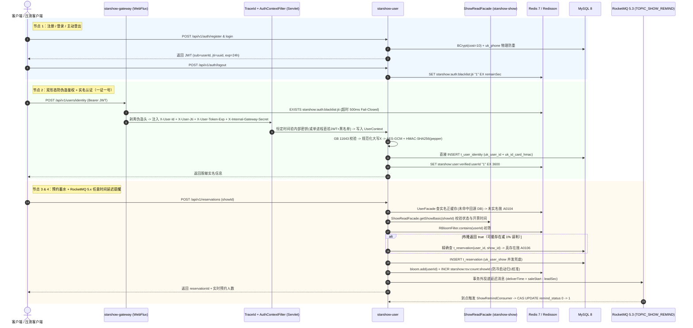

# [Epic][Phase 1] 链路一：鉴权、实名防黄牛、预约蓄水与开票延迟提醒全链路实现

> **导航锚点**：严格遵循 `AGENTS.md`、`.agents/skills/starshow/SKILL.md`（O(1) 路由 `chain1_user_reservation`）与 `.agents/skills/prove-it/SKILL.md` 编写，完整收敛链路一规格书（`docs/domains/01-user-reservation.md`）以及结合当前 Phase 0 真实仓库代码交叉审计出的关键工程补全方案。

> 2026-11-20 终版复验全部通过：51 项常规测试、4 项真实 Docker 中间件故障/并发/积压测试、双形态原始发行包（含 4 入口缺密拒绝、两进程中断计数恢复、隔离库哨兵完好与中途失败清理）全部实跑通过，`ISSUE-002` ~ `ISSUE-010` 全部关闭。见 [进度账本](../PROGRESS.md) 与 [终版复验回执](./ISSUE-007-chain1-acceptance-evidence.md#2026-11-20-终版复验回执issue-008--issue-010-闭环)。

---

## 1. 背景与目标（Background & Objectives）

StarShow（星演票务）的架构主线是「一切为开票那一秒让路——分层削峰、冷热分治、强一致只留给库存与资金」。Phase 0（`v0.1.0-infra`）已完成多模块骨架、MySQL 14 表 DDL、3 套 Lua 契约及 `starshow-common` 核心纯 Java 工具（`CryptoUtil`、`GeneSnowflakeIdGenerator`、`RedisKeys`、`OrderStateMachine`）。

本 Epic 负责闭环交付 **Phase 1（链路一，目标 Tag `v0.2.0-chain1`）**，在开票前完成三项核心基础设施与业务蓄水能力：

1. **全链路统一 Web 底座与双形态安全边界**：落地 `TraceIdFilter`、`GlobalExceptionHandler`、`UserContext`、`JwtTokenProvider`，打通分布式网关（`starshow-gateway`）与单进程聚合态（`starshow-boot-all`）一致的 JWT 鉴权、JTI 黑名单踢人与防 `X-User-Id` 请求头伪造机制。
2. **一证一账号实名防黄牛**：落地 GB 11643-1999 身份证校验 + `AES-256-GCM` 密文落库 + `HMAC-SHA256(pepper)` 数据库唯一索引物理防抢绑，并对外提供带 Redis 正缓存加速的 `UserFacade.isRealNameVerified`。
3. **高并发预约蓄水与 RocketMQ 5.x 任意时间延迟开票提醒**：落地 Redisson 布隆过滤器初筛（含防 1% 误判回查 DB 策略）+ MySQL `uk_user_show` 兜底 + Redis 实时蓄水计数 + RocketMQ 5.x 绝对时间延迟消息生产与幂等消费。

---

## 2. 范围界定（Scope）

### In-Scope（本期必做）
- **`starshow-common`**：Web 底座自动装配（Servlet 条件隔离）、`TraceIdFilter`、`UserContext`、`AuthContextServletFilter`、`TokenBlacklistChecker` SPI、`GlobalExceptionHandler`、`JwtTokenProvider`、`IdCardValidator`、`StarShowSecurityProperties`、`GeneSnowflakeIdGenerator` Bean 注册、新增 `ErrorCode` 与 `RedisKeys.userVerified`。
- **`starshow-api`**：新增 `ShowBasicDTO`、`ShowRemindEvent`；扩展 `ShowReadFacade.getShowBasic(long showId)`。
- **`starshow-gateway`**：`TraceIdGlobalFilter` + `JwtAuthGlobalFilter`（按 Method + Path 白名单放行、JWT 验签、Reactive Redis 黑名单短超时查询、剥离伪造头并注入可信头）。
- **`starshow-show`**：提供最简 `ShowReadFacadeImpl`（直查 `t_show` 支撑链路一校验，Phase 2 无缝升级为 L1+L2 缓存）及分布式模式内部只读端点 `/internal/shows/{showId}/basic`。
- **`starshow-user`**：注册/登录/登出、实名认证与查询、`UserFacadeImpl`（含实名正缓存）、预约蓄水与计数查询、RocketMQ 5.x 延迟开票提醒生产者与幂等消费者。
- **测试与治理**：覆盖规格书全部 L1 单元测试与不变量断言、真实 Docker 中间件 E2E 联调剧本、`02_seed.sql` 补充未开票演示场次、文档治理同步（`01-user-reservation.md`、`API_CONTRACT.md`、`PROGRESS.md`）与开源脱敏扫描。

### Out-of-Scope（本期不做，归属后续 Phase）
- 演出列表/详情 L1+L2 逻辑过期缓存、分区 Bitmap 座位图与 Preheat 预热（归属 Phase 2）。
- 网关 Sentinel 限流规则与 V1~V4 抢票下单引擎（归属 Phase 3）。
- 支付、超时关单竞速、电子票履约与 XXL-Job 对账/定时补偿调度器集成（归属 Phase 4；本期先落 `remind_status = 0/2` 数据状态与可复用补偿查询方法）。
- 5,000+ Token 池全链路压测与前端演示台（归属 Phase 5 / Phase 6）。

---

## 3. 总体架构与端到端链路设计

---

## 4. 规格书与现网代码交叉审计：8 个关键工程隐患与补全方案

在动手编码前，将 `docs/domains/01-user-reservation.md` 与当前仓库代码（`pom.xml`、`StarShowBootAllApplication.java`、`docker/rocketmq/broker.conf`、`docker/mysql/init/02_seed.sql`、`starshow-gateway/application.yml`）逐项核对，**提前识别出 8 个如不处理必然踩坑的工程隐患**，纳入本 Issue 统一解决：

| 编号 | 发现的工程隐患 | 风险后果 | 本 Issue 确定性解决方案 |
| --- | --- | --- | --- |
| **H-1** | **`starshow-common` 同时被 WebFlux (`gateway`) 与 Servlet (`user`/`boot-all`) 依赖** | 若直接将 `TraceIdFilter`、`AuthContextServletFilter`、`GlobalExceptionHandler` 无条件自动装配，或引入非 optional 的 Servlet 依赖，`starshow-gateway` 启动即报 `ClassNotFoundException` 或容器冲突 | ① `starshow-common/pom.xml` 中 `jakarta.servlet-api`、`spring-webmvc`、`jakarta.validation-api` 严格 `<optional>true</optional>`；② 所有 Servlet Filter / `@RestControllerAdvice` 统一放在独立 `StarShowServletWebAutoConfiguration` 并加 `@ConditionalOnWebApplication(type = Type.SERVLET)`；③ 黑名单校验抽象为轻量 SPI `TokenBlacklistChecker`，通过 `ObjectProvider` 注入，保持 `starshow-common` 零 Redis 重依赖 |
| **H-2** | **网关透传头缺少 `X-User-Token-Exp`** | `POST /api/v1/auth/logout` 经过网关转发至 `starshow-user` 时，规格书仅透传 `X-User-Id` / `X-User-Jti`，下游无法计算 `remainSec = exp - now`，导致黑名单 TTL 失效或过长 | 网关验签成功后同步透传 `X-User-Id`、`X-User-Jti`、`X-User-Token-Exp`（JWT 过期秒级时间戳）及 `X-Internal-Gateway-Secret`；下游 `AuthContextServletFilter` 完整恢复 `LoginUser(userId, jti, expireEpochSec)` |
| **H-3** | **`StarShowBootAllApplication` 排除了子模块 `@SpringBootApplication` 类** | `StarShowBootAllApplication` 配置了 `excludeFilters = @Filter(SpringBootApplication.class)`；若将 `@MapperScan` 写在 `StarShowUserApplication` / `StarShowShowApplication` 上，单进程 `boot-all` 启动时所有 Mapper 全部扫不到 | 严禁在 `*Application` 主类上挂 `@MapperScan`；改为在独立 `@Configuration` 类（`UserPersistenceConfig`、`ShowPersistenceConfig`）标注 `@MapperScan("com.starshow.<mod>.mapper")` |
| **H-4** | **子模块 `application.yml` 在 `boot-all` 聚合打包时存在 classpath 同名覆盖风险** | `starshow-boot-all` 直接依赖 `starshow-user`/`starshow-show` 普通 jar；若子模块内放置默认 `application.yml`，多 jar 同名资源会导致配置加载不确定 | `starshow-boot-all` 独占主 `application.yml`（默认 profile=`monolith`）；`starshow-user` 与 `starshow-show` 独立分布式启动配置分别命名为 `application-user.yml` / `application-show.yml`（或通过 `spring.config.name` 隔离），互不污染 |
| **H-5** | **分布式态下 `starshow-user` 缺少 `ShowReadFacade` 远程实现** | 规格书仅在 `starshow-show` 落地本地 `ShowReadFacadeImpl`；当 `starshow-user` 以 `distributed` 模式独立启动（8001）时，Spring 容器缺少 `ShowReadFacade` Bean 直接启动失败 | 遵循 **ADR-001**：`starshow-show` 提供本地 `@Service ShowReadFacadeImpl` + 内部只读接口 `/internal/shows/{showId}/basic`（校验内部网关密钥）；`starshow-user` 提供 `@Profile("distributed")` 限定的 `RemoteShowReadFacadeClient`（基于 Spring 6 `RestClient` 直连 `SHOW_SERVICE_URI`），`monolith` 下完全不激活，彻底杜绝自调用死锁 |
| **H-6** | **RocketMQ `broker.conf` 限制最大延迟 72 小时（`timerMaxDelaySec = 259200`）** | 若演出距开票超过 72 小时，直接调 `syncSendDeliverTimeMills` 会被 Broker 拒绝报错，导致远期预约全部误标 `remind_status = 2` | 发送前检查 `delaySec = (deliverTimeMs - nowMs) / 1000`：若 `delaySec > maxDelaySec`（默认 `259200`，与 `broker.conf` 对齐），保留 `remind_status = 0`（超时间窗待定时扫表进入时间轮后补投），记录结构化 INFO 日志而不硬发超窗消息；同时核实 `rocketmq-spring-boot-starter 2.3.1` 精确 API（支持 `syncSendDeliverTimeMills` 或原生 `DefaultMQProducer` + `Message.setDeliverTimeMs`） |
| **H-7** | **`02_seed.sql` 现有场次 `10001`/`10002` 开票时间均已早于当前时间** | 规格书验收步骤 7 要求预约 `10001` 并观察 5 秒后延迟提醒消费成功；但若当前时间已晚于 `sale_start_time`，按规则会跳过发 MQ 直接置 `remind_status = 1`，导致真实 RocketMQ 时间轮路径未真正跑通 | ① `02_seed.sql` 新增未开票预约专场 `10003`（`sale_status = 'INIT'`，`sale_start_time` 设为未来时间，如 `NOW() + INTERVAL 1 DAY`）；② 增加可选配置 `starshow.reservation.test-override-delay-ms`（生产默认 `0` 不生效，集成测试可设为 `5000`）用于精准验证 5 秒后真实消费闭环 |
| **H-8** | **网关白名单仅按 Path 匹配会引发越权或误拦 + Redis 冷启动计数覆盖竞态** | ① `GET /api/v1/reservations/{showId}/count` 公开而 `POST /api/v1/reservations` 需登录，若仅按 Path 放行 `/api/v1/reservations/**` 会直接放穿预约鉴权；② Redis 重启后 `GET count` 无条件 `SET` 会覆盖并发 `INCR`，而 `POST` 直接 `INCR` 会让计数归 `1` | ① 网关白名单严格按 `(HttpMethod, PathPattern)` 双向匹配；② `GET count` 回源 DB 后使用 `SET ... NX` 回填，绝不覆盖更新的 `INCR`；③ `POST` 执行 `INCR` 后若返回值 `== 1` 且布隆/DB 非首条，自动做一次 DB `COUNT(*)` 校准（仅冷启动首单触发一次，热态 0 开销） |

---

## 5. 编码前 9 问自检门禁（按 `starshow/SKILL.md` 逐条锁定）

| # | 门禁检查项 | 本 Epic 自检结论 |
| --- | --- | --- |
| 1 | **链路归属** | 链路一（鉴权、实名防黄牛、预约蓄水、开票延迟提醒）+ 公共 Web 底座增强 |
| 2 | **模块与分层** | 严格单向依赖：`starshow-common` ← `starshow-api` ← `{starshow-user, starshow-show}` & `starshow-gateway` ← `starshow-common`；Controller 零业务、零 Mapper、零事务 |
| 3 | **冷热边界** | 仅触碰用户/实名/预约域及演出只读元数据，**完全不触碰** `starshow:stock:*` / `starshow:seat:bitmap:*` 实时库存域 |
| 4 | **Cluster Slot 安全** | 链路一 Redis Key（`auth:blacklist`、`user:verified`、`rsv:bloom`、`rsv:count`）均为单 Key 操作，不涉及多 Key Lua 脚本，无 `CROSSSLOT` 风险；所有 Key 统一由 `RedisKeys` 生成，禁止手拼 |
| 5 | **事务与分片边界** | 仅操作 `t_user`、`t_user_identity`、`t_reservation`、`t_show` 单表，无跨分片事务；MQ 延迟提醒投递严格在 DB 写入成功**之后、事务之外**执行 |
| 6 | **状态机单向性** | 不触碰 `t_order` 状态机；`t_reservation.remind_status` 消费更新采用 SQL 级 CAS：`WHERE id = ? AND remind_status = 0`（`0 -> 1` 幂等单向） |
| 7 | **双运行形态** | 跨模块调用严格面向 `UserFacade` / `ShowReadFacade`：`monolith` 直调本地 Bean，`distributed` 通过 `@Profile("distributed")` 客户端走 HTTP，彻底杜绝自调用死锁 |
| 8 | **ADR 冲突** | 严格遵守 **ADR-001**（双形态）、**ADR-005**（Snowflake + `Long -> String`）、**ADR-009**（AES-256-GCM + HMAC-SHA256(pepper) + 开源脱敏），**无任何 ADR 冲突** |
| 9 | **Prove-It 验收面** | L1 全模块单测 + 不变量证明（身份证校验/JWT/防头伪造/一证一号/布隆防误杀/MQ降级）+ Docker Core 栈真实接口与 5 秒延迟提醒 E2E 实跑 + `git diff` 防弱化 + 脱敏扫描 |

---

## 6. 各节点详细实施方案

### 节点 0：全链路公共 Web 底座与配置基建（`starshow-common`）
- **配置属性**：`com.starshow.common.config.StarShowSecurityProperties`（`@ConfigurationProperties(prefix = "starshow.security")`）
  - 字段：`jwtSecret`、`jwtExpireSeconds`（默认 `86400`）、`aesKey`、`idcardPepper`、`internalGatewaySecret`、`blacklistTimeoutMs`（默认 `500`）。
- **基础自动装配**：`StarShowCommonAutoConfiguration`（注册 `GeneSnowflakeIdGenerator`、`JwtTokenProvider`，绑定 `starshow.worker-id` 与 `StarShowSecurityProperties`）。
- **Servlet Web 自动装配**：`StarShowServletWebAutoConfiguration`（`@ConditionalOnWebApplication(type = Type.SERVLET)`，注册到 `AutoConfiguration.imports`）：
  1. `TraceIdFilter`（`Ordered.HIGHEST_PRECEDENCE`）：读取或生成 `X-Trace-Id` → 写 MDC → 回写响应头 → `finally` 清理 `TraceIdContext.clear()`。
  2. `UserContext` & `LoginUser(long userId, String jti, long expireEpochSec)`：`ThreadLocal` 存储 + `requireUserId()` / `requireLoginUser()`（未登录抛 `ErrorCode.UNAUTHORIZED`）。
  3. `TokenBlacklistChecker`（SPI 接口）：`boolean isBlacklisted(String jti)`。
  4. `AuthContextServletFilter`（紧跟 `TraceIdFilter` 之后）：
     - 路径一（分布式网关透传）：若存在 `X-Internal-Gateway-Secret` 且 `MessageDigest.isEqual` 匹配服务端密钥 → 解析 `X-User-Id`、`X-User-Jti`、`X-User-Token-Exp` 写入 `UserContext`；
     - 路径二（单进程 `boot-all` 直调）：未命中可信内部密钥时，**彻底忽略客户端自带的任何 `X-User-Id`/`X-User-Jti`**；若携带 `Authorization: Bearer <jwt>` → 验签 `JwtTokenProvider.parseToken` → 调 `TokenBlacklistChecker`（若已注册）检查黑名单 → 通过则写入 `UserContext`；若 Token 非法/过期/已注销且目标路径非公开白名单 → 直接写 HTTP `401` + `Result.fail(A0101 / A0102)`；
     - 公开匿名路径允许 `UserContext` 为空放行，受保护接口统一由 `@RequireLogin`（拦截器/切面）或 `UserContext.requireUserId()` 强制守卫；`finally` 必须 `UserContext.clear()`。
  5. `GlobalExceptionHandler`（`@RestControllerAdvice`）：
     - `BizException` → 按错误码映射 HTTP 状态（`A0101`/`A0102` → `401`，其余业务错误 → `400` 或 `200` 统一按 REST 规范，需与 `API_CONTRACT.md` 锁定一致：`A0101`/`A0102` 返回 HTTP `401`，其余业务异常返回 HTTP `200` + `Result.fail(code, msg)`，参数校验失败返回 HTTP `400` + `Result.fail(A0103, fieldMsg)`）；
     - `MethodArgumentNotValidException` / `ConstraintViolationException` / `HttpMessageNotReadableException` → `ErrorCode.INVALID_PARAM` (`A0103`)；
     - 兜底 `Exception` → 记 ERROR 日志（含 `traceId`，严禁打印敏感字段），返回 HTTP `500` + `Result.fail(SYSTEM_ERROR)`，**绝不向前端暴露堆栈或 SQL**。
- **纯 Java 安全工具**：
  - `com.starshow.common.auth.JwtTokenProvider`：基于 `jjwt 0.12.6` + `HS256`（启动校验密钥 UTF-8 长度 `>= 32` 字节）；签发 `sub`/`jti`/`iat`/`exp`；明确区分过期异常（`ExpiredJwtException`）与签名篡改异常。
  - `com.starshow.common.validator.IdCardValidator`：GB 11643-1999 18 位校验（正则 + `ResolverStyle.STRICT` 严格日期校验 + 非未来日期 + 加权 Mod 11-2 第 18 位校验码 + `normalize()` 统一将末位 `x` 转为大写 `X`）。

### 节点 1：注册、登录、登出与网关鉴权（`starshow-user` + `starshow-gateway`）
- **注册 (`POST /api/v1/auth/register`)**：
  - 入参：`phone`（`^1[3-9]\d{9}$`）、`password`（8~32 位）、`nickname`（可选，空则默认 `CryptoUtil.maskPhone(phone)`）。
  - 处理：`GeneSnowflakeIdGenerator.nextId()` 生成 `userId` → `BCryptPasswordEncoder(10).encode(password)` → `INSERT t_user` → 捕获 `DuplicateKeyException` 抛 `PHONE_ALREADY_EXISTS("A0107")`。
- **登录 (`POST /api/v1/auth/login`)**：
  - 按 `phone` 查询 `t_user`（`deleted = 0`）；不存在 / `status != 1` / `passwordEncoder.matches` 失败，**一律统一抛出 `LOGIN_FAILED("A0108")`**（防手机号枚举）。
  - 校验通过 → `JwtTokenProvider.generateToken(userId)` → 返回 `{ userId, nickname, token, expireAt }`（`userId` 自动序列化为 String）。
- **主动登出 (`POST /api/v1/auth/logout`)**：
  - 读取 `UserContext.requireLoginUser()`，计算 `remainSec = expireEpochSec - Instant.now().getEpochSecond()`；若 `remainSec > 0`，向 Redis 写入 `SET starshow:auth:blacklist:<jti> "1" EX <remainSec>`。
- **网关鉴权 (`starshow-gateway`)**：
  - `TraceIdGlobalFilter`（高优先级）：生成/透传 `X-Trace-Id`，同步回写客户端响应头。
  - `JwtAuthGlobalFilter`：
    1. 每次请求**无条件剥离**客户端传入的 `X-User-Id`、`X-User-Jti`、`X-User-Token-Exp`、`X-Internal-Gateway-Secret`；
    2. 按 `(HttpMethod, PathPattern)` 匹配白名单（`POST /api/v1/auth/register`、`POST /api/v1/auth/login`、`GET /api/v1/shows/**`、`GET /api/v1/reservations/*/count`、`/actuator/health`、`/v3/api-docs/**`、`/doc.html`、`/webjars/**`）：命中则直接放行；
    3. 非白名单：提取 `Authorization: Bearer <token>` → `JwtTokenProvider.parseToken` → 调用 `ReactiveStringRedisTemplate.hasKey(RedisKeys.authBlacklist(jti)).timeout(Duration.ofMillis(500))`：
       - 命中黑名单 → HTTP `401` + `Result.fail(TOKEN_REVOKED)`；
       - Redis 超时/异常 → Fail-Closed，记告警日志，返回 HTTP `503` + `Result.fail(SYSTEM_ERROR)`；
       - 通过 → 注入可信头 `X-User-Id`、`X-User-Jti`、`X-User-Token-Exp`、`X-Internal-Gateway-Secret` 转发下游。

### 节点 2：实名认证与一证一账号防黄牛（`starshow-user`）
- **提交实名 (`POST /api/v1/users/identity`)**：
  1. `userId = UserContext.requireUserId()`；
  2. 校验 `realName`（2~32 位中英文及间隔号 `·`）与 `IdCardValidator.isValid(idCard)`（非法抛 `ID_CARD_INVALID("A0109")`）；
  3. 规范化 `normalizedIdCard = IdCardValidator.normalize(idCard)`（去空格 + 末位转大写 `X`）；
  4. 调用 `CryptoUtil` 生成：`realNameCipher`、`idCardCipher`（AES-256-GCM）、`idCardMasked`、`idCardHmac`（`HMAC-SHA256(normalizedIdCard, idcardPepper)`）；
  5. **跳过先查后插（防 TOCTOU）**，直接执行 `INSERT INTO t_user_identity`：
     - 捕获 `DuplicateKeyException` → 查 `selectByUserId(userId)`：
       - 本用户已有记录 → 抛 `IDENTITY_ALREADY_VERIFIED("A0110")`；
       - 本用户无记录 → 必为 `uk_id_card_hmac` 冲突 → 抛 `IDENTITY_DUPLICATE("A0105")`；
  6. 写入 Redis 正缓存 `SET starshow:user:verified:<userId> "1" EX 3600`；返回 `{ verified: true, idCardMasked, verifiedTime }`。
- **查询实名 (`GET /api/v1/users/identity`)**：
  - 查询 `t_user_identity` 返回 `{ verified, idCardMasked, verifiedTime }`，**绝不返回明文身份证与密文**。
- **`UserFacadeImpl`（`starshow-user`）**：
  - `isRealNameVerified(long userId)`：先查 `starshow:user:verified:<userId>`（命中直接返回 `true`）；未命中查 DB `t_user_identity`，存在则回填 Redis 正缓存（TTL 1h）返回 `true`，不存在返回 `false`（不缓存负结果，防止用户刚实名后短时误判未实名）。

### 节点 3：场次预约蓄水与布隆防重（`starshow-user` + `starshow-show`）
- **`ShowReadFacadeImpl`（`starshow-show` 最小实现）**：
  - 查 `t_show` 返回 `ShowBasicDTO(showId, title, saleStartTime, saleEndTime, saleStatus)`；找不到返回 `null`；同时保留 `getTierSnapshot` 最小 DB 查询实现以保持接口完整。
- **发起预约 (`POST /api/v1/reservations`)**：
  1. 校验实名：`if (!userFacade.isRealNameVerified(userId))` → 抛 `IDENTITY_REQUIRED("A0104")`；
  2. 校验场次：`ShowBasicDTO show = showReadFacade.getShowBasic(showId)`；`null` 抛 `SHOW_NOT_FOUND("A0201")`；`ENDED` 或当前时间已过 `saleEndTime` 抛 `SHOW_NOT_ON_SALE("A0202")`；
  3. **布隆初筛 + 防 1% 误判二次确认**：
     - 获取 `RBloomFilter<Long> bloom = redissonClient.getBloomFilter(RedisKeys.reservationBloom(showId))`；
     - 懒初始化：`if (bloom.tryInit(500_000L, 0.01))` 仅在首次初始化成功时设置过期时间（`saleEndTime + 1 天`，若已无未来时间则默认 `+7 天`）；
     - 若 `bloom.contains(userId)` 返回 `true` → **强制回查 MySQL** `t_reservation(user_id, show_id)`；仅当 DB 确实存在才抛 `RESERVATION_DUPLICATE("A0106")`，0 误杀正常用户；
  4. **落库 + 蓄水计数**：
     - 生成 `reservationId = idGenerator.nextId()`，执行 `INSERT t_reservation(id, user_id, show_id, remind_status=0)`；
     - 捕获 `DuplicateKeyException`（并发重复请求撞 `uk_user_show`）→ 抛 `RESERVATION_DUPLICATE("A0106")`（不重复 `INCR`、不发 MQ）；
     - 落库成功后：`bloom.add(userId)`；`count = incrementCountWithColdStartCalibration(showId)`（`INCR` 返回 `1` 时与 DB `COUNT(*)` 校准，防止 Redis 重启丢计数）；
  5. 触发节点 4 延迟提醒（在 DB 提交之外执行），返回 `{ reservationId, showId, currentCount, remindScheduled }`。
- **查询预约人数 (`GET /api/v1/reservations/{showId}/count`)**：
  - 读 `starshow:rsv:count:<showId>`；若缺失，回源 `SELECT COUNT(*) FROM t_reservation WHERE show_id = ? AND deleted = 0`，使用 `SET NX`（`setIfAbsent`）回填并返回当前值。

### 节点 4：RocketMQ 5.x 任意时间延迟开票提醒（`starshow-user`）
- **生产者（`ShowRemindProducer`）**：
  - 边界时间判定：
    - 若配置 `testOverrideDelayMs > 0`（仅测试环境）→ `deliverTimeMs = nowMs + testOverrideDelayMs`；
    - 否则若 `now >= saleStartTime`（已开票后预约）→ 跳过发 MQ，更新 `remind_status = 1` 并返回 `remindScheduled = false`；
    - 否则计算 `targetMs = saleStartTime - remindLeadSeconds * 1000`；若 `targetMs <= nowMs`（距开票不足 10 分钟）→ 设为 `nowMs + 2000L`；
    - 若 `(deliverTimeMs - nowMs) / 1000 > maxDelaySeconds`（超出 `broker.conf` 的 `259200s` 时间轮上限）→ 保留 `remind_status = 0`（等待进入时间窗后由补偿扫描投递），不硬发报错；
  - 发送消息至 `MqTopics.SHOW_REMIND`（携带 `ShowRemindEvent` 与业务 Key `rsv:<reservationId>`），采用 RocketMQ 5.x 绝对投递时间戳（开发期实测验证 `rocketmq-spring-boot-starter 2.3.1` 的 `syncSendDeliverTimeMills` 或原生 `Message.setDeliverTimeMs`）；
  - **降级保护**：捕获任何 MQ 异常 → 记录告警日志 → 更新 `t_reservation.remind_status = 2`（发送失败待补偿）→ **吞掉异常不回滚预约主流程**。
- **消费者（`ShowRemindConsumer`）**：
  - 加 `@ConditionalOnProperty(prefix = "starshow.reservation", name = "mq-enabled", havingValue = "true", matchIfMissing = true)`，防无 MQ 单测上下文卡死；
  - `@RocketMQMessageListener(topic = MqTopics.SHOW_REMIND, consumerGroup = MqTopics.CG_REMIND_NOTIFY)`；
  - 执行数据库级 CAS 幂等更新：`UPDATE t_reservation SET remind_status = 1 WHERE id = #{id} AND remind_status = 0`；
  - 仅影响行数 `== 1` 时触发模拟通知日志（打印 `traceId`、`reservationId`、`userId`、`showId`、`showTitle`），重复投递返回 0 行直接幂等忽略。

---

## 7. 精确契约与模块变更清单

### 7.1 Maven 依赖变更
| 模块 | 新增 / 调整依赖 | 说明 |
| --- | --- | --- |
| `starshow-common/pom.xml` | `jjwt-api`、`jjwt-impl`、`jjwt-jackson`；`jakarta.servlet-api` (`optional`)、`spring-webmvc` (`optional`)、`jakarta.validation-api` (`optional`) | 供 `gateway` 与 `user` 复用 JWT，同时严格防止 Servlet 依赖污染 WebFlux 网关 |
| `starshow-user/pom.xml` | `org.springframework.security:spring-security-crypto`、`org.apache.rocketmq:rocketmq-spring-boot-starter` | 仅引入轻量 BCrypt（不引入 Spring Security Web 过滤链）；支持 RocketMQ 5.x 延迟消息 |
| `starshow-gateway/pom.xml` | 通过 `starshow-common` 传递 `jjwt` | 无需额外引入 Servlet 依赖 |

### 7.2 `starshow-api` 契约增量
- 新增 `com.starshow.api.dto.ShowBasicDTO`：`Long showId`、`String title`、`LocalDateTime saleStartTime`、`LocalDateTime saleEndTime`、`String saleStatus`
- 扩展 `com.starshow.api.facade.ShowReadFacade`：新增 `ShowBasicDTO getShowBasic(long showId);`
- 新增 `com.starshow.api.event.ShowRemindEvent`：`Long reservationId`、`Long userId`、`Long showId`、`String showTitle`、`LocalDateTime saleStartTime`、`String traceId`

### 7.3 `ErrorCode` 与 `RedisKeys` 契约增量
- **`ErrorCode.java`** 新增：
  - `PHONE_ALREADY_EXISTS("A0107", "该手机号已注册")`
  - `LOGIN_FAILED("A0108", "手机号或密码错误")`
  - `ID_CARD_INVALID("A0109", "身份证号格式或校验码不合法")`
  - `IDENTITY_ALREADY_VERIFIED("A0110", "当前账号已完成实名认证，请勿重复提交")`
- **`RedisKeys.java`** 新增：
  - `userVerified(long userId)` → `"starshow:user:verified:" + userId`

### 7.4 REST API 契约清单（同步至 `docs/contracts/API_CONTRACT.md`）
| 接口 | 鉴权 | 核心请求体 / 参数 | 核心响应 `data` | 关键业务错误码 |
| --- | --- | --- | --- | --- |
| `POST /api/v1/auth/register` | 公开 | `{ phone, password, nickname? }` | `{ userId, phoneMasked, nickname }` | `A0103`, `A0107` |
| `POST /api/v1/auth/login` | 公开 | `{ phone, password }` | `{ userId, nickname, token, expireAt }` | `A0103`, `A0108` |
| `POST /api/v1/auth/logout` | 登录 | Header `Authorization: Bearer <jwt>` | `null` | `A0101`, `A0102` |
| `POST /api/v1/users/identity` | 登录 | `{ realName, idCard }` | `{ verified: true, idCardMasked, verifiedTime }` | `A0101`, `A0105`, `A0109`, `A0110` |
| `GET /api/v1/users/identity` | 登录 | — | `{ verified, idCardMasked?, verifiedTime? }` | `A0101` |
| `POST /api/v1/reservations` | 实名 | `{ showId }` | `{ reservationId, showId, currentCount, remindScheduled }` | `A0101`, `A0104`, `A0106`, `A0201`, `A0202` |
| `GET /api/v1/reservations/{showId}/count` | 公开 | Path `showId` | `{ showId, count }` | `A0103` |

### 7.5 配置项与环境变量增量（同步至 `.env.example` / `application.yml`）
| 环境变量 / 配置键 | 默认值（仅本地开发占位） | 说明 |
| --- | --- | --- |
| `STARSHOW_INTERNAL_GATEWAY_SECRET` / `starshow.security.internal-gateway-secret` | `starshow-dev-internal-gateway-secret` | 网关与下游服务防头伪造内部密钥 |
| `starshow.security.jwt-expire-seconds` | `86400` | JWT 默认有效期（秒） |
| `starshow.security.blacklist-timeout-ms` | `500` | 网关查 Redis 黑名单超时毫秒数 |
| `starshow.reservation.remind-lead-seconds` | `600` | 开票前提前提醒秒数（默认 10 分钟） |
| `starshow.reservation.remind-max-delay-seconds` | `259200` | RocketMQ 时间轮最大延迟秒数（对齐 `broker.conf`） |
| `starshow.reservation.test-override-delay-ms` | `0` | 测试专用短延迟覆盖（0 表示关闭） |
| `starshow.reservation.mq-enabled` | `true` | RocketMQ 开关（纯单测可设为 `false`） |

---

## 8. 子任务拆解与实施排期（Task Checklist）

切出分支 `feat/chain1-user-reservation`，按以下依赖顺序推进：

- [x] **T0 · 契约与种子准备（`starshow-common` + `starshow-api` + `docker/`）**
  - 补全 `ErrorCode`（`A0107`~`A0110`）、`RedisKeys.userVerified`；
  - 新增 `ShowBasicDTO`、`ShowRemindEvent`，扩展 `ShowReadFacade.getShowBasic`；
  - 更新 `.env.example` 与 `docker/mysql/init/02_seed.sql`（补充未开票预约专场 `10003`）。
- [x] **T1 · 公共 Web 底座与安全工具（`starshow-common`）**
  - 实现 `StarShowSecurityProperties`、`JwtTokenProvider`、`IdCardValidator`、`UserContext`、`TokenBlacklistChecker`；
  - 实现 `StarShowCommonAutoConfiguration` 与 `@ConditionalOnWebApplication(SERVLET)` 隔离的 `StarShowServletWebAutoConfiguration`（含 `TraceIdFilter`、`AuthContextServletFilter`、`GlobalExceptionHandler`）；
  - 编写 `IdCardValidatorTest`、`JwtTokenProviderTest`、`AuthHeaderSpoofingTest`。
- [x] **T2 · 演出最小只读契约（`starshow-show`）**
  - 新增 `ShowDO`、`ShowMapper`、`ShowPersistenceConfig`（独立 `@MapperScan`）；
  - 实现 `ShowReadFacadeImpl` 与内部只读接口 `/internal/shows/{showId}/basic`。
- [x] **T3 · 用户注册、登录、登出与黑名单（`starshow-user`）**
  - 新增 `UserDO`、`UserMapper`、`UserPersistenceConfig`、`RedisTokenBlacklistChecker`、`AuthService`、`AuthController`；
  - 落地 BCrypt 哈希、防账号枚举登录、JTI 黑名单登出及单元测试。
- [x] **T4 · 实名认证与一证一号防黄牛（`starshow-user`）**
  - 新增 `UserIdentityDO`、`UserIdentityMapper`、`UserIdentityService`、`UserIdentityController`、`UserFacadeImpl`；
  - 落地直接 `INSERT` + `DuplicateKeyException` 精准区分 `A0110`/`A0105` + Redis 正缓存；
  - 编写 `UserIdentityServiceTest`（验证一证一号拦 `A0105`、AES-GCM 可逆解密、数据库零明文）。
- [x] **T5 · 预约蓄水与 RocketMQ 5.x 延迟提醒（`starshow-user`）**
  - 新增 `ReservationDO`、`ReservationMapper`、`ReservationService`、`ReservationController`、`ShowRemindProducer`、`ShowRemindConsumer`、`RemoteShowReadFacadeClient`（`@Profile("distributed")`）；
  - 落地布隆初筛+防误杀回查 DB、防冷启动计数校准、`SET NX` 回填、超 72h 时间窗处理、MQ 异常降级置 `remind_status = 2`、消费端 CAS 幂等 `0 -> 1`；
  - 编写 `ReservationServiceTest`（未实名 `A0104` / 布隆误判 0 误杀 / 重复预约 `A0106` / MQ 异常降级 `remind_status=2` / 消费端重复投递幂等）。
- [x] **T6 · 分布式网关鉴权与防伪造收口（`starshow-gateway`）**
  - 配置 `starshow-gateway/src/main/resources/application.yml` 安全参数；
  - 实现 `TraceIdGlobalFilter`、`JwtAuthGlobalFilter`（Method+Path 白名单、Reactive 黑名单 500ms 超时 Fail-Closed、剥离伪造头并注入 4 个可信头）；
  - 编写网关 `JwtAuthGlobalFilterTest` 与 `GatewayAutoConfigurationIsolationTest`（白名单放行、伪造头清洗、黑名单 401 `A0102`、Redis 异常 Fail-Closed、零 Servlet 依赖污染）。
- [x] **T7 · Prove-It 实证验收与文档同步**
  - 已关闭 `ISSUE-008`、`ISSUE-009` 与 `ISSUE-010`，重跑全部原有 L1/中间件用例及新增故障、积压、隔离断言并 100% 通过。
  - 已审计 `git diff`（Phase 0 测试零弱化）与全量脱敏结果，同步规格、契约、进度账本和 [Prove-It 终版复验回执](./ISSUE-007-chain1-acceptance-evidence.md#2026-11-20-终版复验回执issue-008--issue-010-闭环)。

---

## 9. 异常边界、安全红线与降级策略

| 场景 | 根因 | 处理与降级策略 |
| --- | --- | --- |
| 同手机号并发注册 | 双请求同时打入 DB | DB `uk_phone` 拦截 → 捕 `DuplicateKeyException` 转 `A0107` |
| 黄牛多账号并发抢绑同身份证 | 并发绕过前置查询 | 取消前置 `SELECT`，直接 `INSERT` 靠 `uk_id_card_hmac` 物理拦截 → 转 `A0105` |
| 布隆过滤器 1% 误判 | 新用户 Hash 碰撞 | `bloom.contains()==true` 时强制回查 `t_reservation`，DB 不存在则正常落库，0 误杀 |
| 同用户连点/脚本并发预约 | 短时重复提交 | DB `uk_user_show` 拦截转 `A0106`，不重复 `INCR`、不重复发 MQ |
| RocketMQ 抖动 / Broker 不可用 | 网络超时或宕机 | 事务外发送捕异常，保留预约成功并将 `remind_status` 置 `2`，不影响核心蓄水 |
| 演出距开票 > 72h（超 Broker 时间轮上限） | `timerMaxDelaySec = 259200` | 保持 `remind_status = 0` 待进入时间窗后扫表投递，不触发 Broker 拒绝 |
| 网关查 Redis 黑名单超时 | Redis 抖动 | 500ms 超时 Fail-Closed 返回 `503` + `B9999`，告警日志留痕 |
| 客户端伪造 `X-User-Id` 水平越权 | 攻击者手工注入内部头 | 网关入口强制 strip；下游 `AuthContextServletFilter` 恒定时间比对内部密钥，不匹配彻底丢弃 |
| 日志隐私泄露风险 | 异常或入参日志打印明文 | 严禁打印 `password`、`idCard`、`realName`、`token`、`internalGatewaySecret`；仅允许输出脱敏值与 `userId`/`jti` |

---

## 10. 跨板块协同与影响评估

- **`starshow-common`**：Web 基础设施一次性沉淀，后续链路二/三/四直接零重复复用 `TraceIdFilter`、`UserContext`、`GlobalExceptionHandler`。
- **`starshow-show`（链路二）**：Phase 1 先以最小 DB 实现承接 `ShowReadFacade.getShowBasic`，Phase 2 升级 L1+L2 逻辑过期缓存后链路一零改动；同时 `starshow:rsv:count:<showId>` 直接反哺链路二开票前容量评估与热点预热。
- **`starshow-order`（链路三）**：抢票前调用 `UserFacade.isRealNameVerified` 直接命中 Redis 1h 正缓存，避免抢票峰值反压用户库。
- **Phase 5（压测） & Phase 6（演示台）**：注册/实名/登录 API 直接支撑 5,000+ 独立压测用户 JWT Token 池自动化生成与演示台页面①。

---

## 11. 验收标准与 Prove-It 实证门禁（Definition of Done）

所有项全部实跑验证通过、且出具结构化《Prove-It 实证验收回执》后，方可关闭本 Issue：

### 11.1 L1 单元测试与不变量证明（强制全绿：`mvn -B clean test`）
- [x] `IdCardValidatorTest`：合法 18 位（含大小写 `x`/`X`）通过；非法长度、非法日期（`20000230`）、未来日期、校验码错误全部拒绝。
- [x] `JwtTokenProviderTest`：签发与解析 `userId`/`jti`/`exp` 精确一致；过期 Token 抛过期异常；篡改 Payload/签名验签失败；短密钥（< 32 bytes）启动拒绝。
- [x] `AuthHeaderSpoofingTest`：伪造 `X-User-Id: 999` 且无合法 `X-Internal-Gateway-Secret` 与 JWT 时稳定返回 `401`（零水平越权）。
- [x] `UserIdentityServiceTest`：同身份证绑定第 2 个账号精准返回 `A0105`；同账号重复实名返回 `A0110`；AES-GCM 密文可逆还原且落库实体零明文。
- [x] `ReservationServiceTest`：未实名返 `A0104`；布隆 Mock 返回 `true` 但 DB 无记录时正常放行落库（0 误杀）；真实重复预约返 `A0106`；MQ 异常时预约成功且 `remind_status = 2`；消费端重复投递仅首次生效（CAS 幂等）。
- [x] `JwtAuthGlobalFilterTest` & `GatewayAutoConfigurationIsolationTest`：验证白名单按 Method+Path 放行、伪造头清洗、黑名单命中返 `401` + `A0102`、Redis 异常 Fail-Closed、WebFlux 零 Servlet 污染。
- [x] `Chain1MonolithIntegrationTest` & `Chain1WebFlowMockMvcTest`：真实启动 `StarShowBootAllApplication` 验证完整 HTTP 链路、真实 SQL 唯一约束与 CAS 状态流转、64 位 `Long -> String` JSON 序列化。
- [x] Phase 0 原有 6 个单测全部通过且 `git diff` 证明 **0 弱化、0 删减断言**。

### 11.2 真实中间件联调与 E2E 运行态证明（Docker Core 栈）
- [x] 启动 `docker compose -f docker/docker-compose.yml up -d`，确认 MySQL 8 / Redis 7 / RocketMQ 5.3 / Nacos 全部健康，18 张物理表（14 逻辑表）及 `10001`/`10002`/`10003` 种子数据初始化成功。
- [x] 通过可复跑脚本 `scripts/verify-chain1-e2e.ps1` 分别在 `starshow-boot-all`（8090）+ 网关（8000）与由独立网关（8000）、用户服务（8001，OpenFeign）和演出服务（8002，原包无补丁）组成的分布式部署实跑完整链路：
  1. 4 个原始发行包缺失密钥环境变量时 4/4 拒绝启动（[ISSUE-002](./ISSUE-002-chain1-required-secrets.md)）；
  2. 注册账号 A → 登录获 JWT → 实名认证（返回脱敏身份证 `3101**********0016`，查库核验无明文且有 64 位 `id_card_hmac`）；
  3. 注册账号 B → 用同一身份证实名 → 实证返回 `A0105`；
  4. 账号 A 预约未开票场次 `10003`（测试配置短延迟 `5000ms`）→ 先查 MySQL 确认状态为 `3`（Broker 已排期）→ `GET /api/v1/reservations/10003/count` 返回 `1` → 再次预约返回 `A0106`；
  5. 实测 5~6 秒后真实 RocketMQ 5.3.0 时间轮投递命中 `ShowRemindConsumer` 且 MySQL 8 `t_reservation.remind_status` 经 CAS 更新为 `1`；
  6. 账号 A 调 `/api/v1/auth/logout`（写入 Redis 黑名单）→ 复用旧 JWT 请求网关 `8000` 与直连下游（`8090`/`8001`）`/api/v1/users/identity` 均实证返回 HTTP `401` + `A0102`；
  7. 真实 Docker MySQL 8 + Redis 7 + RocketMQ 5.3 实跑 `Chain1LiveMiddlewareVerificationTest`（[ISSUE-003](./ISSUE-003-chain1-reservation-count-consistency.md) 并发同步屏障 + [ISSUE-004](./ISSUE-004-chain1-reminder-recovery.md) 三组提醒故障恢复剧本）2/2 全绿。

### 11.3 文档治理与开源脱敏门禁
- [x] 同步更新 `docs/domains/01-user-reservation.md`、`docs/contracts/API_CONTRACT.md`、`docs/PROGRESS.md` 及 `docs/issues/ISSUE-002..007`。
- [x] `git diff` 脱敏扫描：0 真实凭据、0 公开默认密钥回退（[ISSUE-002](./ISSUE-002-chain1-required-secrets.md) 已关闭）、0 个人邮箱、0 本机绝对路径、0 代理配置、`.env` 未被跟踪。
- [x] 按 `prove-it/SKILL.md` 第四步出具完整《Prove-It 实证验收回执》（见 [ISSUE-007](./ISSUE-007-chain1-acceptance-evidence.md)）。

---

## 12. 前置依赖与待确认事项（Dependencies & Open Decisions）

1. **环境前置**：本地 Docker Desktop 需在进入 T7 真机联调前启动，以拉起 Core 中间件栈（MySQL 8 / Redis 7 / RocketMQ 5.3 / Nacos）。
2. **契约细节确认（默认已按最佳实践拍板，如有异议请在动工前批注）**：
   - 业务异常 HTTP 状态码约定：未登录/黑名单（`A0101`/`A0102`）返回 HTTP `401`，参数校验失败（`A0103`）返回 HTTP `400`，其余领域业务拒绝（如 `A0104`~`A0110`、`A0201`~`A0202`）返回 HTTP `200` + `Result.fail(code, msg)`（便于前端统一拦截 `code !== "00000"`），未捕获系统异常返回 HTTP `500`。
   - `02_seed.sql` 新增 `10003` 未开票演示场次，不影响现有 `10001`/`10002` 压测与选座数据。
