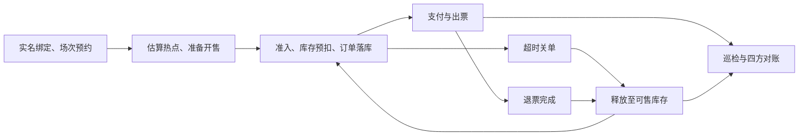

# 四条票务链路优化评审

**状态**　已全部落入四份板块实施方案文档（[链路一](../domains/01-user-reservation.md#八链路一深度优化方案phase-11用户状态可查--提醒落账--改期联动--计数回源保护)、[链路二](../domains/02-show-inventory.md#3-深度优化方案承接四条链路优化评审)、[链路三](../domains/03-order-seckill.md#3-深度优化方案承接四条链路优化评审)、[链路四](../domains/04-payment-reconcile.md#3-深度优化方案承接四条链路优化评审)）及 [API_CONTRACT.md](../contracts/API_CONTRACT.md)、[BENCHMARK_V1_TO_V4.md](../benchmarks/BENCHMARK_V1_TO_V4.md)。**链路一优化（Phase 1.1）已完成编码实现并通过 58 项常规测试、5 项真实 Docker 中间件测试及双形态隔离 E2E 终版验收**（见 [Phase 1.1 实证回执](../issues/ISSUE-007-chain1-acceptance-evidence.md#2026-11-20-链路一深度优化phase-11实证回执)）；链路二～四将在对应 Phase 直接按已固化方案落地。

StarShow 当前已经解决了开票前的身份绑定、预约去重和提醒调度。接下来最能体现业务与高并发设计深度的是定义每个环节交给下游的事实，明确哪些数据可以延迟、哪些状态必须立即确定，以及哪个模块有权重试和修复。

本轮重新执行 `mvn -B test`，51 项常规测试通过。4 项真实中间件测试和双形态发行包联调采用终版回执中的结果。链路二至四的结论来自设计文档和现有 Lua 契约，运行态留到相应阶段验收。[Phase 1 终版回执](../issues/ISSUE-007-chain1-acceptance-evidence.md#2026-11-20-终版复验回执issue-008--issue-010-闭环)

## 一、四条链路交接什么

| 交接 | 权威事实 | 下游如何使用 |
| --- | --- | --- |
| 链路一 → 链路二 | MySQL 中的预约记录。公开预约人数允许短时滞后。 | 用预约量预估热点、规划预热顺序和流量预算。场次总预约量只能表示关注热度，无法推出某票档的成交需求。 |
| 链路二 → 链路三 | 演出开售时间、准备状态，以及当前引擎的可售库存。V4 在售期间以 Redis 库存和座位位图为准。 | 展示层可用有时效的快照。下单在权威库存上再次校验，购票入口的判断与主链路一致。 |
| 链路三 → 链路四 | 按 `orderNo` 查询的持久化订单状态、金额和支付截止时间。 | V4 返回受理后可以查办理进度。订单落库进入 `WAIT_PAY` 后才进入支付。 |
| 链路四 → 链路二、三 | 关单、退票及库存释放各自的执行结果。 | 库存释放成功后恢复可售。对账修复采用同一套有幂等保护的动作，避免手工调整后再次被任务回补。 |

## 二、链路一优先优化用户状态与开票洪峰

### 用户能查到自己的预约和下一步

当前契约提供创建预约和公开人数查询，重复提交返回 `A0106`。用户在请求超时或换设备后，需要知道本人的预约是否已经成功，以及接下来何时能买票。建议在现有预约域补一个按本人和场次查询的能力，复用 `t_reservation` 的唯一键。详情页按查询结果显示预约状态、官方开售时间和购票入口。预约成功表示需求已登记，公开预约人数用于热度展示。[现有预约接口](../contracts/API_CONTRACT.md#链路一鉴权实名与预约-starshow-user)

提醒目前以模拟通知日志验收。`remind_status = 1` 可能表示消费完成，也可能表示演出已开售或结束后无需发送。面向用户展示时应保留这些区别。把站内通知写入持久化记录是该链路后续可选增强。若采用它，同一预约与开售版本使用一个通知业务键，通知内容和消费终态在同一本地事务中提交。用户读站内通知时直接看到提醒和入口，重放消息只保留一条。MQ 接收、站内通知可见、用户打开三个指标分别统计。[提醒消费](../../starshow-user/src/main/java/com/starshow/user/mq/ShowRemindConsumer.java)、[模拟通知实现](../../starshow-user/src/main/java/com/starshow/user/mq/LoggingShowRemindNotifier.java)

### 改期开票时，预约、提醒与售卖入口一起更新

主办方调整开售时间时，已有预约仍然有效，旧的延迟消息却可能携带旧时间。建议在 Phase 2 定义演出开售配置版本，改期落库后就按新版本安排提醒。消费旧消息时核对版本并跳过。页面显示最新开售时间，预热也绑定到同一版开售配置。规格评审要写明谁有权改期，以及开售提前和推迟时各用哪条规则通知。验收时用已有预约的场次分别验证提前和推迟，确保用户获得新时间，售票入口也按新时间开放。[预约与提醒规格](../domains/01-user-reservation.md)

### 把看人数、做预约和抢票的容量分别算清

预约数采用有界最终一致是合理取舍。当前计数缓存默认 30 秒过期，缺失或异常会回源。首页查询人数可以采用有时间标记的上次快照，数据过旧时可以暂时隐藏。给热点场次做同场次回源合并或限流，并记录 MySQL `COUNT(*)` 的回源量。预约是否写入成功仍由 MySQL 记录决定，人数展示失败不应使客户端重新提交预约。[计数实现](../../starshow-user/src/main/java/com/starshow/user/service/ReservationCountStore.java)

提醒可以在统一开售时间之前分批送达，所有用户的购票入口仍在同一时间开放。验证时把提醒消费、详情访问、预约查询和开售后的下单流量放在同一时间轴观察。重点记录开售前提醒迟到比例、详情 P99、计数回源量及抢票入口拒绝原因，便于区分是通知延迟、浏览回源过多，还是下单入口容量不足。

### 说清实名在项目中的能力边界

当前实现校验证件格式和校验码、加密存储，并用 HMAC 唯一索引约束一证一账号。这是项目内的实名绑定和去重能力。链路三继续用 `UserFacade` 复用资格判断，再由网关准入和订单库唯一约束分别控制流量与重复单。演示时可用并发绑证和并发买票展示两种约束各自的作用，避免把持有一个有效账号等同于通过所有购票风控。[实名服务](../../starshow-user/src/main/java/com/starshow/user/service/UserIdentityService.java)、[用户资格接口](../../starshow-api/src/main/java/com/starshow/api/facade/UserFacade.java)

## 三、链路二定义开售准备和热数据所有权

- **预热完成有明确含义。** 预热对指定开售配置生成并校验票档库存、座位位图和元数据。全部通过后标记准备完毕，正式开售仍遵循该版配置的开售时间。只完成部分时保持未准备，可安全重试。开售后收到旧版本预热任务应拒绝执行。通过重复执行任务、预热中途重启、旧任务晚到这三组验收，证明在售库存不会被覆盖。
- **交易入口分辨准备中、库存不可用和卖光了。** 当前 Lua 将库存键缺失与库存不足都映射为 `-1`。建议在交易契约中分开两类结果。库存键缺失时，开售前显示准备中，开售后阻止下单并显示库存暂不可用。售罄是可因关单或退票而改变的库存状态，停售则按场次业务规则处理。
- **详情与选座允许短时快照。** 页面显示参考余量，提交后由订单链路原子校验。压测要覆盖详情缓存刚过期、Redis 库存尚未准备、同座位并发提交三种不同场景，分别验证数据库回源预算、业务拒绝原因和座位冲突结果。

涉及模块为 `starshow-show`、`starshow-api` 和后续调用库存 Lua 的 `starshow-order`。方案沿用 MySQL、Caffeine、Redis、Bitmap 和现有跨模块接口。[链路二设计](../domains/02-show-inventory.md)、[预扣脚本返回码](../../starshow-order/src/main/resources/lua/seckill_deduct.lua)

## 四、链路三先定每个阶段的结果和恢复责任

- **让 V4 的受理结果可查。** HTTP `202` 只承诺请求已进入处理流程。用同一个 `orderNo` 查询待确认、可支付或明确失败，并给客户端查询间隔和停止条件。首次请求超时且没拿到 `orderNo` 时，客户端应能凭原请求标识重试并找回原单号，这个映射需要在 Phase 3 接口契约中定下来。数据库尚未落单时允许短时处理中，支付入口只认持久化的 `WAIT_PAY`。验证网络超时重试、半消息回查、落单延迟和失败回补时用户看到的结果。
- **让事务回查与预扣对同一个决策负责。** 现有规则是查 `deduct_log`，缺失时写入阻止迟到预扣的拒绝标记，即防悬挂墓碑。将查凭证与缺失时写墓碑放在同一个 Lua 中，沿用两个 Key 的 `{showId}`。预扣先完成则回查确认，回查先写墓碑则预扣拒绝。Redis 不可用时返回 `UNKNOWN`，等待后续回查。RocketMQ 负责确认生产侧事务结果，订单消费仍需 MySQL 本地事务和唯一约束兜底。[Redis Lua 原子执行](https://redis.io/docs/latest/develop/interact/programmability/eval-intro/) · [RocketMQ 事务消息](https://rocketmq.apache.org/docs/featureBehavior/04transactionmessage/)
- **保护异步落库的数据库容量。** 同一票档在消费端仍可能集中更新同一行。提前定义消费并发上限与待处理积压阈值，必要时用同票档分批聚合。压测同时记录受理 TPS、落库 TPS、积压最老消息年龄、数据库锁等待及排空耗时，才能解释吞吐提升来自哪里。

现有 V1～V4 保持可切换。每轮对照在开售前固定策略，重置为相同初始库存与同一批用户、请求节奏。V1～V3 按各自的权威扣减路径验证库存和有效单，V4 额外验 Redis 实时库存、预扣悬挂清零与落库排空。若场景限定一人一张，5,000 名用户无法卖完 10,000 张票，应该扩大同一用户池或设两组固定库存场景，分别证明吞吐与售罄时的正确性。[链路三设计](../domains/03-order-seckill.md)、[V1～V4 压测模板](../benchmarks/BENCHMARK_V1_TO_V4.md)

## 五、链路四把支付截止、资金终态和库存释放分别落账

- **一张订单用同一个时间基准。** 待支付单落库时保存订单截止时间。支付单过期时间有两个上限，创建后 14 分 30 秒和订单关单前 30 秒，取较早的一项。支付页显示实际支付截止时间，超过订单允许的支付窗口后不再创建支付单。验证临界时刻主动查单、正常回调、滞后回调以及回调丢失时的结果。已进入 `CLOSED` 的订单继续按现有规则走异常支付原路退款。
- **状态提交后能找回后续任务。** `PAID` 后要出票，`CLOSED` 后要释放库存，退款 Saga 要继续推进。把下一步动作随状态变化持久化到 MySQL，由现有 RocketMQ 投递，巡检补发遗漏动作。库存回补沿用 Redis Lua，按订单号记账。回补结果未知且 Redis 幂等凭证已失效时，先核对订单级业务记录。确认未释放后再重试，无法确认则保留待核对。验收覆盖状态已提交但消息尚未发出，以及回补已发生但结果尚未入账。
- **对账结果直接指向负责模块和处理动作。** 先按订单号串联渠道流水、支付单、订单和电子票，识别已扣款未出票、已退款未释放、重复回补等类型。记录金额差异、释放状态、可执行补偿、责任模块和处理结果。已核销的票按核销规则处理。资金结果未确定时继续核对，满足释放条件的票才重新纳入可售库存。

涉及 `starshow-payment`、`starshow-order`、`starshow-api` 和库存展示。继续沿用 CAS、退款 Saga、RocketMQ、Redis Lua 与四方对账。[链路四设计](../domains/04-payment-reconcile.md)、[订单状态契约](../contracts/API_CONTRACT.md#3-订单状态机流转矩阵严格单向-cas)

## 六、按现有阶段落实

| 阶段 | 优先补齐 | 对应验收证据 |
| --- | --- | --- |
| 链路一后续增强 | 本人预约可查、提醒状态口径、计数回源容量。 | 超时重试后查到同一预约。开票前集中访问时，预约写入与人数读取可各自验证。 |
| Phase 2 | 预热完成条件、改期版本、开售与售罄结果。 | 旧预热晚到不改库存。改期后提醒和售卖入口使用同一版开售时间。 |
| Phase 3 | 受理到落单状态、预扣与回查、消费限流。 | 事务回查竞态均有明确终态。分别报告受理、落库和实际有效单。 |
| Phase 4 | 支付截止时间、关单与退款释放、消息补发与对账。 | 已关闭订单无法复活。退款可恢复，库存和座位只释放一次。 |
| Phase 5～6 | 将压力、状态和资金证据放进同一场演示。 | 用同一开票场次串起预约热点、开售准备、受理积压、支付或关单、退款回流和对账结果。 |
